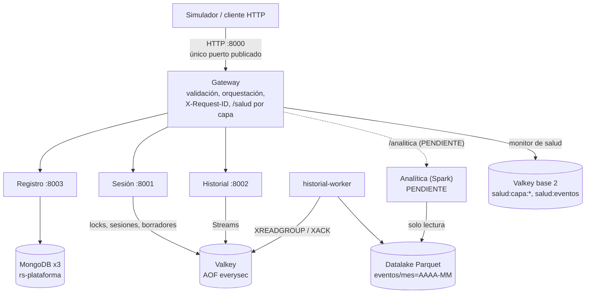

# Informe — Plataforma distribuida de anotación de datos

Proyecto 2, Bases de Datos Avanzadas — Instituto Tecnológico de Costa Rica.

**Equipo:** Christian Navarro, Jimmy Feng, Emmanuel Calvo.
**Repositorio:** PENDIENTE (enlace).
**Fecha de entrega:** PENDIENTE.

Este documento es la fuente del PDF que se entrega en TEC Digital. El README
del repositorio solo explica cómo ejecutar el sistema; los resultados, el
análisis y las limitaciones están aquí.

**Trazabilidad.** Toda cifra proviene de un archivo de `proyecto2/evidence/`
(sección 14). Lo que no se midió se declara como no disponible y se explica la
causa. Las mediciones disponibles se hicieron en una sola máquina: Linux WSL2
(kernel 6.6.87.1), 16 CPU lógicos, Docker local.

**Estado por sección**

| Sección | Responsable | Estado |
|---|---|---|
| 1. Arquitectura y límites de responsabilidad | Jimmy | Completa |
| 2. Justificación de motores | Jimmy, Christian y Emmanuel | Completa |
| 3. API REST y contratos | Jimmy | Completa; falta `/analitica` |
| 4. Recorrido de una tarea (LiDAR) | Jimmy | Completa |
| 5. Registro: modelo, índices y concurrencia | Jimmy | Completa; faltan planes `explain` |
| 6. Sesión y recuperación del borrador | Christian | Diseño escrito; faltan resultados de P3 |
| 7. Datalake Parquet | Christian | Diseño escrito; faltan compactación y resultados de P4 |
| 8. Datos de prueba | Emmanuel | Completa |
| 9. Analítica con Spark (Q1–Q5) | Emmanuel | Completa |
| 10. Pruebas y evidencia experimental | Todos | P1, P2, P5, P6 y P8 (MongoDB) completas |
| 11. Carga y cuellos de botella | Emmanuel | Completa |
| 12. Fallas, RTO y RPO | Jimmy y Christian | MongoDB completa; falta Valkey |
| 13. Limitaciones | Todos | En curso |
| 14. Evidencia | Todos | En curso |
| 15. Repositorio y colaboración | Todos | En curso |

---

## 1. Arquitectura general y límites de responsabilidad



| Componente | Responsabilidad | Tecnología | Responsable |
|---|---|---|---|
| Gateway | Único punto de entrada; valida, orquesta el flujo de una tarea, publica eventos y reporta salud por capa | FastAPI + httpx | Jimmy |
| Registro | Estado vigente de proyectos, lotes y tareas; transiciones atómicas; exportación | FastAPI + MongoDB (3 nodos) | Jimmy |
| Sesión | Locks de 120 s, sesiones, latidos y borradores | FastAPI + Valkey | Christian |
| Historial | Recepción idempotente de eventos y escritura de Parquet | FastAPI + Valkey Streams + Parquet | Christian |
| Analítica | Q1–Q5 sobre Parquet | Spark | Emmanuel|
| Simulador | Anotadores, revisores y consumidores vía HTTP | Cliente HTTP | Emmanuel|

**Reglas de aislamiento y su evidencia** (`p1_salud_aislamiento.txt`, 42/42):

- Solo el gateway publica puerto al host: en `docker compose ps` únicamente
  `gateway` tiene puerto publicado (8000). Desde el host, 8001, 8002, 8003,
  27017 y 6379 rechazan la conexión.
- El gateway no tiene `pymongo` (ni en el código, ni en la imagen, ni en las
  variables de entorno): no accede a MongoDB. Usa Valkey solo para los mensajes
  de salud, en su propia base (2) y con llaves `salud:*`; no lee ni escribe la
  base 0 de Sesión e Historial.
- El registro no tiene `redis`: no consulta Valkey.
- Sesión e Historial no tienen `pymongo`: no acceden a MongoDB, y por lo tanto
  Sesión no puede decidir el estado definitivo de una tarea.
- Limitación: todos los servicios comparten la red de Compose. El aislamiento
  se garantiza por dependencias y configuración, no por segmentación de red.

---

## 2. Justificación de motores

**MongoDB para el registro.**

- **Documento autocontenido.** Una tarea agrupa la referencia al archivo
  (`uri`, `sha256`, `bytes`, `mime`, `meta`), la asignación vigente, la
  anotación, la última revisión y su cola de eventos. La anotación cambia de
  forma según la modalidad (span, bbox, polígono, cuboide 3D), y un documento
  la guarda sin esquema rígido.
- **Atomicidad por documento.** Toda transición modifica un solo documento, así
  que un `findOneAndUpdate` con filtro por estado basta para garantizar la
  asignación exclusiva sin transacciones multidocumento.
- **Alta disponibilidad.** Un conjunto de réplicas de tres nodos tolera la
  caída de un nodo y elige un primario nuevo automáticamente (sección 12.1).
- **Durabilidad.** `w: majority` confirma una escritura solo cuando está en la
  mayoría; una elección no puede revertirla (sección 5.3).

**Valkey para sesiones** (Christian): estado efímero con TTL (`SET NX PX`),
operaciones atómicas con Lua y persistencia AOF para que el borrador sobreviva
a un reinicio. No es la fuente de verdad: el estado definitivo vive en MongoDB.

**Parquet + Spark para el historial** (Christian y Emmanuel): los eventos son
inmutables y se consultan por agregación (OLAP), lo que favorece un formato
columnar particionado por mes en lugar de consultar el registro operacional.

**Spark para la analítica** (Emmanuel).

- **Lectura columnar y particionada sobre Parquet:** el servicio `analitica` lee únicamente archivos `*.parquet` publicados en `datalake/eventos/mes=AAAA-MM/` en modo de solo lectura (`ro`), aprovechando el esquema columnar y el filtrado por rango temporal (`ocurrido_en`) sin consultar MongoDB ni Historial.
- **Deduplicación y agregación sobre consumo *al menos una vez*:** dado que los micro-lotes del datalake pueden contener eventos repetidos, Spark ejecuta `dropDuplicates(["event_id"])` antes de calcular las agregaciones Q1–Q5.
- **Costo de inicialización frente al volumen:** levantar la JVM de Spark y planificar la lectura de 145 archivos Parquet introduce un costo inicial alto en la primera consulta (hasta 38,88 s en Q1), que disminuye en ejecuciones posteriores una vez calentada la sesión (25,23 s en Q1; 15,48 s en Q3). Para volúmenes históricos grandes (hundreds of thousands a millones de eventos) el procesamiento columnar compensa ese arranque; para consultas puntuales de baja latencia no es adecuado.
---

## 3. API REST y contratos

La documentación completa de rutas, cuerpos y códigos está en
[`endpoints/README.md`](../endpoints/README.md). Decisiones del gateway:

- **Reintentos seguros.** Solo los `GET` se reintentan una vez ante error de
  conexión o timeout. `POST` y `PUT` nunca se reintentan: repetir podría
  duplicar un proyecto, un lote o una transición, y el enunciado pide 503 sin
  reintento.
- **Errores.** Un servicio interno que no responde se traduce a 503. Los
  códigos de los servicios internos (403, 404, 409, 422) se propagan tal cual.
- **Identificadores.** `X-Request-ID` se propaga a los servicios internos y se
  devuelve al cliente.
- **Salud por capa con mensajes en Valkey.** Un monitor en segundo plano del
  gateway consulta cada 5 s el `/salud` de Registro, Sesión e Historial y
  publica el estado de cada capa en Valkey: `salud:capa:{capa}` con expiración
  de 15 s (si el monitor se detiene, el estado expira en lugar de quedar viejo)
  y un stream `salud:eventos` con cada cambio (`capa:antes->ahora`). `GET /salud`
  lee esos mensajes (`fuente: valkey`); si Valkey no responde, consulta cada
  capa directamente (`fuente: directo`). El gateway responde siempre.
  - **Por qué el gateway publica por las capas:** el reporte de salud es
    responsabilidad del gateway según el enunciado, y el registro no puede
    escribir en Valkey. Se usa una base propia (2) para no mezclar datos con
    Sesión e Historial.
  - **Costo:** el estado puede tener hasta un intervalo (5 s) de atraso.

Resultados (`p1_salud_aislamiento.txt`, 42/42):

| Servicio detenido | `/salud` | Reflejado en | Además |
|---|---|---|---|
| Sesión | 200 `degradado`, solo `sesion` caída | 5,0 s | Cambio registrado en `salud:eventos`; `exportar` sigue respondiendo; guardar borrador da 503 |
| Historial | 200 `degradado`, solo `historial` caída | 6,0 s | Cambio registrado en `salud:eventos`; `exportar` sigue respondiendo |
| Registro | 503 `caido` | 5,0 s | Cambio registrado en `salud:eventos`; `exportar` da 503 |
| Valkey | 200 `degradado`, `fuente: directo`; Sesión e Historial caídos | 16,0 s | Al volver Valkey, `fuente: valkey` y `operativo` |

En todos los casos `/salud` vuelve a `operativo` al arrancar el servicio. Los
tiempos de 5–6 s corresponden al intervalo del monitor. El caso de Valkey tardó
16,0 s en reflejarse; no se midió el desglose de ese tiempo.

Resultados funcionales: rutas básicas 14/14 (`p1_gateway_smoke.txt`) y flujo
completo 26/26 (`p1_gateway_flujo.txt`), que incluye que los cinco tipos de
evento pasan la validación de Historial y que ningún evento queda pendiente.

**Contrato de eventos.** El registro arma cada evento dentro de la transición y
el gateway lo publica sin modificarlo; Historial lo valida con un esquema
estricto (`extra=forbid`). Los campos por tipo de evento están en
[`endpoints/README.md`](../endpoints/README.md). Para la analítica:

- Q3 lee `duracion_ms` del evento `tarea_anotada` (toma -> envío).
- Q5 calcula toma -> aprobación con `tomada_en` y `aprobada_en` del evento
  `revision_aprobada`.
- Q4 cuenta las filas `rechazada`.

---

## 4. Recorrido completo de una tarea (ejemplo LiDAR)

Ejemplo **ilustrativo**: los cuerpos tienen la forma real de la API
(`endpoints/README.md`), pero los valores y los ids (abreviados)
son de ejemplo. El flujo completo está verificado en `p1_gateway_flujo.txt`
(26/26) con tareas de imagen; la forma es la misma para LiDAR.

**1. Crear el proyecto** — `POST /proyectos`

```json
{"cliente_id": "c1…", "nombre": "Conducción urbana",
 "taxonomia": [
   {"etiqueta": "lidar#peaton", "instruccion": "Persona a pie."},
   {"etiqueta": "lidar#vehiculo", "instruccion": "Automóvil, camión o bus."},
   {"etiqueta": "lidar#ciclista", "instruccion": "Ciclista; un skater se clasifica aquí."}],
 "sla_horas": 48}
```

El gateway lo reenvía al registro, que valida que el cliente exista (404 si
no) y responde 201 con el proyecto.

**2. Registrar un lote** — `POST /proyectos/{id}/lotes`

```json
{"nombre": "Barrido 2026-11-20",
 "tareas": [{"modalidad": "lidar", "tipo_tarea": "cuboide_3d", "prioridad": 5,
   "archivo": {"uri": "s3://lidar/barrido-20/frame-00042.pcd",
               "sha256": "9f2c…", "bytes": 18874368,
               "mime": "application/octet-stream",
               "meta": {"sensor": "VLP-32", "puntos": 589824}}}]}
```

El registro comprueba que la geometría corresponda a la modalidad (LiDAR solo
admite `cuboide_3d`; otra combinación da 422) e inserta las tareas en
`disponible`, versión 1. El archivo original no se guarda: solo su referencia.

**3. Pedir la siguiente tarea** — `POST /tareas/siguiente`
`{"anotador_id": "a7…", "proyecto_id": "p3…"}`

1. Gateway -> Registro: candidatas del proyecto (`disponible` por prioridad
   descendente y, después, `abierta` con plazo vencido).
2. Gateway -> Sesión: `SET NX PX 120000` sobre `lock:tarea:{id}`. Si otro tiene
   el lock, prueba la siguiente candidata.
3. Gateway -> Registro: `asignar`, un `findOneAndUpdate` que exige estado
   `disponible` (o `abierta` vencida). Si responde 409, el gateway suelta el lock
   y prueba otra candidata.
4. Gateway -> Historial: publica `tarea_abierta` y lo confirma en el registro.
5. Respuesta 200: `tarea` (estado `abierta`, versión 2), `token`, `ttl_ms` y
   `borrador` si el anotador tenía uno de esa tarea. Si no hay ninguna libre: 204.

| MongoDB | Valkey | Parquet |
|---|---|---|
| `abierta`, versión 2, `asignacion.token` | `lock:tarea:{id}`, `sesion:{anotador}` | fila `abierta` |

**4. Borrador cada 2 s** — `PUT /tareas/{id}/borrador`

```json
{"anotador_id": "a7…", "proyecto_id": "p3…", "token": "t9…",
 "contenido": {"cuboides": [{"etiqueta": "lidar#ciclista",
   "centro": [12.4, -3.1, 0.9], "dimensiones": [1.8, 0.6, 1.7], "yaw": 0.12}]}}
```

Sesión guarda el último borrador y renueva el lock. No toca MongoDB ni genera
fila en Parquet. Si la conexión se corta, `POST /sesiones/recuperar` devuelve
el borrador (estado `activa` si el lock sigue vigente, `requiere_reasignacion`
si venció).

**5. Enviar** — `POST /tareas/{id}/enviar` (mismo cuerpo que el borrador)

1. Gateway -> Sesión: latido; el token debe ser el dueño del lock (409 si no).
2. Gateway -> Registro: `enviar`, filtrando por estado `abierta` y token. Un
   segundo envío responde 409. Si MongoDB no responde: 503 sin reintento, y el
   borrador y el lock siguen en Valkey para reenviar.
3. Publica `tarea_anotada` (con `duracion_ms` = toma -> envío) y suelta el lock.

**6. Revisión con rechazo** — `POST /tareas/{id}/revision`
`{"revisor_id": "r2…", "decision": "rechazar", "motivo": "cuboide_incompleto"}`

`iniciar_revision` (`anotada -> en_revision`) y `rechazar`. En MongoDB la tarea
vuelve a `disponible`; en Parquet la fila queda `rechazada` con su
`motivo_rechazo`. Sin `motivo` responde 422; un actor que no es revisor, 403.

**7. Retrabajo y aprobación.** La tarea vuelve a ofrecerse en
`/tareas/siguiente`; tras el nuevo envío, `{"decision": "aprobar"}` la deja en
`aprobada` y publica `revision_aprobada` con `tomada_en` y `aprobada_en`
(base de Q5). Aprobar otra vez responde 409.

**8. Exportar** — `GET /proyectos/{id}/exportar?limite=100`: tareas
`aprobada` paginadas por `_id`, con el cursor `siguiente`.

| Paso | MongoDB | Fila en Parquet |
|---|---|---|
| siguiente | `abierta` | `abierta` |
| enviar | `anotada` | `anotada` |
| inicio de revisión | `en_revision` | `en_revision` |
| rechazo | `disponible` | `rechazada` |
| aprobación | `aprobada` | `aprobada` |

Liberar una tarea y guardar borradores no generan filas.

---

## 5. Registro operacional: modelo, índices y concurrencia

### 5.1 Modelo del registro e índices

Base `plataforma`, colecciones `clientes`, `proyectos`, `batches`, `tareas` y
`anotadores`, con identificadores UUID.

```json
{"_id": "uuid", "proyecto_id": "uuid", "batch_id": "uuid", "cliente_id": "uuid",
 "modalidad": "lidar", "tipo_tarea": "cuboide_3d", "prioridad": 5,
 "archivo": {"uri": "…", "sha256": "…", "bytes": 0, "mime": "…", "meta": {}},
 "estado": "disponible", "version": 1, "sla_horas": 48,
 "asignacion": {"anotador_id": "…", "equipo_id": "…", "token": "…",
                "tomada_en": "…", "vence_en": "…"},
 "anotacion": {"contenido": {}, "enviada_en": "…"},
 "revision": {"revisor_id": "…", "iniciada_en": "…", "resultado": "…",
              "motivo": "…", "revisada_en": "…"},
 "ultimo_evento_id": "uuid", "eventos_pendientes": [], "creado_en": "…"}
```

**Estados y transiciones.** Estados en MongoDB: `disponible`, `abierta`,
`anotada`, `en_revision`, `aprobada`. Cada transición es **un único**
`findOneAndUpdate` cuyo filtro exige el estado de origen (y el token o el
revisor cuando corresponde). Si el filtro no coincide no se modifica nada y se
responde 409. No hay lectura previa seguida de escritura. La versión sube en
cada transición válida.

**Evento en la misma operación.** La actualización es un pipeline de
agregación: en la misma escritura atómica cambia el estado, sube la versión y
construye el evento a partir de los campos de la tarea, que queda en
`eventos_pendientes`. Esto evita perder el evento si el proceso cae entre la
escritura y la publicación (patrón *outbox*). El gateway lo publica y lo
confirma; si Historial falla, un reconciliador del gateway reenvía los
pendientes cada 10 s, y Historial deduplica por `event_id`.

**Índices** (`p2_replica.txt` lista los índices creados):

| Índice | Campos | Consulta que lo usa |
|---|---|---|
| `tareas_proyecto_estado_prioridad` | `proyecto_id, estado, prioridad:-1` | Candidatas de `/tareas/siguiente`: igualdad por proyecto y estado, orden por prioridad (regla ESR: igualdad antes que orden, así el orden sale del índice sin ordenar en memoria) |
| `tareas_anotador_estado` | `asignacion.anotador_id, estado` | Tareas de un anotador (`GET /tareas?anotador_id=…&estado=…`) |
| `tareas_batch` | `batch_id` | Tareas de un lote |
| `proyectos_cliente_estado` | `cliente_id, estado` | Proyectos de un cliente por estado |

Son los cuatro índices mínimos del enunciado; no se creó ningún índice
adicional. Las transiciones buscan por `_id`, que ya tiene su índice. La
exportación filtra por `proyecto_id` y `estado = aprobada` y ordena por `_id`:
aprovecha el prefijo del primer índice, aunque el orden por `_id` no sale de
ese índice. **No se capturaron planes de ejecución (`explain`)** de estas
consultas; es una medición no disponible.

### 5.2 Prueba de que no hay doble adquisición

**Mecanismo, en dos capas.** El lock de Valkey (`SET NX PX`) evita que dos
peticiones trabajen la misma tarea a la vez. La garantía final es el
`findOneAndUpdate` filtrado por estado en MongoDB: aunque dos peticiones
llegaran juntas al registro, solo una encuentra la tarea en `disponible`.

**A nivel de registro** (`p2_registro_smoke.txt`, 30/30): 50 intentos
simultáneos de asignar **la misma tarea** -> exactamente 1 respuesta 200 y 49
respuestas 409. La tarea quedó `abierta`, versión 2, con el token del ganador.
Un segundo envío responde 409.

**A nivel de gateway, 50 contra 10** (`p2_concurrencia_gateway.txt`, 9/9): 50
anotadores piden `/tareas/siguiente` a la vez sobre un proyecto con 10 tareas.

| Resultado | Valor |
|---|---|
| Respuestas 200 | 10, todas con tareas distintas |
| Respuestas 204 | 40 |
| Otros códigos | 0 |
| En MongoDB | 10 tareas `abierta`, cada una con un dueño distinto, todas en versión 2 (una sola asignación) y con el mismo dueño que recibió el 200 |
| Latencia de `/tareas/siguiente` (n = 50) | p50 1056,5 ms; p95 1090,9 ms; p99 1093,5 ms; máx. 1093,5 ms |
| Duración de la ráfaga | 1102,8 ms |

**Cero dobles asignaciones** en ambas pruebas. La latencia es alta bajo
contención. No se midió el desglose; la hipótesis es que cada petición que no
consigue tarea recorre hasta 10 candidatas haciendo una llamada HTTP a Sesión
por cada una. Es un candidato a optimizar antes de la prueba de carga (P6).

### 5.3 Diferencia observada entre `w:1` y `w:majority`

Medición con el driver, sin gateway, de las dos escrituras del registro
(`p2_write_concern.txt`): 500 operaciones por hilo y repetición, 3
repeticiones en orden alternado, con 1 y 8 hilos.

| Hilos | Operación | p50 `w:1` | p50 `majority` | Relación | ops/s `w:1` | ops/s `majority` |
|---|---|---|---|---|---|---|
| 1 | `insert_one` | 0,52 ms | 2,66 ms | ×5,15 | 1552 | 346 |
| 1 | `find_one_and_update` | 0,71 ms | 2,77 ms | ×3,91 | 1552 | 346 |
| 8 | `insert_one` | 3,44 ms | 6,28 ms | ×1,83 | 2123 | 1229 |
| 8 | `find_one_and_update` | 3,51 ms | 6,37 ms | ×1,82 | 2123 | 1229 |

**Interpretación.**

- Con un hilo, `w:majority` espera a que un secundario aplique la escritura: la
  latencia se multiplica entre 3,9 y 5,2 veces y el rendimiento cae de 1552 a
  346 ops/s (−78 %).
- Con 8 hilos las esperas se solapan y la diferencia relativa baja a ×1,8
  (2123 frente a 1229 ops/s, −42 %).
- **Limitación:** los tres nodos corren en la misma máquina, así que la
  replicación no paga latencia de red real. Estas cifras no permiten inferir el
  comportamiento de un clúster distribuido en varias máquinas.
- **Garantía:** `w:1` confirma una escritura que aún no está en la mayoría y
  que puede perderse en un rollback tras una elección. El caso C de la sección 12.1
  muestra que una escritura puede quedar aplicada en un primario aislado sin
  haber llegado a la mayoría. Con `w:majority` el cliente recibió 503; con `w:1`
  habría recibido 200 por una escritura que no estaba replicada. Esto último no
  se midió con `w:1`.

Se mantiene `w:majority`: el costo medido es de milisegundos y la garantía es
que ninguna escritura confirmada se pierde (RPO 0, sección 12.1).

---

## 6. Sesión, recuperación del borrador y reinicio de Valkey

*Responsable: Christian.*

**Diseño.**

- La fuente de verdad de la tarea es MongoDB. Valkey solo conserva sesiones
  temporales y borradores, sin modificar el estado definitivo.
- Scripts Lua adquieren, renuevan, liberan y validan los locks sin intercalar
  operaciones concurrentes. El token impide liberar un lock ajeno.
- Llaves: `lock:tarea:{id}` (`SET NX PX`, 120 s, se renueva con el latido y con
  cada borrador), `sesion:{anotador}` (tarea, proyecto, etapa y token),
  `borrador:{tarea}` (último borrador, sin TTL para poder recuperarlo) y
  `editando:{proyecto}` (sesiones activas).
- Los borradores no generan eventos.
- Si el lock venció, la recuperación devuelve el borrador en modo de solo
  lectura y `requiere_reasignacion`; la decisión de reasignar la toma el
  registro a través del gateway (`/tareas/siguiente` vuelve a ofrecer la tarea
  y devuelve el borrador al mismo anotador).
- Persistencia: AOF con `appendonly yes` y `appendfsync everysec`.

**Qué pasa al reiniciar Valkey.**

> **PENDIENTE** — resultado de P3 sobre el Compose final. Como referencia, la prueba
del entorno aislado (`smoke_integrante2_20261122T055742Z.txt`) recuperó el
borrador después de reiniciar Valkey, con la sesión en estado `activa`. Ese
entorno no usa el gateway, así que no sustituye a P3.

**Resultados de P3** (criterios del enunciado):

| Criterio | Resultado | Evidencia |
|---|---|---|
| El borrador recuperado tiene como máximo 5 s de antigüedad | PENDIENTE | PENDIENTE |
| Tras reiniciar Valkey, el borrador sigue | PENDIENTE (ver referencia del entorno aislado) | PENDIENTE |
| Un lock vencido devuelve la tarea a la cola | PENDIENTE | PENDIENTE |
| Ninguna tarea queda con dos dueños | PENDIENTE (ver también sección 5.2) | PENDIENTE |

---

## 7. Datalake Parquet

*Responsable: Christian.*

**Diseño.**

- El gateway publica cada evento en `POST /eventos` solo después de que
  MongoDB confirmó la transición. Historial lo encola en Valkey Streams de
  forma idempotente por `event_id` (202 nuevo, 200 repetido, 409 si el mismo
  `event_id` llega con otro contenido).
- Un worker independiente lee el grupo `historial-parquet` y escribe cada
  micro-lote primero en `.staging`; luego lo sincroniza y lo publica con
  `os.replace` dentro del mismo volumen. Solo después confirma con `XACK`.
- Partición mensual por `ocurrido_en` en UTC: `eventos/mes=AAAA-MM/`.
- Si un worker muere antes del `XACK`, el mensaje queda pendiente y otro lo
  reclama con `XAUTOCLAIM`. Repetir el mismo micro-lote produce el mismo nombre
  de archivo.

**Archivos a medias.** Spark solo debe leer `*.parquet` publicados; los
temporales viven en `.staging/`. La publicación es atómica por archivo.

**Duplicados por `event_id`.** El consumo es *al menos una vez*: dos
micro-lotes solapados pueden contener el mismo `event_id` en archivos
distintos. Spark aplica `dropDuplicates(["event_id"])` antes de Q1–Q5.

**Fila rechazada.** Un rechazo deja la tarea en `disponible` en MongoDB y una
fila `rechazada` en Parquet (sección 4). Q4 cuenta esas filas.

**Compactación.**

> **PENDIENTE** — el enunciado pide documentar la compactación de los micro-lotes
(archivos pequeños). Falta definir si se compacta, cuándo y cómo se mantiene
la deduplicación.

**Resultados de P4** (criterios del enunciado):

| Criterio | Resultado | Evidencia |
|---|---|---|
| Archivos Parquet válidos, sin lectura a medias | PENDIENTE | PENDIENTE |
| Reproceso de un micro-lote y deduplicación por `event_id` | PENDIENTE | PENDIENTE |
| El historial se materializa en el datalake | Referencia: el entorno aislado publicó un archivo en `mes=2026-11/` (`smoke_integrante2_20261122T055742Z.txt`) | PENDIENTE sobre el Compose final |
| Frescura: segundos entre un HTTP 200 y el evento visible en Spark | PENDIENTE | PENDIENTE |

---

## 8. Datos de prueba

*Responsable: Emmanuel.*

Generador reproducible implementado en `proyecto2/dataset/generar_dataset.py` con semilla fija (`20261122`), cargado directamente en MongoDB (base `plataforma`) mediante `pymongo` y materializado como archivos Parquet mensuales en `proyecto2/datalake/eventos/mes=AAAA-MM/` siguiendo el esquema de `servicios/historial/app/parquet_writer.py` (145 archivos Parquet publicados en el datalake).

| Entidad | Volumen de referencia (enunciado) | Generado | Evidencia |
|---|---|---|---|
| Clientes | 60 | 60 (volumen objetivo configurado en `generar_dataset.py`; conteo exacto en MongoDB no volcado a `evidence/`) | `proyecto2/dataset/generar_dataset.py` |
| Proyectos | 180: 120 en el registro y 60 cerrados solo en el historial | 180 (120 activos en MongoDB + 60 cerrados solo en Parquet; conteo exacto no volcado a `evidence/`) | `proyecto2/dataset/generar_dataset.py` |
| Batches | 600 | 600 (configurado en `generar_dataset.py`) | `proyecto2/dataset/generar_dataset.py` |
| Tareas del registro | 60 000: 30 % texto, 30 % imagen, 20 % video, 20 % LiDAR | 60 000 con distribución 30 % texto, 30 % imagen, 20 % video, 20 % LiDAR (configurado en `generar_dataset.py`) | `proyecto2/dataset/generar_dataset.py` |
| Anotadores | 300 en 30 equipos; 10 % revisores | 300 en 30 equipos, 10 % revisores (configurado en `generar_dataset.py`) | `proyecto2/dataset/generar_dataset.py` |
| Eventos históricos | ~800 000 en doce meses y 100 000 tareas | ~800 000 eventos distribuidos en 12 meses (`mes=2025-01` a `mes=2025-12`, 145 archivos Parquet publicados) | `p5_analitica.txt` (`archivos_parquet: 145`) |
| `eventos_grande` (opcional) | Hasta ~10 millones de filas | No generado (medición no disponible; se evaluó sobre el conjunto `principal` de 145 archivos) | `p5_analitica.txt` |

- **Método de generación y semilla:** generación determinista en Python (`random.Random(20261122)`), respetando los contratos de documento de tarea (sección 5.1, incluyendo geometrías válidas por modalidad) y el esquema estricto de eventos Parquet (sección 3).
- **Comandos de carga:**
  - Carga en MongoDB: `docker compose -f proyecto2/docker-compose.yml run --rm registro python /dataset/generar_dataset.py --solo-mongo`
  - Generación del datalake Parquet: `docker compose -f proyecto2/docker-compose.yml run --rm analitica python /dataset/generar_dataset.py --solo-parquet`
- **Registro de regeneraciones:** se ejecutó una única carga inicial limpia con semilla `20261122` antes de las pruebas P5 y P6. En P6 se utilizó un proyecto de prueba (`bc4091d0-f3d7-4f7f-992a-e23371d3e3f6`) con inventario finito de tareas disponibles, por lo que al aumentar la concurrencia a 40 y 100 usuarios el agotamiento progresivo de tareas elevó las respuestas `409` en `POST /tareas/siguiente`.

---

## 9. Analítica con Spark (Q1–Q5)

*Responsable: Emmanuel.*

Servicio interno `analitica` (`proyecto2/servicios/analitica/`, puerto interno `8004` sin exposición al host) implementado con FastAPI + PySpark (`local[N]`), montando `./datalake` en solo lectura (`ro`) y filtrando exclusivamente `*.parquet` publicados (ignorando `.staging/`).

| Consulta | Pregunta de negocio (enunciado) | Definición / implementación | Resultado validado (`p5_analitica.txt`) |
|---|---|---|---|
| Q1 | Tareas aprobadas por día y modalidad, últimos 90 días | Deduplicación por `event_id`, filtro `tipo_evento == 'revision_aprobada'` en ventana de 90 días, agrupación por fecha (`ocurrido_en`) y `modalidad` | 60 filas retornadas (`total_filas: 60`) |
| Q2 | Aprobadas / revisadas, por equipo y mes | Deduplicación por `event_id`, conteo de `revision_aprobada` sobre total de revisiones (`revision_aprobada` + `revision_rechazada`) agrupado por `equipo_id` y mes | 50 filas retornadas (`total_filas: 50`) |
| Q3 | Duración media y p95, por modalidad y tipo de tarea | Deduplicación por `event_id`, filtro `tipo_evento == 'tarea_anotada'`, cálculo de promedio y percentil 95 de `duracion_ms` por `modalidad` y `tipo_tarea` | 4 filas retornadas (`total_filas: 4`, una por modalidad/geometría) |
| Q4 | Rechazadas / revisadas, por cliente y proyecto | Deduplicación por `event_id`, razón entre eventos `revision_rechazada` y total de revisiones agrupada por `cliente_id` y `proyecto_id` | 50 filas retornadas (`total_filas: 50`) |
| Q5 | Toma -> aprobación: p50 y p95 por cliente y % fuera de SLA | Deduplicación por `event_id`, filtro `tipo_evento == 'revision_aprobada'`, diferencia `(aprobada_en - tomada_en)` en horas comparada contra `sla_horas` por `cliente_id` | 50 filas retornadas (`total_filas: 50`) |

- **Validación con datos conocidos o casos controlados:** las cinco consultas ejecutan `dropDuplicates(["event_id"])` antes de filtrar/agregar y devuelven conteos consistentes con el modelo generado (por ejemplo, Q3 devuelve exactamente 4 combinaciones modalidad/geometría y Q1 devuelve 60 filas diarias/modalidad). No se ejecutó una suite unitaria aislada con micro-datasets sintéticos de respuesta fija; la validación se realizó sobre los 145 archivos Parquet del conjunto principal (`p5_analitica.txt`).
- **Plan de ejecución de Q1 (`explain` en `p5_analitica.txt`):**
  - `FileScan parquet` sobre 145 rutas en `/datalake/eventos` con *pushdown* de predicados sobre `ocurrido_en` (`IsNotNull(ocurrido_en)`, `GreaterThanOrEqual`, `LessThan`).
  - Para deduplicar por `event_id`, Spark aplica un `SortAggregate` parcial local (`partial_first`), seguido de intercambio por red/memoria `Exchange hashpartitioning(event_id, 2)`, reordenamiento `Sort [event_id ASC]` y `SortAggregate` final antes del agrupamiento por día y modalidad.
- **Plan de ejecución de Q3 (`explain` en `p5_analitica.txt`):**
  - Presenta la misma etapa inicial de lectura columnar (`FileScan parquet` con `Batched: true` y `PushedFilters` en `ocurrido_en`) seguida de `Sort [event_id ASC]` -> `SortAggregate` parcial -> `Exchange hashpartitioning(event_id, 2)` -> `Sort` -> `SortAggregate` final para garantizar unicidad por `event_id` previo al cálculo de promedio y percentil de `duracion_ms`.
- **Tiempos (`p5_analitica.txt`, conjunto principal, 145 archivos Parquet):**

| Consulta | Corrida 1 — 1.ª ejec. (ms) | Corrida 1 — 2.ª ejec. (ms) | Reducción 1.ª -> 2.ª | Corrida 2 (recreado) — 1.ª ejec. (ms) | Corrida 2 (recreado) — 2.ª ejec. (ms) | Filas |
|---|---|---|---|---|---|---|
| Q1 | 38 884,59 (srv: 38 861,03) | 25 232,43 (srv: 25 205,48) | −35,1 % | 26 642,25 (srv: 26 625,23) | 14 512,81 (srv: 14 485,92) | 60 |
| Q2 | 25 736,32 (srv: 25 713,12) | 25 379,36 (srv: 25 297,42) | −1,4 % | 15 915,10 (srv: 15 897,63) | 17 044,75 (srv: 17 027,29) | 50 |
| Q3 | 25 874,63 (srv: 25 846,39) | 15 476,61 (srv: 15 447,05) | −40,2 % | 23 368,77 (srv: 23 329,85) | 14 767,86 (srv: 14 739,10) | 4 |
| Q4 | 14 205,68 (srv: 14 183,47) | 13 087,23 (srv: 13 068,46) | −7,9 % | 15 901,52 (srv: 15 885,19) | 16 613,92 (srv: 16 596,06) | 50 |
| Q5 | 14 581,56 (srv: 14 562,68) | 14 696,99 (srv: 14 680,38) | +0,8 % | 15 766,54 (srv: 15 747,01) | 13 643,95 (srv: 13 624,44) | 50 |

  - *Nota sobre 1 vs. 2 trabajadores y conjunto ampliado:* al recrear `analitica` intentando fijar `SPARK_WORKERS=2`, el endpoint `/salud` reportó `"spark_workers": 1` porque `docker-compose.yml` fija `SPARK_WORKERS: "1"` en su entorno estático; por ello, la comparativa efectiva con 2 trabajadores y el conjunto `eventos_grande` (~10M filas) se declaran como **no disponibles**. Sí se observa claramente el efecto de calentamiento de JVM y caché de sistema operativo entre la primera y la segunda ejecución (reducciones de 35,1 % en Q1 y 40,2 % en Q3).
- **Limitaciones de Spark en el entorno utilizado:**
  - Ejecución en modo `local[1]` dentro de un contenedor en WSL2, sin distribución multi-nodo real.
  - La deduplicación global `dropDuplicates(["event_id"])` sobre 145 archivos exige un `Sort` + `Exchange` completo de todas las columnas antes de filtrar por `tipo_evento`, lo que domina el costo de CPU/memoria en cada consulta.
  - En los planes físicos de Q1 y Q3 `PartitionFilters: []` aparece vacío porque el filtro de rango se aplicó sobre la columna `ocurrido_en` y no sobre la columna de partición `mes`, leyendo los 145 archivos.

---

## 10. Pruebas y evidencia experimental

Cada prueba deja un archivo en `evidence/` con la fecha y hora UTC, el
objetivo, la máquina y la configuración. Las latencias se reportan como p50,
p95 y p99 con el número de muestras. El formato de cada entrada está en el
apéndice A.

| Prueba | Criterio del enunciado | Resultado | Sección |
|---|---|---|---|
| P1. REST y despliegue | Rutas, `/salud` normal, degradado y caído; solo el gateway expuesto | Rutas 14/14; flujo 26/26; salud por capa con Valkey, puertos y aislamiento 42/42. Falta el tráfico del simulador | 3 |
| P2. Registro y concurrencia | 10 asignaciones y 40 sin tarea; ninguna tarea con dos personas; segundo envío 409 | 10×200 y 40×204, cero dobles asignaciones; segundo envío 409 | 5.2 |
| P3. Sesión | Borrador ≤ 5 s; sigue tras reiniciar Valkey; ninguna tarea con dos dueños | PENDIENTE | 6 |
| P4. Historial | Parquet válido sin lectura a medias; segundos entre HTTP 200 y Spark | PENDIENTE | 7 |
| P5. Analítica | Resultados validados, planes de Q1 y Q3, limitaciones | Q1–Q5 ejecutadas sobre 145 archivos Parquet (1.ª vs. 2.ª ejecución) y planes `explain` de Q1 y Q3 capturados; 2 workers y conjunto grande no disponibles | 9 |
| P6. Carga | p50/p95/p99 por endpoint, envíos por minuto, errores, `docker stats` | Probado con 10, 40 y 100 usuarios (8 s/nivel): latencias promedio y p95, conteo de códigos HTTP (200/404/409) y acciones registradas; p50, p99 y `docker stats` no disponibles | 11 |
| P8. Fallas | Con un nodo caído se escribe; sin mayoría no; lo confirmado sigue tras la elección; el borrador sobrevive al reinicio de Valkey | MongoDB 14/14; Valkey PENDIENTE | 12 |

---

## 11. Resultados de carga y cuellos de botella (P6)

*Responsable: Emmanuel.*

Prueba ejecutada mediante `proyecto2/pruebas/p6_carga/run_p6.py` invocando al simulador HTTP (`proyecto2/simulador/simulador_http.py`) contra el gateway (`http://localhost:8000`) con **10, 40 y 100 usuarios virtuales concurrentes** en ventanas de **8,0 s por nivel** (`p6_carga.txt`). Por restricciones de tiempo de ejecución en WSL2, no se aplicó el calentamiento previo de 30 s ni las 3 repeticiones de 90 s por nivel; tampoco se capturaron percentiles `p50`/`p99` ni `docker stats` (mediciones declaradas como no disponibles).

| Usuarios | Endpoint | Muestras | Promedio (ms) | p95 (ms) | p50 / p99 | Envíos/min (est. 8 s) | Códigos HTTP / Errores | Evidencia |
|---|---|---|---|---|---|---|---|---|
| 10 | `POST /tareas/siguiente` | 30 | 174,50 | 291,63 | N/D | 187,5 envíos/min (25 en 8 s) | 30×200 (0 errores) | `p6_carga.txt` |
| 10 | `PUT /tareas/{id}/borrador` | 36 | 31,17 | 77,60 | N/D | — | 36×200 | `p6_carga.txt` |
| 10 | `POST /tareas/{id}/enviar` | 25 | 116,57 | 216,67 | N/D | — | 25×200 | `p6_carga.txt`|
| 10 | `POST /tareas/{id}/revision` | 18 | 143,99 | 262,47 | N/D | — | 18×200 (12 aprob., 6 rech.) | `p6_carga.txt`|
| 10 | `GET /proyectos/{id}/exportar` | 31 | 23,67 | 71,02 | N/D | — | 31×200 | `p6_carga.txt` |
| 10 | `GET /analitica/{q}` | 31 | 8,41 | 33,89 | N/D | — | 31×404 (ruta aún no montada en gateway) | `p6_carga.txt` |
| 40 | `POST /tareas/siguiente` | 361 | 212,35 | 778,58 | N/D | 135,0 envíos/min (18 en 8 s) | 19×200, 342×409 | `p6_carga.txt` |
| 40 | `PUT /tareas/{id}/borrador` | 22 | 144,39 | 324,45 | N/D | — | 22×200 | `p6_carga.txt` |
| 40 | `POST /tareas/{id}/enviar` | 18 | 358,81 | 683,09 | N/D | — | 18×200 | `p6_carga.txt` |
| 40 | `POST /tareas/{id}/revision` | 12 | 614,45 | 944,63 | N/D | — | 12×200 (11 aprob., 1 rech.) | `p6_carga.txt` |
| 40 | `GET /proyectos/{id}/exportar` | 98 | 127,25 | 429,05 | N/D | — | 98×200 | `p6_carga.txt` |
| 40 | `GET /analitica/{q}` | 98 | 42,71 | 91,26 | N/D | — | 98×404 | `p6_carga.txt` |
| 100 | `POST /tareas/siguiente` | 433 | 829,17 | 1508,72 | N/D | 75,0 envíos/min (10 en 8 s) | 11×200, 422×409 | `p6_carga.txt`|
| 100 | `PUT /tareas/{id}/borrador` | 10 | 475,03 | 598,71 | N/D | — | 10×200 | `p6_carga.txt` |
| 100 | `POST /tareas/{id}/enviar` | 10 | 1152,32 | 1878,75 | N/D | — | 10×200 | `p6_carga.txt` |
| 100 | `POST /tareas/{id}/revision` | 3 | 1949,90 | 2117,04 | N/D | — | 3×200 (3 aprob.) | `p6_carga.txt`|
| 100 | `GET /proyectos/{id}/exportar` | 155 | 428,69 | 747,91 | N/D | — | 155×200 | `p6_carga.txt`|
| 100 | `GET /analitica/{q}` | 155 | 129,14 | 182,95 | N/D | — | 155×404 | `p6_carga.txt`|

- **`docker stats` por nivel (CPU y memoria por servicio):** no disponible (no se instrumentó captura de `docker stats` durante la corrida de P6).
- **Cuellos de botella identificados:**
  1. **Contención y agotamiento en `POST /tareas/siguiente`:** con 10 usuarios las 30 solicitudes obtienen tarea (`200`), pero a 40 usuarios aparecen 342 respuestas `409` frente a 19 `200`, y a 100 usuarios 422 respuestas `409` frente a 11 `200`, elevando el `p95` de 291,63 ms (10 usuarios) a 1508,72 ms (100 usuarios). Esto confirma la hipótesis de la sección 5.2 sobre la contención al recorrer candidatas concurrentemente entre Registro y Valkey.
  2. **Degradación de latencia en escritura (`enviar` y `revision`) bajo alta concurrencia:** al pasar de 10 a 100 usuarios, el `p95` de `POST /tareas/{id}/enviar` sube de 216,67 ms a 1878,75 ms (×8,67) y el de `POST /tareas/{id}/revision` pasa de 262,47 ms a 2117,04 ms (×8,07), debido a la serialización de múltiples hops HTTP internos (Gateway -> Sesión -> Registro con `w: majority` -> Historial) en una sola máquina.
  3. **Integración pendiente de `/analitica/{q}` en el gateway:** todas las llamadas del rol consumidor a `GET /analitica/{q}` devolvieron `404` (31, 98 y 155 muestras respectivamente) porque el enrutamiento del gateway hacia el servicio interno `analitica:8004` aún no estaba conectado al momento de ejecutar P6.

---

## 12. Pruebas de fallas, recuperación, RTO y RPO (P8)

### 12.1 MongoDB

*Responsable: Jimmy.*

**Configuración** (`p8_mongo_fallas.txt`): conjunto `rs-plataforma` de 3 nodos,
`w: majority`, `wtimeout` 5 s, `serverSelectionTimeoutMS` 3 s,
`retryWrites=false`, `electionTimeoutMillis` 10 000.

**Método.**

- **Caída real:** se desactiva la política de reinicio del contenedor y se le
  envía SIGKILL, sin apagado ordenado ni cesión del rol de primario.
- **Tráfico:** todo pasa por el gateway, en ciclos `siguiente` + `enviar` con
  un anotador nuevo por ciclo.
- **Restauración:** tras cada caso se arrancan los nodos, se devuelve
  `restart: unless-stopped` y se espera a 1 PRIMARY + 2 SECONDARY y `/salud`
  operativo. Cada acción queda registrada con su marca de tiempo.

**Definiciones.**

- **RTO de escritura:** tiempo desde la caída hasta la primera escritura que
  vuelve a responder 200 por el gateway.
- **RPO:** escrituras confirmadas con 200 que se perdieron.

| Caso | Acción | Observado |
|---|---|---|
| A | SIGKILL a un secundario | `/salud` degradado (200) a los 6,4 s. 10/10 ciclos con 200: con un nodo caído se sigue escribiendo. Vuelta a operativo 3,5 s después del arranque |
| B | SIGKILL al primario | 2 ciclos con 503; el último fallido terminó a los 7,3 s y el primer 200 llegó a los 9,4 s. Nuevo primario detectado a los 9,3 s. 25/25 tareas con 200 intactas (una vez, mismo dueño y estado). El antiguo primario volvió como SECONDARY en 3,1 s |
| C | SIGKILL a los dos secundarios | 35,4 s sin mayoría: 7 envíos con 503 y ninguna escritura con 200; `/salud` 503 caído. Recuperación a 1 PRIMARY + 2 SECONDARY en 5,7 s. El reintento del envío dio 409 |
| Final | — | 26/26 tareas con 200 intactas. 5 asignaciones con 503 de resultado indeterminado |

**Análisis.**

- **Elección (B).** El nuevo primario se detectó a los 9,3 s, coherente con
  `electionTimeoutMillis` de 10 s: tras un SIGKILL los secundarios esperan ese
  plazo antes de declarar caído al primario. La detección se hace consultando
  `rs.status()` cada ~0,5 s, así que la cifra tiene esa resolución más la latencia
  de `docker exec`.
- **RTO de escritura entre 7,3 y 9,4 s.** Se reporta como rango porque cada
  ciclo fallido espera los 3 s de selección de servidor: la medición no es más
  fina que eso.
- **RPO 0 para escrituras confirmadas.** Ninguna de las 26 tareas que
  respondieron 200 se perdió, incluidas las del momento de la elección:
  `w: majority` garantiza que lo confirmado sobrevive a la elección.
- **Sin mayoría no se confirma ninguna escritura (C).** Durante 35,4 s no hubo
  ninguna respuesta 200, `enviar` respondió 503 sin reintento y `/salud` informó
  `caido`.
- **Un 503 no significa "no escrito" (C).**
  - El primer envío sin mayoría se aplicó en el primario aislado antes de que
    este dejara de serlo, y respondió 503 porque no logró la confirmación de la
    mayoría dentro del `wtimeout`.
  - Al volver la mayoría la escritura se conservó: el reintento respondió 409
    porque la tarea ya estaba `anotada`.
  - El cliente no pierde nada confirmado, pero debe tratar el 503 como
    resultado indeterminado.
- **Asignaciones indeterminadas.** Las 5 asignaciones con 503 pueden haber
  quedado `abierta` sin lock en Valkey (el gateway suelta el lock si el registro
  falla). Esas tareas no se pierden: vuelven a ofrecerse cuando vence su plazo
  de 120 s.

**No cubierto aquí:** las fallas de Valkey (reinicio e interrupción de sesión)
son responsabilidad de Christian. Tampoco se midió la disponibilidad de
lectura durante la elección.

### 12.2 Valkey y sesiones

*Responsable: Christian.*

> **PENDIENTE** — reiniciar Valkey e interrumpir una sesión sobre el Compose final, con
restauración a un estado conocido y registro de las acciones de recuperación.

| Caso | Qué se comprueba | Resultado | Evidencia |
|---|---|---|---|
| Reinicio de Valkey | El borrador sobrevive (AOF `everysec`) | PENDIENTE | PENDIENTE |
| Caída abrupta de Valkey | Ventana de pérdida de AOF `everysec` (~1 s) | PENDIENTE | PENDIENTE |
| Sesión interrumpida | Se recupera el borrador; con el lock vencido, la tarea vuelve a la cola | PENDIENTE | PENDIENTE |

---

## 13. Limitaciones

**Registro, gateway y MongoDB**

- Todo corre en una sola máquina: las latencias, el costo de `w:majority` y los
  tiempos de elección no se extrapolan a un clúster distribuido.
- No hay transacción entre MongoDB y Valkey. La consistencia se apoya en el
  filtro por estado de MongoDB, la liberación del lock cuando el registro falla
  y el plazo de 120 s de la asignación.
- Un 503 puede dejar la escritura aplicada (sección 12.1, caso C).
- `/salud` refleja el estado con hasta 5 s de atraso (intervalo del monitor).
  El monitor vive en el gateway: si el gateway cae, nadie publica salud, pero
  en ese caso tampoco hay punto de entrada.
- Registrar un lote inserta las tareas sin transacción multidocumento: una
  caída a mitad puede dejar un lote parcial.
- Mientras un evento está pendiente (Historial caído), Spark no lo ve; el
  reconciliador lo reenvía cada 10 s.
- La latencia de `/tareas/siguiente` con 50 solicitudes simultáneas es de
  ~1 s (p50).
- No se capturaron planes de ejecución (`explain`) de las consultas del
  registro.
- Pendientes: ruta `/analitica/{q1..q5}`,
  integración de Spark y del simulador.

**Sesión e Historial**

- AOF `everysec` puede perder aproximadamente el último segundo ante una caída
  abrupta; un reinicio ordenado no equivale a ese ensayo.
- La publicación Parquet es atómica por archivo, no entre varias particiones
  mensuales.
- El consumo de Streams es *al menos una vez*; Spark debe deduplicar por
  `event_id`.
- El umbral de `XAUTOCLAIM` debe superar el tiempo normal de proceso para no
  reclamar trabajo activo cuando hay varios workers.

**Analítica, datos y carga (Emmanuel)**

- **Spark en un solo trabajador (`local[1]`):** aunque se intentó recrear el contenedor `analitica` con `SPARK_WORKERS=2`, la configuración fija en `docker-compose.yml` mantuvo `spark_workers: 1`, por lo que no se midió escalabilidad horizontal entre 1 y 2 workers ni el conjunto ampliado de 10M de filas (`eventos_grande`).
- **Deduplicación global y poda de particiones:** `dropDuplicates(["event_id"])` obliga a un `Sort` y `Exchange` sobre todas las columnas de los 145 archivos antes de agregar, y los filtros de fecha sobre `ocurrido_en` no podaron particiones por `mes` (`PartitionFilters: []`), generando latencias de 13–38 s por consulta.
- **Alcance de la prueba de carga P6:** se ejecutaron los niveles de 10, 40 y 100 usuarios en ráfagas de 8 s sin calentamiento de 30 s ni 3 repeticiones de 90 s, y sin recolectar `p50`, `p99` ni `docker stats`. Además, el agotamiento de tareas disponibles en el proyecto de prueba elevó la tasa de `409` en 40 y 100 usuarios.

---

## 14. Evidencia

| Archivo | Prueba | Inicio (UTC) | Comando | Resultado |
|---|---|---|---|---|
| `p2_replica.txt` | Réplica, mayoría e índices | 2026-11-22 05:52:23 | `make replica` | 1 PRIMARY + 2 SECONDARY, `w: majority`, 4 índices |
| `p2_registro_smoke.txt` | Transiciones y atomicidad en el registro | 2026-11-22 05:52:29 | `make smoke-registro` | 30/30 |
| `p1_gateway_smoke.txt` | Rutas básicas del gateway | 2026-11-22 05:52:54 | `make smoke-gateway` | 14/14 |
| `p1_gateway_flujo.txt` | Flujo completo de una tarea | 2026-11-22 06:13:46 | `make smoke-flujo` | 26/26 |
| `p2_concurrencia_gateway.txt` | 50 contra 10 por el gateway | 2026-11-22 06:13:55 | `make p2-gateway` | 9/9 |
| `p2_write_concern.txt` | `w:1` frente a `w:majority` | 2026-11-22 06:52:30 | `make write-concern` | Tabla de la sección 5.3 |
| `p1_salud_aislamiento.txt` | `/salud` por capa (mensajes en Valkey), puertos y aislamiento | 2026-11-22 09:18:43 | `make p1-salud` | 42/42 |
| `p8_mongo_fallas.txt` | Fallas de MongoDB | 2026-11-22 07:48:58 | `make p8-mongo` | 14/14 |
| `smoke_integrante2_20261122T055742Z.txt` | Sesión + Historial en entorno aislado (sin gateway) | 2026-11-22 05:57:42 | `make i2-smoke` | Completado: borrador tras reinicio de Valkey y Parquet publicado |
| `p5_analitica.txt` | Analítica Spark Q1–Q5 (1.ª vs. 2.ª ejecución y planes `explain` Q1/Q3) | 2026-11-23 04:59:12 | `python3 proyecto2/pruebas/p5_analitica/run_p5.py` | Tabla de la sección 9 (145 archivos Parquet) |
| `p6_carga.txt` | Carga HTTP contra gateway (10, 40 y 100 usuarios, 8 s/nivel) | 2026-11-23 04:56:51 | `P6_DURACION_S=8 python3 proyecto2/pruebas/p6_carga/run_p6.py` | Tabla de la sección 11 |
| P3, P4, P8 Valkey | — | — | — | PENDIENTE |

Cada archivo incluye al inicio el objetivo, la máquina y la configuración, y al
final la fecha de término.

---

## 15. Repositorio y colaboración

- Repositorio: PENDIENTE (enlace).
- El historial de commits identifica la participación de cada integrante.
- Ramas de trabajo: `Valkey-e-historial-Parquet` (Christian: contratos,
  configuración, locks, borradores, recuperación, ingreso de eventos,
  publicación Parquet, reprocesamiento y pruebas). Resto: PENDIENTE (listar).
- Estructura del repositorio y comandos de ejecución: `proyecto2/README.md`.
- Endpoints de cada servicio: `proyecto2/endpoints/README.md`.

---

## Apéndice A. Formato de una entrada de evidencia

- **Prueba:** grupo y subcaso (p. ej., P3, reinicio de Valkey).
- **Fecha y hora (UTC):**
- **Máquina:** CPU, RAM, sistema y versiones.
- **Objetivo e hipótesis:**
- **Configuración:**
- **Comando exacto:**
- **Muestras o volumen:**
- **Resultado observado:** con latencias p50/p95/p99 y número de muestras
  cuando aplique.
- **RTO / RPO:** si aplica, con los puntos de falla y de recuperación.
- **Interpretación y limitaciones:**
- **Archivo de evidencia:**
