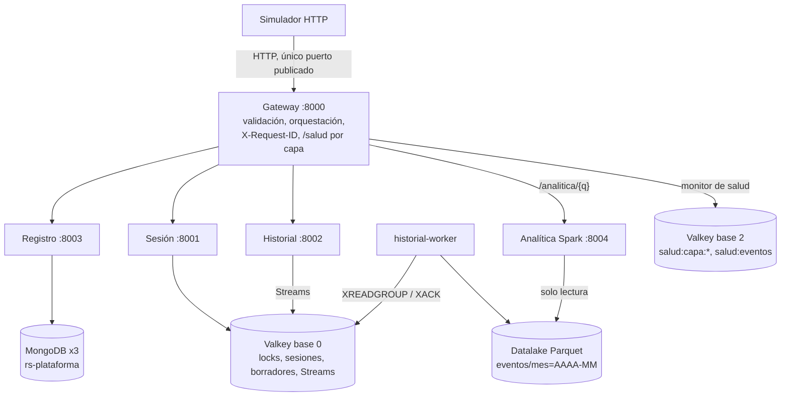

# Informe — Plataforma distribuida de anotación de datos

**Proyecto 2 — TI4601 Bases de Datos Avanzadas.** Instituto Tecnológico de
Costa Rica. Profesor: Manuel Zumbado Corrales.

**Equipo:** Christian Navarro Ellerbrock (2023071460), Emmanuel Calvo Mora
(2023213365) y Jimmy Feng Feng (2023060347).

- **Repositorio:** <https://github.com/Chris-0307/proyecto2_BDA>
- **Fecha de entrega:** 24-11-2026
- **Tecnologías:** FastAPI, MongoDB (3 nodos en réplica), Valkey (AOF),
  Parquet y Apache Spark, desplegados con Docker Compose.
- **Entorno de medición:** las mediciones de Gateway, Registro y MongoDB (P1,
  P2, P8 de MongoDB y `w:1` frente a `w:majority`) se hicieron en Linux WSL2
  (kernel 6.6.87.1) con 16 CPU lógicos. Las de Sesión e Historial (P3, P4 y P8
  de Valkey) se hicieron en Windows con 12 CPU lógicos y 7,73 GiB disponibles
  para Docker. Cada archivo de evidencia registra la máquina en que se ejecutó.
- **Trazabilidad:** toda cifra de este informe proviene de un archivo de
  `proyecto2/evidence/` (sección 14).

---

## 1. Arquitectura y límites de responsabilidad

El único punto de entrada es el gateway (puerto 8000). Registro, Sesión
e Historial son internos; MongoDB y Valkey no se exponen al host. La
analítica con Spark lee el datalake en modo de solo lectura.



*Arquitectura del sistema, con la ruta `/analitica` del gateway hacia Spark.*

| Componente | Responsabilidad | Tecnología | Responsable |
|---|---|---|---|
| Gateway | Único punto de entrada; valida, orquesta el flujo de una tarea, publica eventos y reporta salud por capa | FastAPI + httpx | Jimmy |
| Registro | Estado vigente de proyectos, lotes y tareas; transiciones atómicas; exportación | FastAPI + MongoDB (3 nodos) | Jimmy |
| Sesión | Locks de 120 s, sesiones, latidos y borradores | FastAPI + Valkey | Christian |
| Historial | Recepción idempotente de eventos y escritura de Parquet | FastAPI + Valkey Streams + Parquet | Christian |
| Analítica | Consultas Q1–Q5 sobre Parquet | Spark | Emmanuel |
| Simulador | Anotadores, revisores y consumidores vía HTTP | Cliente HTTP | Emmanuel |

**Reglas de aislamiento** (`p1_salud_aislamiento.txt`, 54/54):

- Solo el gateway publica puerto al host: en `docker compose ps` únicamente
  `gateway` tiene puerto publicado (8000). Desde el host, 8001, 8002, 8003,
  8004, 27017 y 6379 rechazan la conexión.

- El gateway no tiene `pymongo` (ni en el código, ni en la imagen, ni en las
  variables de entorno): no accede a MongoDB. Usa Valkey solo para los
  mensajes de salud, en su propia base (2) y con llaves `salud:*`; no lee ni
  escribe la base 0 de Sesión e Historial.

- El registro no tiene `redis`: no consulta Valkey.

- Sesión e Historial no tienen `pymongo`: no acceden a MongoDB, y por lo tanto
  Sesión no puede decidir el estado definitivo de una tarea.

- Analítica no tiene `pymongo` ni `redis` y el datalake está montado en solo
  lectura: lee únicamente el lago Parquet.

- El simulador no importa clientes de bases (`pymongo`, `redis`, `pyspark`) ni
  menciona hosts o puertos internos: solo se comunica con el gateway
  (`localhost:8000`).

- **Limitación:** todos los servicios comparten la red de Compose; el
  aislamiento se garantiza por dependencias y configuración, no por
  segmentación de red.

---

## 2. Justificación de motores

- **MongoDB para el registro.** Una tarea es un documento autocontenido
  (referencia al archivo, asignación, anotación, revisión y cola de
  eventos), y la anotación cambia de forma según la modalidad (span,
  bbox, polígono, cuboide 3D). Toda transición modifica un solo
  documento, así que un `findOneAndUpdate` con filtro por estado
  garantiza la asignación exclusiva sin transacciones multidocumento. El
  conjunto de réplicas de tres nodos tolera la caída de uno, y
  `w: majority` impide que una elección revierta una escritura
  confirmada (secciones 5.3 y 12).

- **Valkey para sesiones.** Estado efímero con TTL (`SET NX PX`),
  operaciones atómicas con Lua y persistencia AOF para que el borrador
  sobreviva a un reinicio. No es la fuente de verdad: el estado
  definitivo vive en MongoDB.

- **Parquet + Spark para el historial.** Los eventos son inmutables y se
  consultan por agregación (OLAP), lo que favorece un formato columnar
  particionado por mes en lugar de consultar el registro operacional.

- **Spark para la analítica.** El servicio `analitica` lee solo los
  `*.parquet` publicados en `datalake/eventos/mes=AAAA-MM/` (montaje
  `ro`), sin consultar MongoDB ni Historial. Como el consumo es *al
  menos una vez*, ejecuta `dropDuplicates(["event_id"])` antes de
  Q1–Q5. Levantar la JVM y planificar la lectura de todos los meses
  publicados tiene un costo inicial alto (17,6 s en la primera Q1, sección 9);
  compensa con volúmenes históricos grandes (de cientos de miles a
  millones de eventos), pero no es adecuado para consultas puntuales de
  baja latencia.

---

## 3. API REST y contratos

La documentación completa de rutas, cuerpos y códigos está en
`endpoints/README.md`. Decisiones del gateway:

- **Reintentos seguros.** Solo los `GET` se reintentan una vez ante
  error de conexión o timeout. `POST` y `PUT` nunca se reintentan:
  repetir podría duplicar un proyecto, un lote o una transición, y el
  enunciado pide 503 sin reintento.

- **Errores.** Un servicio interno que no responde se traduce a 503; los
  códigos 403, 404, 409 y 422 de los servicios internos se propagan tal
  cual.

- **Identificadores.** `X-Request-ID` se propaga a los servicios
  internos y se devuelve al cliente.

- **Salud por capa con mensajes en Valkey.** Un monitor del gateway
  consulta cada 5 s el `/salud` de Registro, Sesión, Historial y Analítica y
  publica el estado en `salud:capa:{capa}` (expira a los 15 s, de modo que un
  monitor detenido no deja estado viejo) y en el stream `salud:eventos` (cada
  cambio, como `capa:antes->ahora`). `GET /salud` lee esos mensajes
  (`fuente: valkey`); si Valkey no responde, consulta cada capa directamente
  (`fuente: directo`). El gateway siempre responde. El gateway publica por las
  capas porque el reporte de salud es su responsabilidad y el registro no
  puede escribir en Valkey; usa una base propia (2) para no mezclar datos con
  Sesión e Historial. Estado global: `caido` (503) si el registro no está
  disponible; `degradado` (200) si alguna otra capa falla o MongoDB perdió un
  nodo; `operativo` (200) si todas responden. *Costo:* el estado puede tener
  hasta 5 s de atraso.

- **Ruta de analítica.** `GET /analitica/{q1..q5}?conjunto=principal|grande`
  reenvía la consulta a `analitica:8004/q/{q}`. Una consulta de Spark tarda
  decenas de segundos, así que el gateway espera hasta 120 s y **no
  reintenta**: repetirla duplicaría el costo. Una consulta desconocida
  responde 404, un `conjunto` inválido 422 y Analítica sin respuesta 503. En
  P6, el simulador registró como `timeout` (código 504 en su propio registro)
  las solicitudes que no recibieron respuesta dentro de su timeout de cliente
  de 120 s; no es una respuesta del gateway ni de Analítica.

Resultados de salud (`p1_salud_aislamiento.txt`, 54/54):

| Servicio detenido | `/salud` | Reflejado en | Además |
|---|---|---|---|
| Sesión | 200 `degradado`, solo `sesion` caída | 2,0 s | Cambio en `salud:eventos`; `exportar` responde; guardar borrador da 503 |
| Historial | 200 `degradado`, solo `historial` caída | 5,0 s | Cambio en `salud:eventos`; `exportar` responde |
| Analítica | 200 `degradado`, solo `analitica` caída | 5,0 s | Cambio en `salud:eventos`; `exportar` responde |
| Registro | 503 `caido` | 6,0 s | Cambio en `salud:eventos`; `exportar` da 503 |
| Valkey | 200 `degradado`, `fuente: directo`; Sesión e Historial caídos | 16,4 s | Al volver Valkey: `fuente: valkey` y `operativo` |

En todos los casos `/salud` vuelve a `operativo` al arrancar el servicio.
Los tiempos de 2–6 s dependen de en qué momento del intervalo del monitor
(5 s) se detuvo el servicio; el caso de Valkey tardó 16,4 s y no se midió el
desglose de ese tiempo.

**Resultados funcionales:** rutas básicas 14/14 (`p1_gateway_smoke.txt`)
y flujo completo 26/26 (`p1_gateway_flujo.txt`), que incluye que los
cinco tipos de evento pasan la validación de Historial y que ningún
evento queda pendiente.

**Contrato de eventos.** El registro arma cada evento dentro de la
transición y el gateway lo publica sin modificarlo; Historial lo valida
con un esquema estricto (`extra=forbid`). Para la analítica: Q3 lee
`duracion_ms` de `tarea_anotada` (toma->envío); Q5 calcula
toma->aprobación con `tomada_en` y `aprobada_en` de
`revision_aprobada`; Q4 cuenta las filas `rechazada`.

---

## 4. Recorrido completo de una tarea (ejemplo LiDAR)

Ejemplo **ilustrativo**: los cuerpos tienen la forma real de la API,
pero los valores y los ids (abreviados) son de ejemplo. El flujo
completo está verificado en `p1_gateway_flujo.txt` (26/26) con tareas de
imagen; la forma es la misma para LiDAR.

| N.º | Llamada | Qué ocurre |
|---|---|---|
| 1 | `POST /proyectos` | El registro valida que el cliente exista (404 si no) y responde 201. La taxonomía lleva etiqueta e instrucción (p. ej. `lidar#ciclista`). |
| 2 | `POST /proyectos/{id}/lotes` | Se valida que la geometría corresponda a la modalidad (LiDAR solo admite `cuboide_3d`; otra combinación da 422). Las tareas se insertan en `disponible`, versión 1. Solo se guarda la referencia al archivo. |
| 3 | `POST /tareas/siguiente` | Gateway->Registro: candidatas por prioridad. Gateway->Sesión: `SET NX PX 120000` sobre `lock:tarea:{id}` (si está ocupado, prueba la siguiente). Gateway->Registro: `asignar` (`findOneAndUpdate` que exige `disponible` o `abierta` vencida; con 409 suelta el lock y prueba otra). Publica `tarea_abierta`. Responde 200 con `tarea`, `token`, `ttl_ms` y el borrador si existía; 204 si no hay ninguna libre. |
| 4 | `PUT /tareas/{id}/borrador` | Cada 2 s. Sesión guarda el último borrador y renueva el lock; no toca MongoDB ni genera fila en Parquet. Tras una desconexión, `POST /sesiones/recuperar` devuelve el borrador (`activa` si el lock sigue vigente, `requiere_reasignacion` si venció). |
| 5 | `POST /tareas/{id}/enviar` | Latido (el token debe ser el dueño del lock; 409 si no). Registro filtra por estado `abierta` y token: un segundo envío da 409. Si MongoDB no responde, 503 sin reintento y el borrador y el lock siguen en Valkey. Publica `tarea_anotada` (con `duracion_ms`) y suelta el lock. |
| 6 | `POST /tareas/{id}/revision` | `iniciar_revision` (`anotada`->`en_revision`) y `rechazar`. Sin `motivo`: 422; actor que no es revisor: 403. |
| 7 | `siguiente` + `revision` | La tarea rechazada se vuelve a ofrecer; tras el nuevo envío, `aprobar` la deja en `aprobada` y publica `revision_aprobada` (base de Q5). Aprobar otra vez da 409. |
| 8 | `GET /proyectos/{id}/exportar` | Tareas `aprobada` paginadas por `_id`, con cursor `siguiente`. |

Ejemplo del cuerpo del borrador (paso 4) para una tarea LiDAR:

```json
{"anotador_id": "a7...", "proyecto_id": "p3...", "token": "t9...",
 "contenido": {"cuboides": [{"etiqueta": "lidar#ciclista",
   "centro": [12.4, -3.1, 0.9], "dimensiones": [1.8, 0.6, 1.7], "yaw": 0.12}]}}
```

| Paso | Estado en MongoDB | Fila en Parquet |
|---|---|---|
| siguiente | `abierta` (versión 2, `asignacion.token`) | `abierta` |
| enviar | `anotada` | `anotada` |
| inicio de revisión | `en_revision` | `en_revision` |
| rechazo | `disponible` | `rechazada` (con `motivo_rechazo`) |
| aprobación | `aprobada` | `aprobada` |

Liberar una tarea y guardar borradores no generan filas.

---

## 5. Registro operacional: modelo, índices y concurrencia

### 5.1 Modelo e índices

Base `plataforma`, colecciones `clientes`, `proyectos`, `batches`,
`tareas` y `anotadores`, con identificadores UUID. Documento de una
tarea:

```json
{"_id": "uuid", "proyecto_id": "uuid", "batch_id": "uuid", "cliente_id": "uuid",
 "modalidad": "lidar", "tipo_tarea": "cuboide_3d", "prioridad": 5,
 "archivo": {"uri": "...", "sha256": "...", "bytes": 0, "mime": "...", "meta": {}},
 "estado": "disponible", "version": 1, "sla_horas": 48,
 "asignacion": {"anotador_id": "...", "equipo_id": "...", "token": "...",
                "tomada_en": "...", "vence_en": "..."},
 "anotacion": {"contenido": {}, "enviada_en": "..."},
 "revision": {"revisor_id": "...", "iniciada_en": "...", "resultado": "...",
              "motivo": "...", "revisada_en": "..."},
 "ultimo_evento_id": "uuid", "eventos_pendientes": [], "creado_en": "..."}
```

**Estados y transiciones.** `disponible`, `abierta`, `anotada`,
`en_revision`, `aprobada`. Cada transición es **un único**
`findOneAndUpdate` cuyo filtro exige el estado de origen (y el token o
el revisor cuando corresponde); si no coincide, no se modifica nada y se
responde 409. No hay lectura previa seguida de escritura, y la versión
sube en cada transición válida.

**Evento en la misma operación (*outbox*).** La actualización es un
pipeline de agregación: en la misma escritura atómica cambia el estado,
sube la versión y construye el evento, que queda en
`eventos_pendientes`. Así no se pierde el evento si el proceso cae entre
la escritura y la publicación. El gateway lo publica y lo confirma; si
Historial falla, un reconciliador del gateway reenvía los pendientes
cada 10 s, y Historial deduplica por `event_id`.

**Índices** (`p2_replica.txt` lista los cuatro creados; son los mínimos
del enunciado):

| Índice | Campos | Consulta que lo usa |
|---|---|---|
| `tareas_proyecto_estado_prioridad` | `proyecto_id, estado, prioridad:-1` | Candidatas de `/tareas/siguiente`. Regla ESR: igualdad antes que orden, así el orden sale del índice sin ordenar en memoria |
| `tareas_anotador_estado` | `asignacion.anotador_id, estado` | Tareas de un anotador |
| `tareas_batch` | `batch_id` | Tareas de un lote |
| `proyectos_cliente_estado` | `cliente_id, estado` | Proyectos de un cliente por estado |

Las transiciones buscan por `_id`, que ya tiene índice. La exportación
filtra por `proyecto_id` y `estado = aprobada` y ordena por `_id`:
aprovecha el prefijo del primer índice, aunque el orden por `_id` no
sale de él.

**Planes de ejecución (`explain`).** Planes con `executionStats` sobre el
dataset cargado (`p2_explain_registro.txt`, 10/10; MongoDB 8.0.38, 60.405
tareas, 138 proyectos):

| Consulta | Índice usado | Etapas | Ordenamiento en memoria | Devueltos | Claves examinadas | Docs examinados |
|---|---|---|---|---|---|---|
| Candidatas disponibles (`/tareas/siguiente`) | `tareas_proyecto_estado_prioridad` | LIMIT -> FETCH -> IXSCAN | No | 20 | 20 | 20 |
| Candidatas abiertas vencidas | `tareas_proyecto_estado_prioridad` | LIMIT -> FETCH -> IXSCAN | No | 0 | 0 | 0 |
| Tareas de un anotador | `tareas_anotador_estado` | FETCH -> IXSCAN | No | 0 | 0 | 0 |
| Tareas de un lote | `tareas_batch` | FETCH -> IXSCAN | No | 60 | 60 | 60 |
| Exportar aprobadas (orden por `_id`) | `tareas_proyecto_estado_prioridad` | SORT -> FETCH -> IXSCAN | Sí | 1 | 1 | 1 |
| Proyectos de un cliente | `proyectos_cliente_estado` | FETCH -> IXSCAN | No | 15 | 15 | 15 |
| Transición por `_id` + estado | `_id_` | FETCH -> IXSCAN | No | 1 | 1 | 1 |

Todas las consultas reportaron 0 ms de ejecución en el servidor.

- Todas las consultas usan un índice (`IXSCAN`); ninguna recorre la colección
  completa.
- En las consultas que devolvieron documentos, las claves y los documentos
  examinados coinciden con los devueltos: el índice filtra exactamente lo
  necesario. Las candidatas de `/tareas/siguiente` examinaron 20 documentos
  para devolver 20, y el orden por prioridad sale del índice (regla ESR), sin
  ordenamiento en memoria.
- Las consultas de abiertas vencidas y de tareas de un anotador devolvieron 0
  documentos con los valores de ejemplo; aun así el plan elegido usa el
  índice previsto.
- La exportación usa el prefijo `proyecto_id, estado` de
  `tareas_proyecto_estado_prioridad`, pero ordena por `_id` en memoria. Con 1
  tarea aprobada el costo es nulo; con muchas aprobadas por proyecto, ese
  ordenamiento crecería con el número de aprobadas. Un índice
  `(proyecto_id, estado, _id)` lo evitaría, pero no se creó porque el
  enunciado exige justificar cada índice adicional con una medición, y no hay
  una medición con volumen de aprobadas que lo respalde.
- Los conteos incluyen, además del dataset generado (60.000 tareas y 120
  proyectos), los datos que dejaron las pruebas anteriores.

### 5.2 Prueba de que no hay doble adquisición

**Mecanismo en dos capas.** El lock de Valkey (`SET NX PX`) evita que
dos peticiones trabajen la misma tarea a la vez. La garantía final es el
`findOneAndUpdate` filtrado por estado en MongoDB: aunque dos peticiones
llegaran juntas al registro, solo una encuentra la tarea en
`disponible`.

**A nivel de registro** (`p2_registro_smoke.txt`, 30/30): 50 intentos
simultáneos de asignar **la misma tarea** dieron exactamente 1 respuesta
200 y 49 respuestas 409. La tarea quedó `abierta`, versión 2, con el
token del ganador; un segundo envío responde 409.

**A nivel de gateway, 50 contra 10** (`p2_concurrencia_gateway.txt`,
9/9): 50 anotadores piden `/tareas/siguiente` a la vez sobre un proyecto
con 10 tareas.

| Resultado | Valor |
|---|---|
| Respuestas 200 / 204 / otros | 10 (todas con tareas distintas) / 40 / 0 |
| En MongoDB | 10 tareas `abierta`, cada una con un dueño distinto, todas en versión 2 (una sola asignación) y con el mismo dueño que recibió el 200 |
| Latencia de `/tareas/siguiente` (n = 50) | p50 1.056,5 ms; p95 1.090,9 ms; p99 1.093,5 ms; máx. 1.093,5 ms |
| Duración de la ráfaga | 1.102,8 ms |

**Cero dobles asignaciones** en ambas pruebas. La latencia es alta bajo
contención; no se midió el desglose, y la hipótesis es que cada petición
sin tarea recorre hasta 10 candidatas con una llamada HTTP a Sesión por
cada una. Es un candidato a optimizar (ver
sección 11).

### 5.3 Diferencia observada entre `w:1` y `w:majority`

Medición con el driver, sin gateway, de las dos escrituras del registro
(`p2_write_concern.txt`): 500 operaciones por hilo y repetición, 3
repeticiones en orden alternado, con 1 y 8 hilos.

| Hilos | Operación | p50 `w:1` | p50 `majority` | Relación | ops/s `w:1` | ops/s `majority` |
|---|---|---|---|---|---|---|
| 1 | `insert_one` | 0,52 ms | 2,66 ms | ×5,15 | 1.552 | 346 |
| 1 | `find_one_and_update` | 0,71 ms | 2,77 ms | ×3,91 | 1.552 | 346 |
| 8 | `insert_one` | 3,44 ms | 6,28 ms | ×1,83 | 2.123 | 1.229 |
| 8 | `find_one_and_update` | 3,51 ms | 6,37 ms | ×1,82 | 2.123 | 1.229 |

- Con un hilo, `w:majority` espera a que un secundario aplique la
  escritura: la latencia se multiplica entre 3,9 y 5,2 veces y el
  rendimiento cae de 1.552 a 346 ops/s (−78 %). Con 8
  hilos las esperas se solapan y la diferencia baja a
  ×1,8 (2.123 frente a 1.229 ops/s,
  −42 %).

- **Limitación:** los tres nodos corren en la misma máquina, así que la
  replicación no paga latencia de red real; estas cifras no permiten
  inferir el comportamiento de un clúster en varias máquinas.

- **Garantía:** `w:1` confirma una escritura que aún no está en la
  mayoría y que puede perderse en un rollback tras una elección. En el
  caso C de la sección 12.1 una escritura quedó aplicada en un primario
  aislado sin llegar a la mayoría: con `w:majority` el cliente recibió
  503; con `w:1` habría recibido 200 por una escritura no replicada
  (esto último no se midió con `w:1`).

Se mantiene `w:majority`: el costo medido es de milisegundos y la
garantía es que ninguna escritura confirmada se pierde (RPO 0).

---

## 6. Sesión, recuperación del borrador y reinicio de Valkey

**Diseño.**

- La fuente de verdad de la tarea es MongoDB. Valkey solo conserva
  sesiones temporales y borradores, sin modificar el estado definitivo.

- Scripts Lua adquieren, renuevan, liberan y validan los locks sin
  intercalar operaciones concurrentes; el token impide liberar un lock
  ajeno.

- Llaves: `lock:tarea:{id}` (`SET NX PX`, 120 s, se renueva con el
  latido y con cada borrador), `sesion:{anotador}` (tarea, proyecto,
  etapa y token), `borrador:{tarea}` (último borrador, sin TTL para
  poder recuperarlo) y `editando:{proyecto}` (sesiones activas). Los
  borradores no generan eventos.

- Si el lock venció, la recuperación devuelve el borrador en solo
  lectura y `requiere_reasignacion`; la decisión de reasignar la toma el
  registro a través del gateway (`/tareas/siguiente` vuelve a ofrecer la
  tarea y devuelve el borrador al mismo anotador).

- Persistencia: AOF con `appendonly yes` y `appendfsync everysec`.

**Qué pasa al reiniciar Valkey.** La prueba P3 se ejecutó sobre el
Compose final, utilizando el gateway como punto de entrada. Se verificó
la configuración de AOF con `appendonly yes` y `appendfsync everysec`.

Después de guardar tres borradores con intervalos de dos segundos, se
reinició el contenedor de Valkey conservando su volumen persistente. La
recuperación mediante el gateway respondió HTTP 200 en 1,179 s desde el
inicio del reinicio, conservando el contenido y la versión del último
borrador, así como el lock activo.

La prueba obtuvo 29/29 comprobaciones correctas. La evidencia se
encuentra en `p3_gateway_sesion.txt`.

**Resultados de P3** (criterios del enunciado):

| Criterio | Resultado | Evidencia |
|---|---|---|
| El borrador recuperado tiene como máximo 5 s de antigüedad | 2,036 s | `p3_gateway_sesion.txt` |
| Tras reiniciar Valkey, el borrador sigue | Contenido y versión conservados. Recuperación en 1,179 s | `p3_gateway_sesion.txt` |
| Un lock vencido devuelve la tarea a la cola | Reasignación exitosa tras esperar 122 s sin actividad | `p3_gateway_sesion.txt` |
| Ninguna tarea queda con dos dueños | Un único propietario vigente en MongoDB. El token anterior responde HTTP 409 | `p3_gateway_sesion.txt` |

Una vez vencido el lock, el anotador original pudo recuperar su borrador
en modo de solo lectura, pero no modificarlo. Un segundo anotador
adquirió la misma tarea con un token diferente, sin recibir el borrador
del propietario anterior.

MongoDB confirmó un único propietario vigente. Los intentos de guardar,
enviar y recuperar la sesión utilizando el token anterior respondieron
HTTP 409 después de la reasignación.

Finalmente, se liberó la tarea de prueba mediante el gateway, obteniendo
HTTP 200.

---

## 7. Datalake Parquet

**Diseño.**

- El gateway publica cada evento en `POST /eventos` solo después de que
  MongoDB confirmó la transición. Historial lo encola en Valkey Streams
  de forma idempotente por `event_id` (202 nuevo, 200 repetido, 409 si
  el mismo `event_id` llega con otro contenido).

- Un worker independiente lee el grupo `historial-parquet` y escribe
  cada micro-lote primero en `.staging`; luego lo sincroniza y lo
  publica con `os.replace` dentro del mismo volumen. Solo después
  confirma con `XACK`.

- Partición mensual por `ocurrido_en` en UTC: `eventos/mes=AAAA-MM/`.

- Si un worker muere antes del `XACK`, el mensaje queda pendiente y otro
  lo reclama con `XAUTOCLAIM`; repetir el mismo micro-lote produce el
  mismo nombre de archivo.

- **Archivos a medias:** Spark solo lee `*.parquet` publicados (los
  temporales viven en `.staging/`); la publicación es atómica por
  archivo.

- **Duplicados:** el consumo es *al menos una vez*, así que dos
  micro-lotes solapados pueden contener el mismo `event_id`; Spark
  aplica `dropDuplicates(["event_id"])` antes de Q1–Q5.

- **Fila rechazada:** un rechazo deja la tarea en `disponible` en
  MongoDB y una fila `rechazada` en Parquet; Q4 cuenta esas filas.

**Compactación.**

La escritura continua de micro-lotes puede generar una cantidad elevada
de archivos Parquet pequeños, aumentando el costo de apertura, lectura y
planificación de las consultas en Spark.

Se propone una estrategia de compactación manual por partición mensual,
preferiblemente sobre meses cerrados. Como política inicial, se plantea
evaluar la compactación cuando una partición supere los 100 archivos,
generando archivos de aproximadamente 128 MiB cuando el volumen de datos
lo permita. Estos parámetros son propuestas de diseño y no resultados
experimentales.

1.  Suspender las operaciones del gateway, procesar los eventos
    pendientes y detener el worker y los lectores de Spark.

2.  Leer los archivos publicados de la partición mensual seleccionada.

3.  Verificar la consistencia del contenido de los eventos repetidos y
    deduplicar por `event_id`.

4.  Escribir los archivos compactados en una ubicación temporal fuera
    del patrón de lectura de Spark.

5.  Validar el esquema, el contenido y los identificadores únicos antes
    y después de la compactación.

6.  Respaldar los archivos originales y publicar los archivos
    compactados dentro de la partición correspondiente.

7.  Restaurar los servicios y permitir nuevamente la lectura y escritura
    del datalake.

La compactación conserva las diferentes transiciones de cada tarea y los
estados históricos, incluyendo los eventos de rechazo. Spark mantiene la
deduplicación por `event_id` para manejar posibles reprocesamientos
posteriores.

La compactación automática no se encuentra implementada en la versión
actual. Se documenta como una estrategia de mantenimiento y mejora
futura.

**Resultados de P4** (criterios del enunciado):

| Criterio | Resultado | Evidencia |
|---|---|---|
| Archivos Parquet válidos, sin lectura a medias | Spark leyó correctamente mientras existía un archivo temporal incompleto. | `p4_gateway_parquet.txt` |
| Reproceso de un micro-lote y deduplicación por `event_id` | Un mensaje recuperado, cero pendientes y ningún archivo adicional. Tres filas físicas se redujeron a dos eventos únicos. | `p4_gateway_parquet.txt` |
| El historial se materializa en el datalake | Ocho eventos de negocio correspondientes al ciclo completo de una tarea con retrabajo. | `p4_gateway_parquet.txt` |
| Frescura: segundos entre un HTTP 200 y el evento visible en Spark | p50: 2,177 s; p95: 2,366 s; p99: 2,366 s (n=2). | `p4_gateway_parquet.txt` |

La prueba P4 obtuvo 27/27 comprobaciones correctas sobre el Compose
final. Se simuló una falla después de publicar un micro-lote y antes de
ejecutar `XACK`. El mensaje permaneció pendiente hasta que fue
recuperado mediante `XAUTOCLAIM`, sin generar un archivo adicional.

También se comprobó que Spark no intenta leer archivos temporales
durante la escritura. Al publicar dos micro-lotes solapados, las tres
filas físicas se redujeron a dos eventos únicos mediante la
deduplicación por `event_id`.

En el flujo completo de una tarea, MongoDB registró el rechazo como
`disponible`, mientras que Parquet conservó el estado `rechazada`. Los
borradores y los envíos duplicados que respondieron HTTP 409 no
generaron eventos adicionales.

**Mediciones de frescura.**

| Evento | Tiempo (s) | Intentos |
|---|---|---|
| Primer envío | 2,177 | 2 |
| Rechazo | 1,933 | 2 |
| Segundo envío | 2,366 | 2 |
| Aprobación | 2,600 | 2 |

Las mediciones se realizaron con Spark 3.5.3, `local[1]` y la JVM
precalentada. El tiempo corresponde al intervalo entre la respuesta HTTP
200 y la primera observación del evento en Spark, incluyendo el costo de
lectura, sondeo y transporte.

La prueba se ejecutó desde Windows, con 12 CPU lógicos y 7,73 GiB de
memoria disponible para Docker. Debido al reducido número de muestras,
los resultados son funcionales y no representan una prueba de
rendimiento bajo carga.

---

## 8. Datos de prueba

*Responsable: Emmanuel.*

Generador reproducible en `proyecto2/dataset/generar_dataset.py`, con
semilla fija (`20261122`, `random.Random`). Todos los identificadores se
derivan de la semilla con `uuid5`, así que el mismo cliente, proyecto,
equipo y tarea tiene el mismo id en MongoDB y en los eventos Parquet.
Carga MongoDB (base `plataforma`) con `pymongo`, vaciando antes las
colecciones del registro para que la carga sea repetible, y materializa
Parquet mensual en `datalake/eventos/mes=AAAA-MM/` con el esquema de
`servicios/historial/app/parquet_writer.py` (publicación vía `.staging`
y `os.replace`, archivos `gen-20261122-AAAA-MM-pNNN.parquet`). Respeta
el documento de tarea de la sección 5.1 (incluidas las geometrías
válidas por modalidad) y el esquema estricto de eventos.

**Realismo del historial.** Cada tarea histórica sigue el flujo real:
`tarea_abierta` -> `tarea_anotada` -> `revision_iniciada` -> (`revision_rechazada`
-> retrabajo)\* -> `revision_aprobada`, con hasta 4 rechazos, versión
creciente y `tomada_en` igual a la toma de la ronda vigente. Cada
proyecto tiene su propia probabilidad de rechazo (0,35–0,70), su cola de
revisión (2–60 h) y un SLA de 24, 48 o 72 h, por lo que Q4 y Q5
muestran diferencias reales entre clientes y proyectos. La carga
publicó 830.256 eventos de 100.000 tareas y 180 proyectos en 60 archivos
Parquet (`mes=2025-11` a `mes=2026-10`); en una simulación local con la
misma semilla, ~8,6 % de las tareas quedó fuera de SLA y el rechazo por
proyecto quedó entre 0,33 y 0,65.

| Entidad | Volumen del enunciado | Generado |
|---|---|---|
| Clientes | 60 | 60 |
| Proyectos | 180: 120 en el registro y 60 cerrados solo en el historial | 180 (120 activos en MongoDB y 60 cerrados solo en Parquet) |
| Batches | 600 | 600 |
| Tareas del registro | 60.000: 30 % texto, 30 % imagen, 20 % video, 20 % LiDAR | 60.000: 18.065 texto, 18.038 imagen, 11.932 video, 11.965 LiDAR |
| Anotadores | 300 en 30 equipos; 10 % revisores | 300 en 30 equipos, 30 revisores (10 %) |
| Eventos históricos | ~800.000 en doce meses y 100.000 tareas | 830.256 eventos de 100.000 tareas en 12 meses (`mes=2025-11` a `mes=2026-10`), 60 archivos Parquet |
| `eventos_grande` (opcional) | Hasta ~10 millones de filas | No generado (medición no disponible) |

Los conteos de la tabla son los que el generador reportó al insertar en
MongoDB y al publicar Parquet (`datos_generacion.txt`, 2026-11-25
01:00:05 UTC).

**Comandos de carga:**

```bash
make datos
# Equivale a:
# MongoDB
docker compose -f proyecto2/docker-compose.yml run --rm registro python /dataset/generar_dataset.py --solo mongo
# Datalake Parquet (en historial-worker: tiene el esquema del worker y el datalake con escritura)
docker compose -f proyecto2/docker-compose.yml run --rm -v "$(pwd)/proyecto2/dataset:/dataset:ro" historial-worker \
  python /dataset/generar_dataset.py --solo parquet --dir-eventos /datalake/eventos
```

**Regeneraciones:** el generador se corrigió después de la primera
medición (ids compartidos entre MongoDB y Parquet, flujo de eventos
realista y meses 2025-11 a 2026-10). P6 se ejecutó con la versión
anterior del dataset; el Proyecto 084 que usó
(`600d1c8a-fc7b-5126-81a0-8775bd5adb36`) tenía un inventario finito de
tareas, por lo que al subir la concurrencia a 40 y 100 usuarios se
agotaron las tareas disponibles. P5 se midió con el dataset corregido.

---

## 9. Analítica con Spark (Q1–Q5)

*Responsable: Emmanuel.*

Servicio interno `analitica` (`servicios/analitica/`, puerto interno
8004, sin exposición al host) implementado con FastAPI + PySpark
(`local[N]`), montando `./datalake` en solo lectura (`ro`) y filtrando
exclusivamente los `*.parquet` publicados (`mes=*/*.parquet`),
ignorando `.staging/`. Todas las consultas parten de
`dropDuplicates(["event_id"])` sobre todo el conjunto, sin filtro fijo
de año, y la sesión Spark usa zona horaria UTC. `conjunto=grande` lee
`datalake/eventos_grande`; si no existe responde 404. El gateway
expone la ruta `GET /analitica/{q}` (timeout de 120 s y sin reintento)
que reenvía a este servicio.

| Consulta | Pregunta de negocio (enunciado) | Definición / implementación | Filas (`p5_analitica.txt`) |
|---|---|---|---|
| Q1 | Tareas aprobadas por día y modalidad, últimos 90 días | `revision_aprobada` en los 90 días anteriores al último `ocurrido_en` del conjunto; `countDistinct(tarea_id)` por día (`to_date(ocurrido_en)`) y `modalidad` | 359 |
| Q2 | Aprobadas / revisadas, por equipo y mes | `revision_aprobada` + `revision_rechazada` por `equipo_id` y mes (`yyyy-MM`); `aprobadas / revisadas` | 360 |
| Q3 | Duración media y p95, por modalidad y tipo de tarea | `tarea_anotada` con `duracion_ms`; `avg` y `percentile_approx(0.95)` por `modalidad` y `tipo_tarea` | 5 |
| Q4 | Rechazadas / revisadas, por cliente y proyecto | `revision_aprobada` + `revision_rechazada` por `cliente_id` y `proyecto_id`; `rechazadas / revisadas` | 180 |
| Q5 | Toma -> aprobación: p50 y p95 por cliente y % fuera de SLA | `revision_aprobada`; horas = `aprobada_en` − `tomada_en`; p50, p95 y % con horas > `sla_horas`, por `cliente_id` | 60 |

**Validación.** `pruebas/p5_analitica/validar_consultas.py` ejecuta las
mismas funciones de `app/consultas.py` sobre un micro-dataset de 10
filas con un `event_id` duplicado y compara contra valores calculados a
mano: deduplicación 10 -> 9 y resultados esperados de Q1–Q5 (ventana de
90 días, proporciones, media y p95, percentiles y % fuera de SLA).
Evidencia: `p5_validacion_consultas.txt` (`make p5-validar`), 6/6.

Sobre el conjunto principal las filas coinciden con lo esperado para
cada agrupación: Q2 da 360 = 30 equipos × 12 meses; Q3 da 5, una por
combinación de modalidad y tipo de tarea; Q4 da 180, una por proyecto;
Q5 da 60, una por cliente; y Q1 da 359 de un máximo de 364 (91 días
tocados por la ventana × 4 modalidades).

Versiones anteriores de Q1–Q3 no respondían el enunciado (Q1 agrupaba
por mes y tipo de evento, Q2 y Q3 por otras claves) y el conjunto
principal se limitaba con un filtro fijo a 2025; se reescribieron en
`app/consultas.py`. Los tiempos y planes de esta sección se vuelven a
midieron con el código y el dataset corregidos.

**Planes de ejecución (`explain`) de Q1 y Q3** (`p5_analitica.txt`,
`plan_explain` con `w=1`):

- **Lectura:** `Scan parquet` sobre los 60 archivos
  (`InMemoryFileIndex`), leyendo solo las columnas que usa cada consulta
  (5 de 20 en Q1 y Q3). No hay `PushedFilters` ni `PartitionFilters`: el
  filtro va después de la deduplicación y la lectura con
  `mes=*/*.parquet` no expone `mes` como columna, así que se leen todas
  las filas.

- **Deduplicación por `event_id`:** `Sort` + `SortAggregate` parcial,
  `Exchange hashpartitioning(event_id, N)`, `Sort` + `SortAggregate`
  final (con `first(...)` por columna). Es la parte común a las cinco
  consultas.

- **Q1:** `Filter` (`revision_aprobada` y `ocurrido_en > 2026-07-31
  19:38:26`, la ventana de 90 días ya resuelta), `countDistinct` en dos
  fases (`HashAggregate` por día, modalidad y tarea; `Exchange`;
  `HashAggregate` por día y modalidad; `Exchange`; final) y
  `Exchange rangepartitioning` + `Sort` por día y modalidad.

- **Q3:** `Filter` (`tarea_anotada` y `duracion_ms` no nulo),
  `ObjectHashAggregate` parcial con `count`, `avg` y
  `percentile_approx(0.95)`, `Exchange hashpartitioning(modalidad,
  tipo_tarea)`, agregación final y `rangepartitioning` + `Sort`.

**Tiempos** (`p5_analitica.txt`, 60 archivos Parquet, 2026-11-25
01:01:03 a 01:03:45 UTC). Tiempo medido en el cliente, en ms; el del
servidor difiere en menos de 20 ms. P5 mide el servicio `analitica`
directamente, no por el gateway:

| Consulta | `w=1`, 1.ª ejec. | `w=1`, 2.ª ejec. | `w=2`, 1.ª ejec. | `w=2`, 2.ª ejec. | Filas |
|---|---|---|---|---|---|
| Q1 | 17.623,82 | 11.266,67 | 13.457,20 | 6.074,90 | 359 |
| Q2 | 7.777,16 | 6.768,88 | 3.898,85 | 3.467,56 | 360 |
| Q3 | 6.857,69 | 7.146,24 | 4.375,89 | 3.664,93 | 5 |
| Q4 | 7.021,02 | 6.290,77 | 3.729,25 | 3.511,55 | 180 |
| Q5 | 6.623,32 | 6.402,71 | 4.037,58 | 3.661,07 | 60 |

**Primera frente a segunda ejecución.** La diferencia grande está en Q1
(17,62 s frente a 11,27 s con `w=1`; 13,46 s frente a 6,07 s con
`w=2`). Q1 es la primera consulta tras recrear el servicio, así que su
primera ejecución incluye el arranque de la sesión Spark y la primera
lectura de los archivos; no se aisló con una medición aparte. En Q2–Q5
la diferencia es de hasta 1 s, o negativa (Q3 con `w=1`), y se toma como
ruido de medición.

**Comparativa de 1 frente a 2 trabajadores.** Se recreó `analitica`
con `SPARK_WORKERS=1` y luego con `2`; `/salud` reportó
`spark_workers: 1` y `2` (`local[N]` dentro del mismo contenedor en
WSL2, no un clúster multi-nodo). En las segundas ejecuciones los tiempos
bajan de 6,29–11,27 s (`w=1`) a 3,47–6,07 s (`w=2`), una mejora de
1,75× a 1,95×, cerca de 2×. Q2–Q5 quedan en un rango estrecho
(3,5–3,7 s con `w=2`) pese a calcular cosas distintas, consistente con
que la lectura y la deduplicación comunes dominen el costo; Q1 cuesta
más por el `countDistinct` en dos fases. Limitaciones: una sola muestra
por celda y `w=1` siempre antes que `w=2`, con la caché del sistema
operativo ya caliente.

El conjunto ampliado `eventos_grande` (~10 millones de filas) no está
generado y se declara **no disponible**.

**Limitaciones de Spark en el entorno utilizado.**

- Ejecución local dentro de un contenedor en WSL2 (`local[1]` y
  `local[2]`), sin distribución multi-nodo real.

- La deduplicación global `dropDuplicates(["event_id"])` exige un
  `Exchange` de todas las filas antes de agregar; es el costo común a
  todas las consultas.

- Los filtros se aplican sobre `ocurrido_en` y no sobre la columna de
  partición `mes`, así que no hay poda de particiones: se leen todos los
  meses publicados.


---

## 10. Pruebas y evidencia experimental

Cada prueba deja un archivo en `evidence/` con fecha y hora UTC,
objetivo, máquina y configuración. Las latencias se reportan como p50,
p95 y p99 con el número de muestras cuando fue posible (formato en el
apéndice A).

| Prueba | Criterio del enunciado | Resultado | Secc. |
|---|---|---|---|
| P1. REST y despliegue | Rutas, `/salud` normal, degradado y caído; solo el gateway expuesto; el gateway recibe el tráfico del simulador | Rutas 14/14; flujo 26/26; salud por capa, puertos y aislamiento 54/54; el simulador opera solo contra el gateway (`p6_carga.txt`; código verificado en `p1_salud_aislamiento.txt`) | 3 |
| P2. Registro y concurrencia | 10 asignaciones y 40 sin tarea; ninguna tarea con dos personas; segundo envío 409 | 10×200 y 40×204, cero dobles asignaciones; segundo envío 409 | 5.2 |
| P3. Sesión | Borrador ≤ 5 s; sigue tras reiniciar Valkey; ninguna tarea con dos dueños | 29/29 comprobaciones correctas; borrador de 2,036 s; recuperación tras reinicio en 1,179 s; sin dobles asignaciones observadas | 6 |
| P4. Historial | Materialización Parquet, reprocesamiento, publicación atómica, deduplicación y frescura | 27/27 comprobaciones correctas; 3 filas físicas reducidas a 2 eventos únicos; frescura de envíos entre 2,177 y 2,366 s | 7 |
| P5. Analítica | Resultados validados, planes de Q1 y Q3, limitaciones | Q1–Q5 validadas contra valores a mano, 6/6; sobre 830.256 eventos (60 archivos), segundas ejecuciones de 6,3–11,3 s con `w=1` y 3,5–6,1 s con `w=2` (1,75×–1,95×); planes `explain` de Q1 y Q3 capturados; conjunto grande no disponible | 9 |
| P6. Carga | p50/p95/p99 por endpoint, envíos por minuto, errores, `docker stats` | 10, 40 y 100 usuarios, 3 repeticiones de 90 s por nivel sobre Proyecto 084: latencias promedio/p50/p95/p99, códigos HTTP, acciones, agotamiento a 0 tareas y `docker stats` cada 15 s | 11 |
| P8. Fallas | Con un nodo caído se escribe; sin mayoría no; lo confirmado sigue tras la elección; el borrador sobrevive al reinicio de Valkey | MongoDB 14/14; Valkey 31/31 comprobaciones correctas. RTO de 1,310 s en reinicio ordenado, 13,245 s en parada controlada y 1,767 s en caída abrupta. Sin pérdida de versiones de borrador observada. | 12 |

---

## 11. Resultados de carga y cuellos de botella (P6)

*Responsable: Emmanuel.*

Prueba ejecutada sobre el gateway (`localhost:8000`) con **10, 40 y 100
usuarios virtuales concurrentes**, realizando **3 repeticiones de 90 s
por nivel**, con muestreo de `docker stats` cada 15 s y finalización
registrada en `2026-11-24T16:34:31Z` en `p6_carga.txt`. Se utilizó el
**Proyecto 084** (`600d1c8a-fc7b-5126-81a0-8775bd5adb36`), que partió
con 420 tareas disponibles y tenía 377 al iniciar la primera repetición
de 10 usuarios.

### 11.1 Nivel de 10 usuarios

| Rep. | Endpoint | n | Prom. | p50 | p95 | p99 | Códigos / acciones |
|---|---|---|---|---|---|---|---|
| 1 | `POST /tareas/siguiente` | 170 | 211,97 | 172,12 | 480,58 | 642,39 | `200`: 170 (`tarea_tomada`) |
| 1 | `PUT /tareas/{id}/borrador` | 248 | 41,27 | 30,05 | 97,35 | 171,00 | `200`: 248 (`borrador_guardado`) |
| 1 | `POST /tareas/{id}/enviar` | 138 | 168,30 | 131,26 | 354,39 | 585,76 | `200`: 138 (`tarea_enviada`) |
| 1 | `POST /tareas/{id}/revision` | 132 | 236,37 | 204,47 | 406,48 | 626,49 | `200`: 132 (109 aprob., 23 rech.) |
| 1 | `POST /tareas/{id}/liberar` | 32 | 63,32 | 52,62 | 131,77 | 148,97 | `200`: 32 (`tarea_liberada`) |
| 1 | `GET /proyectos/{id}/exportar` | 2 | 232,38 | 223,85 | 240,91 | 240,91 | `200`: 2 (`exportar_ok`) |
| 1 | `GET /analitica/{q}` | 2 | 103 597,96 | 103 562,92 | 103 633,00 | 103 633,00 | `200`: 2 (`analitica_ok`) |
| 2 | `POST /tareas/siguiente` | 156 | 321,31 | 292,15 | 637,92 | 878,66 | `200`: 156 (`tarea_tomada`) |
| 2 | `PUT /tareas/{id}/borrador` | 229 | 61,04 | 48,72 | 163,38 | 213,50 | `200`: 229 (`borrador_guardado`) |
| 2 | `POST /tareas/{id}/enviar` | 133 | 240,51 | 200,30 | 507,31 | 771,36 | `200`: 133 (`tarea_enviada`) |
| 2 | `POST /tareas/{id}/revision` | 127 | 350,90 | 334,26 | 564,84 | 743,39 | `200`: 127 (96 aprob., 31 rech.) |
| 2 | `POST /tareas/{id}/liberar` | 23 | 122,35 | 101,47 | 288,87 | 435,21 | `200`: 23 (`tarea_liberada`) |
| 2 | `GET /proyectos/{id}/exportar` | 2 | 127,81 | 94,76 | 160,86 | 160,86 | `200`: 2 (`exportar_ok`) |
| 2 | `GET /analitica/{q}` | 2 | 120 077,00 | 120 053,09 | 120 100,92 | 120 100,92 | `timeout`: 2 |
| 3 | `POST /tareas/siguiente` | 148 | 351,85 | 316,25 | 887,27 | 1 211,89 | `200`: 148 (`tarea_tomada`) |
| 3 | `PUT /tareas/{id}/borrador` | 227 | 63,00 | 45,73 | 149,77 | 337,68 | `200`: 227 (`borrador_guardado`) |
| 3 | `POST /tareas/{id}/enviar` | 128 | 250,84 | 193,93 | 594,18 | 1 023,63 | `200`: 128 (`tarea_enviada`) |
| 3 | `POST /tareas/{id}/revision` | 122 | 378,48 | 339,77 | 742,05 | 1 231,75 | `200`: 122 (95 aprob., 27 rech.) |
| 3 | `POST /tareas/{id}/liberar` | 20 | 123,53 | 83,10 | 291,50 | 406,26 | `200`: 20 (`tarea_liberada`) |
| 3 | `GET /proyectos/{id}/exportar` | 2 | 284,10 | 252,94 | 315,26 | 315,26 | `200`: 2 (`exportar_ok`) |
| 3 | `GET /analitica/{q}` | 2 | 120 093,23 | 120 088,09 | 120 098,37 | 120 098,37 | `timeout`: 2 |

### 11.2 Nivel de 40 usuarios

| Rep. | Endpoint | n | Prom. | p50 | p95 | p99 | Códigos / acciones |
|---|---|---|---|---|---|---|---|
| 1 | `POST /tareas/siguiente` | 1741 | 776,83 | 616,66 | 1 707,66 | 3 334,81 | `200`: 84, `204`: 144, `timeout`: 1513 |
| 1 | `PUT /tareas/{id}/borrador` | 114 | 503,23 | 395,35 | 966,64 | 2 021,91 | `200`: 114 |
| 1 | `POST /tareas/{id}/enviar` | 78 | 1 349,37 | 1 257,48 | 2 556,72 | 3 015,01 | `200`: 78 |
| 1 | `POST /tareas/{id}/revision` | 75 | 1 771,30 | 1 610,21 | 3 402,28 | 3 434,17 | `200`: 75 |
| 1 | `POST /tareas/{id}/liberar` | 6 | 677,53 | 392,95 | 1 402,52 | 1 402,52 | `200`: 6 |
| 1 | `GET /proyectos/{id}/exportar` | 8 | 912,80 | 1 089,32 | 1 119,46 | 1 119,46 | `200`: 8 |
| 1 | `GET /analitica/{q}` | 8 | 120 091,33 | 120 099,25 | 120 102,99 | 120 102,99 | `timeout`: 8 |
| 2 | `POST /tareas/siguiente` | 5710 | 127,52 | 87,71 | 367,32 | 643,17 | `204`: 5710, sin tareas disponibles |
| 2 | `GET /proyectos/{id}/exportar` | 8 | 527,32 | 577,14 | 851,13 | 851,13 | `200`: 8 |
| 2 | `GET /analitica/{q}` | 8 | 120 072,02 | 120 097,91 | 120 100,82 | 120 100,82 | `timeout`: 8 |
| 3 | `POST /tareas/siguiente` | 6398 | 86,77 | 51,96 | 256,33 | 495,64 | `204`: 6398, sin tareas disponibles |
| 3 | `GET /proyectos/{id}/exportar` | 8 | 805,91 | 910,15 | 1 221,94 | 1 221,94 | `200`: 8 |
| 3 | `GET /analitica/{q}` | 8 | 120 059,27 | 120 083,46 | 120 101,64 | 120 101,64 | `timeout`: 8 |

### 11.3 Nivel de 100 usuarios

| Rep. | Endpoint | n | Prom. | p50 | p95 | p99 | Códigos / acciones |
|---|---|---|---|---|---|---|---|
| 1 | `POST /tareas/siguiente` | 7199 | 500,88 | 475,75 | 797,95 | 1 023,06 | `204`: 7199 |
| 1 | `GET /proyectos/{id}/exportar` | 20 | 736,94 | 654,22 | 1 051,03 | 1 066,68 | `200`: 20 |
| 1 | `GET /analitica/{q}` | 20 | 120 088,81 | 120 101,94 | 120 114,60 | 120 117,90 | `timeout`: 20 |
| 2 | `POST /tareas/siguiente` | 7469 | 473,06 | 435,13 | 798,79 | 918,31 | `204`: 7469 |
| 2 | `GET /proyectos/{id}/exportar` | 20 | 652,03 | 625,58 | 933,18 | 946,66 | `200`: 20 |
| 2 | `GET /analitica/{q}` | 20 | 120 071,30 | 120 082,70 | 120 101,61 | 120 102,28 | `timeout`: 20 |
| 3 | `POST /tareas/siguiente` | 7413 | 479,43 | 447,63 | 773,38 | 939,11 | `204`: 7413 |
| 3 | `GET /proyectos/{id}/exportar` | 20 | 612,76 | 587,07 | 914,79 | 934,50 | `200`: 20 |
| 3 | `GET /analitica/{q}` | 20 | 120 086,29 | 120 099,92 | 120 106,92 | 120 112,78 | `timeout`: 20 |

**Cuellos de botella y observaciones.**

1.  **Agotamiento del inventario y paso a `204`.** Con 10 usuarios las
    tareas disponibles pasan de 377 -> 262
    -> 160 -> 59 sin
    agotarse. En la primera repetición de 40 usuarios entran 44 tareas
    disponibles y caen a 0. Desde ese punto hasta el final de las tres
    repeticiones de 100 usuarios, `POST /tareas/siguiente` responde
    `204` de forma sostenida: 5710 y 6398 respuestas en las repeticiones
    2 y 3 de 40 usuarios, y 7199, 7469 y 7413 en las tres repeticiones
    de 100 usuarios.

2.  **Contención y timeouts bajo 40 usuarios.** En la primera repetición
    de 40 usuarios, `POST /tareas/siguiente` registra 1513 respuestas
    `timeout`, frente a 84 respuestas `200` y 144 `204`, con p95 de
    1.707,66 ms y p99 de 3.334,81 ms. Asimismo, `enviar` alcanza un p95
    de 2.556,72 ms y `revision` de 3.402,28 ms.

3.  **Saturación de `GET /analitica/{q}`.** En la primera repetición de
    10 usuarios, las dos consultas medidas responden `200` en
    aproximadamente 103,6 s. A partir de la segunda repetición de 10
    usuarios y en todos los niveles de 40 y 100 usuarios, las consultas
    alcanzan el umbral de aproximadamente 120,1 s y devuelven `timeout`,
    mientras Spark compite por CPU y memoria en el mismo host WSL2.

4.  **Recursos del sistema.** Se capturó `docker stats` cada 15 s. Por
    ejemplo, al cierre de la tercera repetición de 100 usuarios,
    `bda-mongo-2` alcanzó 102,55 % de CPU y 462,2 MiB de memoria,
    mientras `bda-proyecto2-valkey-1` registró 1,18 % de CPU y 12,2 MiB
    de memoria.

---

## 12. Fallas, recuperación, RTO y RPO (P8)

### 12.1 MongoDB

*Responsable: Jimmy.*

**Configuración** (`p8_mongo_fallas.txt`): conjunto `rs-plataforma` de 3
nodos, `w: majority`, `wtimeout` 5 s, `serverSelectionTimeoutMS` 3 s,
`retryWrites=false`, `electionTimeoutMillis` 10.000.

**Método.** Caída real: se desactiva la política de reinicio del
contenedor y se envía SIGKILL, sin apagado ordenado ni cesión del rol de
primario. Todo el tráfico pasa por el gateway, en ciclos `siguiente` +
`enviar` con un anotador nuevo por ciclo. Tras cada caso se arrancan los
nodos, se devuelve `restart: unless-stopped` y se espera a 1 PRIMARY + 2
SECONDARY y `/salud` operativo.

**Definiciones.** *RTO de escritura:* tiempo desde la caída hasta la
primera escritura que vuelve a responder 200 por el gateway. *RPO:*
escrituras confirmadas con 200 que se perdieron.

| Caso | Acción | Observado |
|---|---|---|
| A | SIGKILL a un secundario | `/salud` degradado (200) a los 6,4 s. 10/10 ciclos con 200: con un nodo caído se sigue escribiendo. Vuelta a operativo 3,5 s después del arranque |
| B | SIGKILL al primario | 2 ciclos con 503; el último fallido terminó a los 7,3 s y el primer 200 llegó a los 9,4 s. Nuevo primario detectado a los 9,3 s. 25/25 tareas con 200 intactas (una vez, mismo dueño y estado). El antiguo primario volvió como SECONDARY en 3,1 s |
| C | SIGKILL a los dos secundarios | 35,4 s sin mayoría: 7 envíos con 503 y ninguna escritura con 200; `/salud` 503 `caido`. Recuperación a 1 PRIMARY + 2 SECONDARY en 5,7 s. El reintento del envío dio 409 |
| Final | — | 26/26 tareas con 200 intactas. 5 asignaciones con 503 de resultado indeterminado |

**Análisis.**

- **Elección (B).** El nuevo primario se detectó a los 9,3 s, coherente
  con `electionTimeoutMillis` de 10 s. La detección consulta
  `rs.status()` cada ~0,5 s, así que la cifra
  tiene esa resolución más la latencia de `docker exec`.

- **RTO de escritura entre 7,3 y 9,4 s.** Se reporta como rango porque
  cada ciclo fallido espera los 3 s de selección de servidor; la
  medición no es más fina.

- **RPO 0 para escrituras confirmadas.** Ninguna de las 26 tareas con
  200 se perdió, incluidas las del momento de la elección.

- **Sin mayoría no se confirma ninguna escritura (C).** Durante 35,4 s
  no hubo ningún 200, `enviar` respondió 503 sin reintento y `/salud`
  informó `caido`.

- **Un 503 no significa «no escrito» (C).** El primer envío sin
  mayoría se aplicó en el primario aislado antes de que dejara de serlo
  y respondió 503 porque no logró la confirmación de la mayoría dentro
  del `wtimeout`. Al volver la mayoría la escritura se conservó (el
  reintento dio 409 porque la tarea ya estaba `anotada`). El cliente no
  pierde nada confirmado, pero debe tratar el 503 como resultado
  indeterminado.

- **Asignaciones indeterminadas.** Las 5 asignaciones con 503 pueden
  haber quedado `abierta` sin lock en Valkey (el gateway suelta el lock
  si el registro falla). No se pierden: vuelven a ofrecerse cuando vence
  su plazo de 120 s.

**No cubierto aquí:** las fallas de Valkey
(sección 12.2) y la disponibilidad de lectura durante la
elección, que no se midió.

### 12.2 Valkey y sesiones

| Caso | Qué se comprueba | Resultado | Evidencia |
|---|---|---|---|
| Reinicio de Valkey | El borrador sobrevive (AOF `everysec`) | RTO: 1,310 s; RPO observado: 0 ms | `p8_valkey_fallas.txt` |
| Caída abrupta de Valkey | Ventana de pérdida de AOF `everysec` (~1 s) | RTO: 1,767 s; RPO observado: 0 ms | `p8_valkey_fallas.txt` |
| Sesión interrumpida | Se recupera el borrador; con el lock vencido, la tarea vuelve a la cola | Recuperación y reasignación correctas | `p3_gateway_sesion.txt` |

La prueba P8 de Valkey obtuvo 31/31 comprobaciones correctas sobre el
Compose final. Se evaluaron tres escenarios: reinicio ordenado,
indisponibilidad temporal y caída abrupta mediante `SIGKILL`.

Durante la indisponibilidad de Valkey, el gateway respondió HTTP 200 en
estado degradado, mientras que las operaciones de guardar borrador y
enviar una tarea respondieron HTTP 503.

En la caída abrupta se confirmó la terminación del contenedor mediante
el código de salida 137. El último borrador fue recuperado sin pérdida
de contenido ni de versión.

Finalmente, se restauró la política de reinicio `unless-stopped`, se
verificó la configuración de AOF y se comprobó que el anotador podía
continuar editando.

| Escenario | RTO (s) | RPO (ms) | Versiones perdidas |
|---|---|---|---|
| Reinicio ordenado | 1,310 | 0 | 0 |
| Parada controlada | 13,245 | 0 | 0 |
| Caída abrupta | 1,767 | 0 | 0 |

*RTO y RPO observados ante fallas de Valkey.*

El RTO observado incluye la ejecución de los comandos Docker y el sondeo
hasta obtener una respuesta HTTP 200 de recuperación. En la parada
controlada también incluye el tiempo empleado en comprobar el
comportamiento del gateway durante la indisponibilidad.

---

## 13. Limitaciones

**Registro, gateway y MongoDB**

- Todo corre en una sola máquina: las latencias, el costo de
  `w: majority` y los tiempos de elección no se extrapolan a un clúster
  distribuido.

- No hay transacción entre MongoDB y Valkey. La consistencia se apoya en
  el filtro por estado de MongoDB, la liberación del lock cuando el
  registro falla y el plazo de 120 s de la asignación.

- Un 503 puede dejar la escritura aplicada
  (sección 12.1, caso C).

- `/salud` refleja el estado con hasta 5 s de atraso. El monitor vive en
  el gateway: si el gateway cae, nadie publica salud, pero tampoco hay
  punto de entrada.

- Registrar un lote inserta las tareas sin transacción multidocumento:
  una caída a mitad puede dejar un lote parcial.

- Mientras un evento está pendiente (Historial caído), Spark no lo ve;
  el reconciliador lo reenvía cada 10 s.

- La latencia de `/tareas/siguiente` con 50 solicitudes simultáneas es
  de ~1 s (p50).

**Sesión e Historial**

- AOF `everysec` puede perder aproximadamente el último segundo ante una
  caída abrupta; un reinicio ordenado no equivale a ese ensayo.

- La publicación Parquet es atómica por archivo, no entre varias
  particiones mensuales.

- El consumo de Streams es *al menos una vez*; Spark debe deduplicar por
  `event_id`.

- El umbral de `XAUTOCLAIM` debe superar el tiempo normal de proceso
  para no reclamar trabajo activo cuando hay varios workers.

- La prueba de reprocesamiento P4 simuló una falla antes de `XACK`, sin
  terminar abruptamente el proceso real del worker.

- La frescura se midió con dos envíos y Spark precalentado. No se evaluó
  su comportamiento bajo carga.

- Se verificó la visibilidad de los eventos directamente mediante Spark
  y su `event_id`. No se midió la frescura específica hasta Q1.

- La compactación de micro-lotes Parquet se plantea como una operación
  manual de mantenimiento. No existe un compactador automático ni se
  realizaron mediciones comparativas de rendimiento antes y después de
  compactar. La estrategia requiere una ventana sin lectores ni
  escritores activos.

- Las pruebas de fallas de Valkey se realizaron con un ensayo por
  escenario. El RPO observado de 0 ms no garantiza la ausencia de
  pérdida de datos en todas las condiciones.

- La caída abrupta mediante `SIGKILL` simula la terminación del proceso
  de Valkey, pero no una pérdida eléctrica del equipo anfitrión.

- El RPO se calculó sobre las versiones confirmadas de los borradores,
  no sobre la totalidad de los datos de Valkey ni del historial de
  eventos.

**Analítica, datos y carga**

Spark se ejecutó localmente con `local[1]` y `local[2]` dentro del mismo
contenedor en WSL2; por lo tanto, la comparación entre 1 y 2
trabajadores no representa una prueba de escalabilidad en un clúster
multi-nodo real. El conjunto opcional `eventos_grande`, de
aproximadamente 10 millones de filas, no fue generado y su medición se
declara no disponible.

La deduplicación global por `event_id` y la falta de poda de particiones
por mes producen un costo elevado de lectura e intercambio entre
particiones: los filtros van sobre `ocurrido_en` y no sobre `mes`, así
que se leen todos los meses publicados.

P6 se ejecutó con la versión anterior del dataset, con 10, 40 y 100 usuarios, tres repeticiones de 90 s por
nivel y muestreo de `docker stats` cada 15 s. Los resultados están
condicionados por el inventario finito del Proyecto 084: las tareas
disponibles se agotaron durante la prueba, por lo que las repeticiones
posteriores registraron respuestas `204` en `POST /tareas/siguiente`.
Además, `GET /analitica/{q}` alcanzó aproximadamente 120 s y devolvió
`timeout` bajo carga.

---

## 14. Evidencia

| Archivo | Prueba | Inicio (UTC) | Comando | Resultado |
|---|---|---|---|---|
| `p2_replica.txt` | Réplica, mayoría e índices | 2026-11-22 05:52:23 | `make replica` | 1 PRIMARY + 2 SECONDARY, `w: majority`, 4 índices |
| `p2_registro_smoke.txt` | Transiciones y atomicidad | 2026-11-22 05:52:29 | `make smoke-registro` | 30/30 |
| `p1_gateway_smoke.txt` | Rutas básicas del gateway (incluye la capa Analítica en `/salud`) | 2026-11-25 00:37:19 | `make smoke-gateway` | 14/14 |
| `p1_gateway_flujo.txt` | Flujo completo de una tarea | 2026-11-22 06:13:46 | `make smoke-flujo` | 26/26 |
| `p2_concurrencia_gateway.txt` | 50 contra 10 por el gateway | 2026-11-22 06:13:55 | `make p2-gateway` | 9/9 |
| `p2_write_concern.txt` | `w:1` frente a `w: majority` | 2026-11-22 06:52:30 | `make write-concern` | Tabla de la sección 5.3 |
| `p1_salud_aislamiento.txt` | `/salud` por capa (Registro, Sesión, Historial, Analítica, Valkey), puertos y aislamiento | 2026-11-25 00:37:22 | `make p1-salud` | 54/54 |
| `p2_explain_registro.txt` | Planes `explain` de las consultas del registro | 2026-11-25 00:39:04 | `make explain-registro` | 10/10 |
| `p8_mongo_fallas.txt` | Fallas de MongoDB | 2026-11-22 07:48:58 | `make p8-mongo` | 14/14 |
| `smoke_integrante2_20261122T055742Z.txt` | Sesión + Historial aislado (sin gateway) | 2026-11-22 05:57:42 | `make i2-smoke` | Borrador tras reinicio de Valkey y Parquet publicado |
| `datos_generacion.txt` | Conteos del generador (MongoDB y Parquet) | 2026-11-25 01:00:05 | `make datos` | 60.000 tareas en MongoDB; 830.256 eventos en 60 archivos Parquet |
| `p5_validacion_consultas.txt` | Validación de Q1–Q5 contra valores a mano | 2026-11-25 01:00:50 | `make p5-validar` | 6/6 |
| `p5_analitica.txt` | Analítica Q1–Q5, `w=1`/`w=2` y `explain` Q1/Q3 | 2026-11-25 01:01:03 | `make p5` | Tabla de la sección 9 (60 archivos) |
| `p6_carga.txt` | Carga HTTP (10, 40 y 100 usuarios, 3 repeticiones de 90 s) | 2026-11-24 16:34:31 | `make p6` | Tabla de la sección 11, con p50/p95/p99 y `docker stats` |
| `p3_gateway_sesion.txt` | Sesión, recuperación, AOF y vencimiento de locks | 2026-11-24 21:02:18 | `make p3` | 29/29 comprobaciones correctas |
| `p4_gateway_parquet.txt` | Materialización, reprocesamiento, deduplicación y frescura Parquet | 2026-11-24 21:26:13 | `make p4` | 27/27 comprobaciones correctas |
| `p8_valkey_fallas.txt` | Fallas de Valkey, persistencia AOF, RTO y RPO | 2026-11-24 21:41:23 | `make p8-valkey` | 31/31 comprobaciones correctas |

Cada archivo incluye al inicio el objetivo, la máquina y la
configuración, y al final la fecha de término.

---

## 15. Repositorio y colaboración

- Repositorio: <https://github.com/Chris-0307/proyecto2_BDA>.

- El historial de commits identifica la participación de cada
  integrante.

- Ramas de trabajo: `Valkey-e-historial-Parquet` (Christian: contratos,
  configuración, locks, borradores, recuperación, ingreso de eventos,
  publicación Parquet, reprocesamiento y pruebas). La rama develop usada
  por Jimmy y Emmanuel para el desarollo de pruebas y mediciones
  obtenidas.

- Estructura del repositorio y comandos de ejecución:
  `proyecto2/README.md`. Endpoints de cada servicio:
  `proyecto2/endpoints/README.md`.

---

## 16. Conclusiones

El registro garantiza la asignación exclusiva de tareas con una sola
operación atómica por transición: 50 intentos sobre la misma tarea
dieron un 200 y 49 respuestas 409, y 50 solicitudes contra 10 tareas
dieron 10 asignaciones distintas, sin dobles asignaciones. Con
`w: majority` el costo medido es de milisegundos (de 3,9 a 5,2 veces la
latencia de `w:1` con un hilo) y a cambio ninguna escritura confirmada
se perdió ante la caída del primario (RPO 0, RTO de escritura entre 7,3
y 9,4 s).

La analítica con Spark calcula Q1–Q5 tal como las pide el enunciado,
validadas contra valores calculados a mano, sobre un historial generado
con los mismos ids que el registro y un flujo de revisión realista. La
deduplicación global por `event_id` es el costo común a todas las
consultas; la comparación entre `local[1]` y `local[2]` en el mismo
contenedor no equivale a un clúster multi-nodo, y el conjunto ampliado
de ~10 millones de filas no se evaluó. Sobre 830.256 eventos, las
segundas ejecuciones tardaron 6,3–11,3 s con un trabajador y 3,5–6,1 s
con dos (1,75×–1,95×).

La prueba de carga P6 se ejecutó con 10, 40 y 100 usuarios, tres
repeticiones de 90 s por nivel y medición de recursos. El aumento de
concurrencia produjo contención y `timeout`, especialmente en la primera
repetición de 40 usuarios, donde `POST /tareas/siguiente` registró 1513
timeouts y un p99 de 3.334,81 ms. Además, el inventario finito del
Proyecto 084 se agotó durante esa prueba, por lo que las repeticiones
posteriores operaron sin tareas disponibles y devolvieron `204`. La ruta
`/analitica/{q}` también mostró saturación bajo carga, alcanzando
aproximadamente 120 s y devolviendo `timeout`.

Las pruebas de Sesión e Historial obtuvieron 29/29 y 27/27
comprobaciones correctas, respectivamente. Valkey conservó el borrador
tras un reinicio ordenado y permitió recuperar la sesión en 1,179 s, sin
observar pérdida del contenido.

El historial Parquet permitió recuperar micro-lotes pendientes sin
generar archivos adicionales y eliminar eventos duplicados mediante
Spark. Los dos envíos evaluados fueron visibles en Spark después de
2,177 y 2,366 s, demostrando la integración entre el registro
operacional y el almacenamiento histórico.

Las pruebas de tolerancia a fallas de Valkey demostraron la recuperación
de los borradores mediante AOF después de reinicios ordenados y caídas
abruptas. En los tres escenarios evaluados no se observó pérdida de
versiones confirmadas.

Durante la indisponibilidad, el gateway mantuvo su funcionamiento en
modo degradado y rechazó las operaciones dependientes de Valkey. Una vez
restaurado el servicio, el anotador pudo continuar su trabajo sin perder
el borrador previamente guardado.
