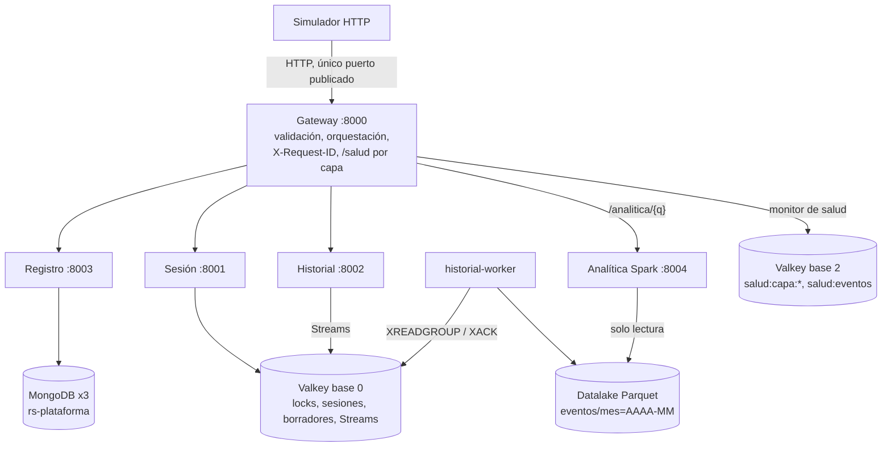

# Informe — Plataforma distribuida de anotación de datos

**Proyecto 2 — TI4601 Bases de Datos Avanzadas.** Instituto Tecnológico de
Costa Rica. Profesor: Manuel Zumbado Corrales.

**Equipo:** Christian Navarro Ellerbrock (2023071460), Emmanuel Calvo Mora
(2023213365) y Jimmy Feng Feng (2023060347).

- **Repositorio:** <https://github.com/Chris-0307/proyecto2_BDA>
- **Fecha de entrega:** 24-11-2026
- **Tecnologías:** FastAPI, MongoDB (3 nodos en réplica), Valkey (AOF),
  Parquet y Apache Spark, desplegados con Docker Compose.
- **Entorno de medición:** todas las pruebas se ejecutaron en una misma
  corrida completa desde cero (`make reset`, 2026-11-25 entre 01:12 y
  03:00 UTC), en Linux WSL2 (kernel 6.6.87.1) con 16 CPU lógicos y
  15,5 GiB de RAM disponibles para Docker 28.3.3 (Compose v2.39.2);
  MongoDB 8.0.38 y Spark 3.5.3 (`maquina.txt`). Cada archivo de evidencia
  registra además la máquina en que se ejecutó.
- **Trazabilidad:** toda cifra de este informe proviene de un archivo de
  `proyecto2/evidence/` (sección 14).

---

## 1. Arquitectura y límites de responsabilidad

El único punto de entrada es el gateway (puerto 8000). Registro, Sesión
e Historial son internos; MongoDB y Valkey no se exponen al host. La
analítica con Spark lee el datalake en modo de solo lectura.



*Arquitectura del sistema, con la ruta `/analitica` del gateway hacia Spark.*

| Componente | Responsabilidad | Tecnología | Responsable |
|---|---|---|---|
| Gateway | Único punto de entrada; valida, orquesta el flujo de una tarea, publica eventos y reporta salud por capa | FastAPI + httpx | Jimmy |
| Registro | Estado vigente de proyectos, lotes y tareas; transiciones atómicas; exportación | FastAPI + MongoDB (3 nodos) | Jimmy |
| Sesión | Locks de 120 s, sesiones, latidos y borradores | FastAPI + Valkey | Christian |
| Historial | Recepción idempotente de eventos y escritura de Parquet | FastAPI + Valkey Streams + Parquet | Christian |
| Analítica | Consultas Q1–Q5 sobre Parquet | Spark | Emmanuel |
| Simulador | Anotadores, revisores y consumidores vía HTTP | Cliente HTTP | Emmanuel |

**Reglas de aislamiento** (`p1_salud_aislamiento.txt`, 54/54):

- Solo el gateway publica puerto al host: en `docker compose ps` únicamente
  `gateway` tiene puerto publicado (8000). Desde el host, 8001, 8002, 8003,
  8004, 27017 y 6379 rechazan la conexión.

- El gateway no tiene `pymongo` (ni en el código, ni en la imagen, ni en las
  variables de entorno): no accede a MongoDB. Usa Valkey solo para los
  mensajes de salud, en su propia base (2) y con llaves `salud:*`; no lee ni
  escribe la base 0 de Sesión e Historial.

- El registro no tiene `redis`: no consulta Valkey.

- Sesión e Historial no tienen `pymongo`: no acceden a MongoDB, y por lo tanto
  Sesión no puede decidir el estado definitivo de una tarea.

- Analítica no tiene `pymongo` ni `redis` y el datalake está montado en solo
  lectura: lee únicamente el lago Parquet.

- El simulador no importa clientes de bases (`pymongo`, `redis`, `pyspark`) ni
  menciona hosts o puertos internos: solo se comunica con el gateway
  (`localhost:8000`).

- **Limitación:** todos los servicios comparten la red de Compose; el
  aislamiento se garantiza por dependencias y configuración, no por
  segmentación de red.

---

## 2. Justificación de motores

- **MongoDB para el registro.** Una tarea es un documento autocontenido
  (referencia al archivo, asignación, anotación, revisión y cola de
  eventos), y la anotación cambia de forma según la modalidad (span,
  bbox, polígono, cuboide 3D). Toda transición modifica un solo
  documento, así que un `findOneAndUpdate` con filtro por estado
  garantiza la asignación exclusiva sin transacciones multidocumento. El
  conjunto de réplicas de tres nodos tolera la caída de uno, y
  `w: majority` impide que una elección revierta una escritura
  confirmada (secciones 5.3 y 12).

- **Valkey para sesiones.** Estado efímero con TTL (`SET NX PX`),
  operaciones atómicas con Lua y persistencia AOF para que el borrador
  sobreviva a un reinicio. No es la fuente de verdad: el estado
  definitivo vive en MongoDB.

- **Parquet + Spark para el historial.** Los eventos son inmutables y se
  consultan por agregación (OLAP), lo que favorece un formato columnar
  particionado por mes en lugar de consultar el registro operacional.

- **Spark para la analítica.** El servicio `analitica` lee solo los
  `*.parquet` publicados en `datalake/eventos/mes=AAAA-MM/` (montaje
  `ro`), sin consultar MongoDB ni Historial. Como el consumo es *al
  menos una vez*, ejecuta `dropDuplicates(["event_id"])` antes de
  Q1–Q5. Levantar la JVM y planificar la lectura de todos los meses
  publicados tiene un costo inicial alto (19,9 s en la primera Q1, sección 9);
  compensa con volúmenes históricos grandes (de cientos de miles a
  millones de eventos), pero no es adecuado para consultas puntuales de
  baja latencia.

---

## 3. API REST y contratos

La documentación completa de rutas, cuerpos y códigos está en
`endpoints/README.md`. Decisiones del gateway:

- **Reintentos seguros.** Solo los `GET` se reintentan una vez ante
  error de conexión o timeout. `POST` y `PUT` nunca se reintentan:
  repetir podría duplicar un proyecto, un lote o una transición, y el
  enunciado pide 503 sin reintento.

- **Errores.** Un servicio interno que no responde se traduce a 503; los
  códigos 403, 404, 409 y 422 de los servicios internos se propagan tal
  cual.

- **Identificadores.** `X-Request-ID` se propaga a los servicios
  internos y se devuelve al cliente.

- **Salud por capa con mensajes en Valkey.** Un monitor del gateway
  consulta cada 5 s el `/salud` de Registro, Sesión, Historial y Analítica y
  publica el estado en `salud:capa:{capa}` (expira a los 15 s, de modo que un
  monitor detenido no deja estado viejo) y en el stream `salud:eventos` (cada
  cambio, como `capa:antes->ahora`). `GET /salud` lee esos mensajes
  (`fuente: valkey`); si Valkey no responde, consulta cada capa directamente
  (`fuente: directo`). El gateway siempre responde. El gateway publica por las
  capas porque el reporte de salud es su responsabilidad y el registro no
  puede escribir en Valkey; usa una base propia (2) para no mezclar datos con
  Sesión e Historial. Estado global: `caido` (503) si el registro no está
  disponible; `degradado` (200) si alguna otra capa falla o MongoDB perdió un
  nodo; `operativo` (200) si todas responden. *Costo:* el estado puede tener
  hasta 5 s de atraso.

- **Ruta de analítica.** `GET /analitica/{q1..q5}?conjunto=principal|grande`
  reenvía la consulta a `analitica:8004/q/{q}`. Una consulta de Spark tarda
  de 3 a 20 s sin carga (sección 9) y bastante más si hay otras en cola,
  así que el gateway espera hasta 120 s y **no reintenta**: repetirla duplicaría el costo. Una consulta desconocida
  responde 404, un `conjunto` inválido 422 y Analítica sin respuesta 503. En
  P6, el simulador registró como `timeout` (código 504 en su propio registro)
  las solicitudes que no recibieron respuesta dentro de su timeout de cliente
  de 120 s; no es una respuesta del gateway ni de Analítica.

Resultados de salud (`p1_salud_aislamiento.txt`, 54/54):

| Servicio detenido | `/salud` | Reflejado en | Además |
|---|---|---|---|
| Sesión | 200 `degradado`, solo `sesion` caída | 3,0 s | Cambio en `salud:eventos`; `exportar` responde; guardar borrador da 503 |
| Historial | 200 `degradado`, solo `historial` caída | 5,0 s | Cambio en `salud:eventos`; `exportar` responde |
| Analítica | 200 `degradado`, solo `analitica` caída | 6,0 s | Cambio en `salud:eventos`; `exportar` responde |
| Registro | 503 `caido` | 5,0 s | Cambio en `salud:eventos`; `exportar` da 503 |
| Valkey | 200 `degradado`, `fuente: directo`; Sesión e Historial caídos | 16,4 s | Al volver Valkey: `fuente: valkey` y `operativo` |

En todos los casos `/salud` vuelve a `operativo` al arrancar el servicio.
Los tiempos de 3–6 s dependen de en qué momento del intervalo del monitor
(5 s) se detuvo el servicio; el caso de Valkey tardó 16,4 s y no se midió el
desglose de ese tiempo.

**`/salud` de Analítica tras P6.** En el primer intento de P1, ejecutado
justo después de P6, `/salud` informó `analitica: caido` sin que el
servicio estuviera detenido: Spark seguía procesando la cola de consultas
`/analitica` que dejó P6, y el `/salud` de Analítica (una función
síncrona) esperaba un hilo libre detrás de ellas. Se cambió a `async` para
que responda en el event loop sin esperar a las consultas; tras
reconstruir el servicio, P1 dio 54/54.

**Resultados funcionales:** rutas básicas 14/14 (`p1_gateway_smoke.txt`)
y flujo completo 26/26 (`p1_gateway_flujo.txt`), que incluye que los
cinco tipos de evento pasan la validación de Historial y que ningún
evento queda pendiente.

**Contrato de eventos.** El registro arma cada evento dentro de la
transición y el gateway lo publica sin modificarlo; Historial lo valida
con un esquema estricto (`extra=forbid`). Para la analítica: Q3 lee
`duracion_ms` de `tarea_anotada` (toma->envío); Q5 calcula
toma->aprobación con `tomada_en` y `aprobada_en` de
`revision_aprobada`; Q4 cuenta las filas `rechazada`.

---

## 4. Recorrido completo de una tarea (ejemplo LiDAR)

Ejemplo **ilustrativo**: los cuerpos tienen la forma real de la API,
pero los valores y los ids (abreviados) son de ejemplo. El flujo
completo está verificado en `p1_gateway_flujo.txt` (26/26) con tareas de
imagen; la forma es la misma para LiDAR.

| N.º | Llamada | Qué ocurre |
|---|---|---|
| 1 | `POST /proyectos` | El registro valida que el cliente exista (404 si no) y responde 201. La taxonomía lleva etiqueta e instrucción (p. ej. `lidar#ciclista`). |
| 2 | `POST /proyectos/{id}/lotes` | Se valida que la geometría corresponda a la modalidad (LiDAR solo admite `cuboide_3d`; otra combinación da 422). Las tareas se insertan en `disponible`, versión 1. Solo se guarda la referencia al archivo. |
| 3 | `POST /tareas/siguiente` | Gateway->Registro: candidatas por prioridad. Gateway->Sesión: `SET NX PX 120000` sobre `lock:tarea:{id}` (si está ocupado, prueba la siguiente). Gateway->Registro: `asignar` (`findOneAndUpdate` que exige `disponible` o `abierta` vencida; con 409 suelta el lock y prueba otra). Publica `tarea_abierta`. Responde 200 con `tarea`, `token`, `ttl_ms` y el borrador si existía; 204 si no hay ninguna libre. |
| 4 | `PUT /tareas/{id}/borrador` | Cada 2 s. Sesión guarda el último borrador y renueva el lock; no toca MongoDB ni genera fila en Parquet. Tras una desconexión, `POST /sesiones/recuperar` devuelve el borrador (`activa` si el lock sigue vigente, `requiere_reasignacion` si venció). |
| 5 | `POST /tareas/{id}/enviar` | Latido (el token debe ser el dueño del lock; 409 si no). Registro filtra por estado `abierta` y token: un segundo envío da 409. Si MongoDB no responde, 503 sin reintento y el borrador y el lock siguen en Valkey. Publica `tarea_anotada` (con `duracion_ms`) y suelta el lock. |
| 6 | `POST /tareas/{id}/revision` | `iniciar_revision` (`anotada`->`en_revision`) y `rechazar`. Sin `motivo`: 422; actor que no es revisor: 403. |
| 7 | `siguiente` + `revision` | La tarea rechazada se vuelve a ofrecer; tras el nuevo envío, `aprobar` la deja en `aprobada` y publica `revision_aprobada` (base de Q5). Aprobar otra vez da 409. |
| 8 | `GET /proyectos/{id}/exportar` | Tareas `aprobada` paginadas por `_id`, con cursor `siguiente`. |

Ejemplo del cuerpo del borrador (paso 4) para una tarea LiDAR:

```json
{"anotador_id": "a7...", "proyecto_id": "p3...", "token": "t9...",
 "contenido": {"cuboides": [{"etiqueta": "lidar#ciclista",
   "centro": [12.4, -3.1, 0.9], "dimensiones": [1.8, 0.6, 1.7], "yaw": 0.12}]}}
```

| Paso | Estado en MongoDB | Fila en Parquet |
|---|---|---|
| siguiente | `abierta` (versión 2, `asignacion.token`) | `abierta` |
| enviar | `anotada` | `anotada` |
| inicio de revisión | `en_revision` | `en_revision` |
| rechazo | `disponible` | `rechazada` (con `motivo_rechazo`) |
| aprobación | `aprobada` | `aprobada` |

Liberar una tarea y guardar borradores no generan filas.

---

## 5. Registro operacional: modelo, índices y concurrencia

### 5.1 Modelo e índices

Base `plataforma`, colecciones `clientes`, `proyectos`, `batches`,
`tareas` y `anotadores`, con identificadores UUID. Documento de una
tarea:

```json
{"_id": "uuid", "proyecto_id": "uuid", "batch_id": "uuid", "cliente_id": "uuid",
 "modalidad": "lidar", "tipo_tarea": "cuboide_3d", "prioridad": 5,
 "archivo": {"uri": "...", "sha256": "...", "bytes": 0, "mime": "...", "meta": {}},
 "estado": "disponible", "version": 1, "sla_horas": 48,
 "asignacion": {"anotador_id": "...", "equipo_id": "...", "token": "...",
                "tomada_en": "...", "vence_en": "..."},
 "anotacion": {"contenido": {}, "enviada_en": "..."},
 "revision": {"revisor_id": "...", "iniciada_en": "...", "resultado": "...",
              "motivo": "...", "revisada_en": "..."},
 "ultimo_evento_id": "uuid", "eventos_pendientes": [], "creado_en": "..."}
```

**Estados y transiciones.** `disponible`, `abierta`, `anotada`,
`en_revision`, `aprobada`. Cada transición es **un único**
`findOneAndUpdate` cuyo filtro exige el estado de origen (y el token o
el revisor cuando corresponde); si no coincide, no se modifica nada y se
responde 409. No hay lectura previa seguida de escritura, y la versión
sube en cada transición válida.

**Evento en la misma operación (*outbox*).** La actualización es un
pipeline de agregación: en la misma escritura atómica cambia el estado,
sube la versión y construye el evento, que queda en
`eventos_pendientes`. Así no se pierde el evento si el proceso cae entre
la escritura y la publicación. El gateway lo publica y lo confirma; si
Historial falla, un reconciliador del gateway reenvía los pendientes
cada 10 s, y Historial deduplica por `event_id`.

**Índices** (`p2_replica.txt` lista los cuatro creados; son los mínimos
del enunciado):

| Índice | Campos | Consulta que lo usa |
|---|---|---|
| `tareas_proyecto_estado_prioridad` | `proyecto_id, estado, prioridad:-1` | Candidatas de `/tareas/siguiente`. Regla ESR: igualdad antes que orden, así el orden sale del índice sin ordenar en memoria |
| `tareas_anotador_estado` | `asignacion.anotador_id, estado` | Tareas de un anotador |
| `tareas_batch` | `batch_id` | Tareas de un lote |
| `proyectos_cliente_estado` | `cliente_id, estado` | Proyectos de un cliente por estado |

Las transiciones buscan por `_id`, que ya tiene índice. La exportación
filtra por `proyecto_id` y `estado = aprobada` y ordena por `_id`:
aprovecha el prefijo del primer índice, aunque el orden por `_id` no
sale de él.

**Planes de ejecución (`explain`).** Planes con `executionStats` sobre el
dataset recién cargado (`p2_explain_registro.txt`, 10/10; MongoDB 8.0.38,
60.000 tareas, 120 proyectos y 300 anotadores, sin datos de otras
pruebas):

| Consulta | Índice usado | Etapas | Ordenamiento en memoria | Devueltos | Claves examinadas | Docs examinados |
|---|---|---|---|---|---|---|
| Candidatas disponibles (`/tareas/siguiente`) | `tareas_proyecto_estado_prioridad` | LIMIT -> FETCH -> IXSCAN | No | 20 | 20 | 20 |
| Candidatas abiertas vencidas | `tareas_proyecto_estado_prioridad` | LIMIT -> FETCH -> IXSCAN | No | 0 | 0 | 0 |
| Tareas de un anotador | `tareas_anotador_estado` | FETCH -> IXSCAN | No | 0 | 0 | 0 |
| Tareas de un lote | `tareas_batch` | FETCH -> IXSCAN | No | 100 | 100 | 100 |
| Exportar aprobadas (orden por `_id`) | `tareas_proyecto_estado_prioridad` | SORT -> FETCH -> IXSCAN | Sí | 0 | 0 | 0 |
| Proyectos de un cliente | `proyectos_cliente_estado` | FETCH -> IXSCAN | No | 2 | 2 | 2 |
| Transición por `_id` + estado | `_id_` | FETCH -> IXSCAN | No | 1 | 1 | 1 |

Todas las consultas reportaron 0 ms de ejecución en el servidor.

- Todas las consultas usan un índice (`IXSCAN`); ninguna recorre la colección
  completa.
- En las consultas que devolvieron documentos, las claves y los documentos
  examinados coinciden con los devueltos: el índice filtra exactamente lo
  necesario. Las candidatas de `/tareas/siguiente` examinaron 20 documentos
  para devolver 20, y el orden por prioridad sale del índice (regla ESR), sin
  ordenamiento en memoria.
- Las consultas de abiertas vencidas, de tareas de un anotador y de
  exportación devolvieron 0 documentos (recién cargado no hay tareas
  abiertas ni aprobadas en el registro); aun así el plan elegido usa el
  índice previsto.
- La exportación usa el prefijo `proyecto_id, estado` de
  `tareas_proyecto_estado_prioridad`, pero ordena por `_id` en memoria.
  Recién cargado el costo es nulo; con muchas aprobadas por proyecto, ese
  ordenamiento crece con el número de aprobadas. En P6 el p50 de `exportar`
  fue de ~6 ms con 10 usuarios y de 413–772 ms con 40 y 100 (sección 11);
  ahí pesa sobre todo la concurrencia, y la parte que corresponde a este
  ordenamiento no se aisló. Un índice
  `(proyecto_id, estado, _id)` lo evitaría, pero no se creó porque el
  enunciado exige justificar cada índice adicional con una medición, y no hay
  una medición con volumen de aprobadas que lo respalde.

### 5.2 Prueba de que no hay doble adquisición

**Mecanismo en dos capas.** El lock de Valkey (`SET NX PX`) evita que
dos peticiones trabajen la misma tarea a la vez. La garantía final es el
`findOneAndUpdate` filtrado por estado en MongoDB: aunque dos peticiones
llegaran juntas al registro, solo una encuentra la tarea en
`disponible`.

**A nivel de registro** (`p2_registro_smoke.txt`, 30/30): 50 intentos
simultáneos de asignar **la misma tarea** dieron exactamente 1 respuesta
200 y 49 respuestas 409. La tarea quedó `abierta`, versión 2, con el
token del ganador; un segundo envío responde 409.

**A nivel de gateway, 50 contra 10** (`p2_concurrencia_gateway.txt`,
9/9): 50 anotadores piden `/tareas/siguiente` a la vez sobre un proyecto
con 10 tareas.

| Resultado | Valor |
|---|---|
| Respuestas 200 / 204 / otros | 10 (todas con tareas distintas) / 40 / 0 |
| En MongoDB | 10 tareas `abierta`, cada una con un dueño distinto, todas en versión 2 (una sola asignación) y con el mismo dueño que recibió el 200 |
| Latencia de `/tareas/siguiente` (n = 50) | p50 1.262,8 ms; p95 1.294,5 ms; p99 1.299,5 ms; máx. 1.299,5 ms |
| Duración de la ráfaga | 1.308,7 ms |

**Cero dobles asignaciones** en ambas pruebas. La latencia es alta bajo
contención; no se midió el desglose, y la hipótesis es que cada petición
sin tarea recorre hasta 10 candidatas con una llamada HTTP a Sesión por
cada una. Es un candidato a optimizar (ver
sección 11).

### 5.3 Diferencia observada entre `w:1` y `w:majority`

Medición con el driver, sin gateway, de las dos escrituras del registro
(`p2_write_concern.txt`): 500 operaciones por hilo y repetición, 3
repeticiones en orden alternado, con 1 y 8 hilos.

| Hilos | Operación | p50 `w:1` | p50 `majority` | Relación | ops/s `w:1` | ops/s `majority` |
|---|---|---|---|---|---|---|
| 1 | `insert_one` | 0,49 ms | 2,78 ms | ×5,66 | 1.605 | 331 |
| 1 | `find_one_and_update` | 0,68 ms | 3,00 ms | ×4,42 | 1.605 | 331 |
| 8 | `insert_one` | 3,55 ms | 6,45 ms | ×1,82 | 2.029 | 918 |
| 8 | `find_one_and_update` | 3,71 ms | 6,62 ms | ×1,79 | 2.029 | 918 |

- Con un hilo, `w:majority` espera a que un secundario aplique la
  escritura: la latencia se multiplica entre 4,4 y 5,7 veces y el
  rendimiento cae de 1.605 a 331 ops/s (−79 %). Con 8 hilos las esperas
  se solapan y la diferencia de la mediana baja a ×1,8 (2.029 frente a
  918 ops/s, −55 %).

- Con 8 hilos y `w:majority` el p99 sube a 96–101 ms (frente a 9 ms con
  `w:1`) y el rendimiento varió entre repeticiones (630 a 1.206 ops/s):
  hay pausas ocasionales esperando la confirmación de la mayoría, que no
  se aislaron.

- **Limitación:** los tres nodos corren en la misma máquina, así que la
  replicación no paga latencia de red real; estas cifras no permiten
  inferir el comportamiento de un clúster en varias máquinas.

- **Garantía:** `w:1` confirma una escritura que aún no está en la
  mayoría y que puede perderse en un rollback tras una elección. En el
  caso C de la sección 12.1 una escritura quedó aplicada en un primario
  aislado sin llegar a la mayoría: con `w:majority` el cliente recibió
  503; con `w:1` habría recibido 200 por una escritura no replicada
  (esto último no se midió con `w:1`).

Se mantiene `w:majority`: el costo medido es de milisegundos y la
garantía es que ninguna escritura confirmada se pierde (RPO 0).

---

## 6. Sesión, recuperación del borrador y reinicio de Valkey

**Diseño.**

- La fuente de verdad de la tarea es MongoDB. Valkey solo conserva
  sesiones temporales y borradores, sin modificar el estado definitivo.

- Scripts Lua adquieren, renuevan, liberan y validan los locks sin
  intercalar operaciones concurrentes; el token impide liberar un lock
  ajeno.

- Llaves: `lock:tarea:{id}` (`SET NX PX`, 120 s, se renueva con el
  latido y con cada borrador), `sesion:{anotador}` (tarea, proyecto,
  etapa y token), `borrador:{tarea}` (último borrador, sin TTL para
  poder recuperarlo) y `editando:{proyecto}` (sesiones activas). Los
  borradores no generan eventos.

- Si el lock venció, la recuperación devuelve el borrador en solo
  lectura y `requiere_reasignacion`; la decisión de reasignar la toma el
  registro a través del gateway (`/tareas/siguiente` vuelve a ofrecer la
  tarea y devuelve el borrador al mismo anotador).

- Persistencia: AOF con `appendonly yes` y `appendfsync everysec`.

**Qué pasa al reiniciar Valkey.** La prueba P3 se ejecutó sobre el
Compose final, utilizando el gateway como punto de entrada. Se verificó
la configuración de AOF con `appendonly yes` y `appendfsync everysec`.

Después de guardar tres borradores con intervalos de dos segundos, se
reinició el contenedor de Valkey conservando su volumen persistente. La
recuperación mediante el gateway respondió HTTP 200 en 0,537 s desde el
inicio del reinicio, conservando el contenido y la versión del último
borrador, así como el lock activo.

La prueba obtuvo 29/29 comprobaciones correctas. La evidencia se
encuentra en `p3_gateway_sesion.txt`.

**Resultados de P3** (criterios del enunciado):

| Criterio | Resultado | Evidencia |
|---|---|---|
| El borrador recuperado tiene como máximo 5 s de antigüedad | 2,013 s | `p3_gateway_sesion.txt` |
| Tras reiniciar Valkey, el borrador sigue | Contenido y versión conservados. Recuperación en 0,537 s | `p3_gateway_sesion.txt` |
| Un lock vencido devuelve la tarea a la cola | Reasignación exitosa tras esperar 122 s sin actividad | `p3_gateway_sesion.txt` |
| Ninguna tarea queda con dos dueños | Un único propietario vigente en MongoDB. El token anterior responde HTTP 409 | `p3_gateway_sesion.txt` |

Una vez vencido el lock, el anotador original pudo recuperar su borrador
en modo de solo lectura, pero no modificarlo. Un segundo anotador
adquirió la misma tarea con un token diferente, sin recibir el borrador
del propietario anterior.

MongoDB confirmó un único propietario vigente. Los intentos de guardar,
enviar y recuperar la sesión utilizando el token anterior respondieron
HTTP 409 después de la reasignación.

Finalmente, se liberó la tarea de prueba mediante el gateway, obteniendo
HTTP 200.

---

## 7. Datalake Parquet

**Diseño.**

- El gateway publica cada evento en `POST /eventos` solo después de que
  MongoDB confirmó la transición. Historial lo encola en Valkey Streams
  de forma idempotente por `event_id` (202 nuevo, 200 repetido, 409 si
  el mismo `event_id` llega con otro contenido).

- Un worker independiente lee el grupo `historial-parquet` y escribe
  cada micro-lote primero en `.staging`; luego lo sincroniza y lo
  publica con `os.replace` dentro del mismo volumen. Solo después
  confirma con `XACK`.

- Partición mensual por `ocurrido_en` en UTC: `eventos/mes=AAAA-MM/`.

- Si un worker muere antes del `XACK`, el mensaje queda pendiente y otro
  lo reclama con `XAUTOCLAIM`; repetir el mismo micro-lote produce el
  mismo nombre de archivo.

- **Archivos a medias:** Spark solo lee `*.parquet` publicados (los
  temporales viven en `.staging/`); la publicación es atómica por
  archivo.

- **Duplicados:** el consumo es *al menos una vez*, así que dos
  micro-lotes solapados pueden contener el mismo `event_id`; Spark
  aplica `dropDuplicates(["event_id"])` antes de Q1–Q5.

- **Fila rechazada:** un rechazo deja la tarea en `disponible` en
  MongoDB y una fila `rechazada` en Parquet; Q4 cuenta esas filas.

**Compactación.**

Cada micro-lote es un archivo, así que la escritura continua genera
muchos archivos Parquet pequeños y cada consulta Spark tiene que abrirlos
todos. Se implementó como operación manual de mantenimiento
(`make compactar`, `mantenimiento/compactar_parquet.py`), siguiendo el
procedimiento de diseño:

1.  Detener `historial-worker`. Los eventos nuevos esperan en Valkey
    Streams y se escriben al reanudarlo; el gateway y la API de
    Historial siguen funcionando.

2.  En cada partición mensual con 20 o más micro-lotes, leer los
    archivos publicados (no los del generador, `gen-*`), deduplicar por
    `event_id` y ordenar por `ocurrido_en`.

3.  Escribir un solo archivo en `.staging/`, sincronizarlo y publicarlo
    con `os.replace` en la partición.

4.  Verificar que el archivo publicado tiene exactamente los `event_id`
    únicos leídos; si no, se borra y se conservan los originales.

5.  Mover los originales a `datalake/respaldo_compactacion/<fecha>/`,
    fuera del patrón que lee Spark (no se borran).

6.  Reanudar el worker.

Resultados (`compactacion_parquet.txt`):

| Momento | Partición | Archivos | Filas = `event_id` únicos | Tamaño | Duración |
|---|---|---|---|---|---|
| Tras P3 y P4 (02:29 UTC) | `mes=2026-11` | 1.680 -> 1 | 2.601 | 11,2 MB -> 0,17 MB | 23,2 s |
| Tras P6 (02:56 UTC) | `mes=2026-11` | 8.288 -> 1 | 28.553 | 60,5 MB -> 1,8 MB | 234,6 s |

No hubo duplicados que quitar (el worker no reprocesó lotes en esta
corrida). El efecto sobre las consultas es grande: con los 1.680
micro-lotes, el primer intento de la prueba de frescura hasta Q1 no
obtuvo respuesta de `GET /analitica/q1` en 120 s (el gateway devolvió
503); tras compactar, Q1 tardó 10,5–11,9 s. En P6, con 10 usuarios, las
consultas de Analítica tardaron 5,0 s, 12,3 s y 17,6 s (p50) en las tres
repeticiones a medida que P6 agregaba micro-lotes (sección 11). Parte
del costo de abrir cada archivo se debe a que el repositorio está en el
disco de Windows (`/mnt/c`) y Docker lo monta a través de WSL2; no se
midió por separado.

La compactación no es automática: se ejecuta a mano y entre pruebas.

**Resultados de P4** (criterios del enunciado):

| Criterio | Resultado | Evidencia |
|---|---|---|
| Archivos Parquet válidos, sin lectura a medias | Spark leyó correctamente mientras existía un archivo temporal incompleto. | `p4_gateway_parquet.txt` |
| Reproceso de un micro-lote y deduplicación por `event_id` | Un mensaje recuperado, cero pendientes y ningún archivo adicional. Tres filas físicas se redujeron a dos eventos únicos. | `p4_gateway_parquet.txt` |
| El historial se materializa en el datalake | Ocho eventos de negocio correspondientes al ciclo completo de una tarea con retrabajo. | `p4_gateway_parquet.txt` |
| Frescura: segundos entre un HTTP 200 y el evento visible en Spark | Envíos: p50 9,134 s; p95 10,080 s; p99 10,080 s (n=2). Los cuatro eventos: 9,1–10,1 s. | `p4_gateway_parquet.txt` |

La prueba P4 obtuvo 27/27 comprobaciones correctas sobre el Compose
final. Se simuló una falla después de publicar un micro-lote y antes de
ejecutar `XACK`. El mensaje permaneció pendiente hasta que fue
recuperado mediante `XAUTOCLAIM`, sin generar un archivo adicional.

También se comprobó que Spark no intenta leer archivos temporales
durante la escritura. Al publicar dos micro-lotes solapados, las tres
filas físicas se redujeron a dos eventos únicos mediante la
deduplicación por `event_id`.

En el flujo completo de una tarea, MongoDB registró el rechazo como
`disponible`, mientras que Parquet conservó el estado `rechazada`. Los
borradores y los envíos duplicados que respondieron HTTP 409 no
generaron eventos adicionales.

**Mediciones de frescura.**

| Evento | Tiempo (s) | Intentos |
|---|---|---|
| Primer envío | 10,080 | 1 |
| Rechazo | 9,362 | 1 |
| Segundo envío | 9,134 | 1 |
| Aprobación | 9,659 | 1 |

Las mediciones se realizaron con Spark 3.5.3, `local[1]` y la JVM
precalentada, usando el mismo lector que Analítica
(`df_eventos_limpios`) sobre `/datalake/eventos`. El tiempo corresponde
al intervalo entre la respuesta HTTP 200 y la primera observación del
evento en Spark, incluyendo el costo de lectura, sondeo y transporte.

Los cuatro eventos se vieron en el **primer** sondeo, así que el evento
ya estaba publicado cuando Spark terminó de leer: la cifra mide sobre
todo el costo de una lectura completa. Cada sondeo leyó 81 a 86 archivos
(los 60 del dataset y los de las pruebas) y deduplicó ~830.000 eventos,
del mismo orden que una consulta de P5 con `w=1` (6–12 s). Una corrida
anterior, con un datalake mucho menor, observó 1,9–2,6 s, lo que es
consistente con esta explicación, aunque no se aisló la demora propia
del worker.

Debido al reducido número de muestras, los resultados son funcionales y
no representan una prueba de rendimiento bajo carga.

**Frescura hasta Q1** (`p5_frescura_q1.txt`, `make p5-frescura`, 7/7,
después de compactar). Por el gateway: se envía una tarea de imagen, se
lee el conteo de Q1 para (2026-11-25, imagen), se aprueba y se repite
`GET /analitica/q1` hasta que el conteo sube en 1.

| Muestra | Conteo de Q1 | Frescura (s) | Consultas Q1 hasta verlo |
|---|---|---|---|
| 1 | 143 -> 144 | 11,40 | 1 |
| 2 | 144 -> 145 | 11,23 | 1 |
| 3 | 145 -> 146 | 11,27 | 1 |
| 4 | 146 -> 147 | 11,34 | 1 |
| 5 | 147 -> 148 | 11,59 | 1 |

p50 11,34 s, p95 y p99 11,59 s (n = 5). En las cinco muestras la primera
Q1 lanzada justo después del HTTP 200 ya contó la aprobación, y el conteo
subió exactamente en 1: el evento llegó al Parquet antes de que Spark
listara los archivos. La frescura hasta Q1 es, por lo tanto, la duración
de una Q1 (10,5–11,9 s con un trabajador de Spark); la demora propia del
camino gateway -> Historial -> worker -> Parquet es menor que eso y no se
pudo separar con esta resolución.

---

## 8. Datos de prueba

*Responsable: Emmanuel.*

Generador reproducible en `proyecto2/dataset/generar_dataset.py`, con
semilla fija (`20261122`, `random.Random`). Todos los identificadores se
derivan de la semilla con `uuid5`, así que el mismo cliente, proyecto,
equipo y tarea tiene el mismo id en MongoDB y en los eventos Parquet.
Carga MongoDB (base `plataforma`) con `pymongo`, vaciando antes las
colecciones del registro para que la carga sea repetible, y materializa
Parquet mensual en `datalake/eventos/mes=AAAA-MM/` con el esquema de
`servicios/historial/app/parquet_writer.py` (publicación vía `.staging`
y `os.replace`, archivos `gen-20261122-AAAA-MM-pNNN.parquet`). Respeta
el documento de tarea de la sección 5.1 (incluidas las geometrías
válidas por modalidad) y el esquema estricto de eventos.

**Realismo del historial.** Cada tarea histórica sigue el flujo real:
`tarea_abierta` -> `tarea_anotada` -> `revision_iniciada` -> (`revision_rechazada`
-> retrabajo)\* -> `revision_aprobada`, con hasta 4 rechazos, versión
creciente y `tomada_en` igual a la toma de la ronda vigente. Cada
proyecto tiene su propia probabilidad de rechazo (0,35–0,70), su cola de
revisión (2–60 h) y un SLA de 24, 48 o 72 h, por lo que Q4 y Q5
muestran diferencias reales entre clientes y proyectos. La carga
publicó 830.256 eventos de 100.000 tareas y 180 proyectos en 60 archivos
Parquet (`mes=2025-11` a `mes=2026-10`); en una simulación local con la
misma semilla, ~8,6 % de las tareas quedó fuera de SLA y el rechazo por
proyecto quedó entre 0,33 y 0,65.

| Entidad | Volumen del enunciado | Generado |
|---|---|---|
| Clientes | 60 | 60 |
| Proyectos | 180: 120 en el registro y 60 cerrados solo en el historial | 180 (120 activos en MongoDB y 60 cerrados solo en Parquet) |
| Batches | 600 | 600 |
| Tareas del registro | 60.000: 30 % texto, 30 % imagen, 20 % video, 20 % LiDAR | 60.000: 18.065 texto, 18.038 imagen, 11.932 video, 11.965 LiDAR |
| Anotadores | 300 en 30 equipos; 10 % revisores | 300 en 30 equipos, 30 revisores (10 %) |
| Eventos históricos | ~800.000 en doce meses y 100.000 tareas | 830.256 eventos de 100.000 tareas en 12 meses (`mes=2025-11` a `mes=2026-10`), 60 archivos Parquet |
| `eventos_grande` (opcional) | Hasta ~10 millones de filas | No generado (medición no disponible) |

Los conteos de la tabla son los que el generador reportó al insertar en
MongoDB y al publicar Parquet (`datos_generacion.txt`, 2026-11-25
01:34:15 UTC; la generación es determinista, así que las cargas
anteriores dieron los mismos conteos).

**Comandos de carga:**

```bash
make datos
# Equivale a:
# MongoDB
docker compose -f proyecto2/docker-compose.yml run --rm registro python /dataset/generar_dataset.py --solo mongo
# Datalake Parquet (en historial-worker: tiene el esquema del worker y el datalake con escritura)
docker compose -f proyecto2/docker-compose.yml run --rm -v "$(pwd)/proyecto2/dataset:/dataset:ro" historial-worker \
  python /dataset/generar_dataset.py --solo parquet --dir-eventos /datalake/eventos
```

**Regeneraciones.** Con la semilla fija cada carga produce exactamente
los mismos datos. En la corrida final el dataset se cargó tres veces:

| Fecha (UTC) | Motivo | Efecto sobre la comparabilidad |
|---|---|---|
| 2026-11-25 ~01:14 | Carga inicial tras `make reset` (volúmenes vacíos), antes de P5 y de los planes `explain` del registro | P5 y `p2_explain_registro.txt` se midieron sobre el dataset puro |
| 2026-11-25 01:34 | Recarga para un primer P6 con un solo proyecto | Ese P6 agotó las 500 tareas del proyecto en el nivel de 40 usuarios; se descartó y su evidencia se reemplazó |
| 2026-11-25 02:32 | Recarga para el P6 final, repartido entre 100 proyectos | P6 parte del mismo estado que la carga inicial (50.000 tareas disponibles en los 100 proyectos); los eventos de las pruebas en `mes=2026-11` se conservan (compactados) |


---

## 9. Analítica con Spark (Q1–Q5)

*Responsable: Emmanuel.*

Servicio interno `analitica` (`servicios/analitica/`, puerto interno
8004, sin exposición al host) implementado con FastAPI + PySpark
(`local[N]`), montando `./datalake` en solo lectura (`ro`) y filtrando
exclusivamente los `*.parquet` publicados (`mes=*/*.parquet`),
ignorando `.staging/`. Todas las consultas parten de
`dropDuplicates(["event_id"])` sobre todo el conjunto, sin filtro fijo
de año, y la sesión Spark usa zona horaria UTC. `conjunto=grande` lee
`datalake/eventos_grande`; si no existe responde 404. El gateway
expone la ruta `GET /analitica/{q}` (timeout de 120 s y sin reintento)
que reenvía a este servicio.

| Consulta | Pregunta de negocio (enunciado) | Definición / implementación | Filas (`p5_analitica.txt`) |
|---|---|---|---|
| Q1 | Tareas aprobadas por día y modalidad, últimos 90 días | `revision_aprobada` en los 90 días anteriores al último `ocurrido_en` del conjunto; `countDistinct(tarea_id)` por día (`to_date(ocurrido_en)`) y `modalidad` | 359 |
| Q2 | Aprobadas / revisadas, por equipo y mes | `revision_aprobada` + `revision_rechazada` por `equipo_id` y mes (`yyyy-MM`); `aprobadas / revisadas` | 360 |
| Q3 | Duración media y p95, por modalidad y tipo de tarea | `tarea_anotada` con `duracion_ms`; `avg` y `percentile_approx(0.95)` por `modalidad` y `tipo_tarea` | 5 |
| Q4 | Rechazadas / revisadas, por cliente y proyecto | `revision_aprobada` + `revision_rechazada` por `cliente_id` y `proyecto_id`; `rechazadas / revisadas` | 180 |
| Q5 | Toma -> aprobación: p50 y p95 por cliente y % fuera de SLA | `revision_aprobada`; horas = `aprobada_en` − `tomada_en`; p50, p95 y % con horas > `sla_horas`, por `cliente_id` | 60 |

**Validación.** `pruebas/p5_analitica/validar_consultas.py` ejecuta las
mismas funciones de `app/consultas.py` sobre un micro-dataset de 10
filas con un `event_id` duplicado y compara contra valores calculados a
mano: deduplicación 10 -> 9 y resultados esperados de Q1–Q5 (ventana de
90 días, proporciones, media y p95, percentiles y % fuera de SLA).
Evidencia: `p5_validacion_consultas.txt` (`make p5-validar`), 6/6.

Sobre el conjunto principal las filas coinciden con lo esperado para
cada agrupación: Q2 da 360 = 30 equipos × 12 meses; Q3 da 5, una por
combinación de modalidad y tipo de tarea; Q4 da 180, una por proyecto;
Q5 da 60, una por cliente; y Q1 da 359 de un máximo de 364 (91 días
tocados por la ventana × 4 modalidades).

Versiones anteriores de Q1–Q3 no respondían el enunciado (Q1 agrupaba
por mes y tipo de evento, Q2 y Q3 por otras claves) y el conjunto
principal se limitaba con un filtro fijo a 2025; se reescribieron en
`app/consultas.py`. Los tiempos y planes de esta sección se midieron
con el código y el dataset corregidos.

**Planes de ejecución (`explain`) de Q1 y Q3** (`p5_analitica.txt`,
`plan_explain` con `w=1`):

- **Lectura:** `Scan parquet` sobre los 60 archivos
  (`InMemoryFileIndex`), leyendo solo las columnas que usa cada consulta
  (5 de 20 en Q1 y Q3). No hay `PushedFilters` ni `PartitionFilters`: el
  filtro va después de la deduplicación y la lectura con
  `mes=*/*.parquet` no expone `mes` como columna, así que se leen todas
  las filas.

- **Deduplicación por `event_id`:** `Sort` + `SortAggregate` parcial,
  `Exchange hashpartitioning(event_id, N)`, `Sort` + `SortAggregate`
  final (con `first(...)` por columna). Es la parte común a las cinco
  consultas.

- **Q1:** `Filter` (`revision_aprobada` y `ocurrido_en > 2026-07-31
  19:38:26`, la ventana de 90 días ya resuelta), `countDistinct` en dos
  fases (`HashAggregate` por día, modalidad y tarea; `Exchange`;
  `HashAggregate` por día y modalidad; `Exchange`; final) y
  `Exchange rangepartitioning` + `Sort` por día y modalidad.

- **Q3:** `Filter` (`tarea_anotada` y `duracion_ms` no nulo),
  `ObjectHashAggregate` parcial con `count`, `avg` y
  `percentile_approx(0.95)`, `Exchange hashpartitioning(modalidad,
  tipo_tarea)`, agregación final y `rangepartitioning` + `Sort`.

**Tiempos** (`p5_analitica.txt`, 60 archivos Parquet, 2026-11-25
01:15:14 a 01:17:54 UTC). Tiempo medido en el cliente, en ms; el del
servidor difiere en menos de 25 ms. P5 mide el servicio `analitica`
directamente, no por el gateway:

| Consulta | `w=1`, 1.ª ejec. | `w=1`, 2.ª ejec. | `w=2`, 1.ª ejec. | `w=2`, 2.ª ejec. | Filas |
|---|---|---|---|---|---|
| Q1 | 19.947,30 | 12.184,95 | 12.707,77 | 6.122,94 | 359 |
| Q2 | 7.324,28 | 6.397,51 | 3.807,42 | 3.855,93 | 360 |
| Q3 | 6.767,46 | 6.326,63 | 4.212,25 | 3.614,07 | 5 |
| Q4 | 6.448,99 | 6.661,15 | 4.008,40 | 3.445,40 | 180 |
| Q5 | 6.652,97 | 6.357,38 | 4.206,72 | 3.666,05 | 60 |

**Primera frente a segunda ejecución.** La diferencia grande está en Q1
(19,95 s frente a 12,18 s con `w=1`; 12,71 s frente a 6,12 s con
`w=2`). Q1 es la primera consulta tras recrear el servicio, así que su
primera ejecución incluye el arranque de la sesión Spark y la primera
lectura de los archivos; no se aisló con una medición aparte. En Q2–Q5
la diferencia es de hasta 0,93 s, o negativa (Q4 con `w=1`, Q2 con
`w=2`), y se toma como ruido de medición.

**Comparativa de 1 frente a 2 trabajadores.** Se recreó `analitica`
con `SPARK_WORKERS=1` y luego con `2`; `/salud` reportó
`spark_workers: 1` y `2` (`local[N]` dentro del mismo contenedor en
WSL2, no un clúster multi-nodo). En las segundas ejecuciones los tiempos
bajan de 6,33–12,18 s (`w=1`) a 3,45–6,12 s (`w=2`), una mejora de
1,66× a 1,99×. Q2–Q5 quedan en un rango estrecho (3,45–3,86 s con
`w=2`) pese a calcular cosas distintas, consistente con que la lectura y
la deduplicación comunes dominen el costo; Q1 cuesta más por el
`countDistinct` en dos fases. Limitaciones: una sola muestra por celda y
`w=1` siempre antes que `w=2`, con la caché del sistema operativo ya
caliente.

El conjunto ampliado `eventos_grande` (~10 millones de filas) no está
generado y se declara **no disponible**.

**Limitaciones de Spark en el entorno utilizado.**

- Ejecución local dentro de un contenedor en WSL2 (`local[1]` y
  `local[2]`), sin distribución multi-nodo real.

- La deduplicación global `dropDuplicates(["event_id"])` exige un
  `Exchange` de todas las filas antes de agregar; es el costo común a
  todas las consultas.

- Los filtros se aplican sobre `ocurrido_en` y no sobre la columna de
  partición `mes`, así que no hay poda de particiones: se leen todos los
  meses publicados.

- El servicio no limita las consultas simultáneas: bajo carga (P6) se
  acumulan en cola, cada una tarda más y las del final superan los 120 s
  del cliente (sección 11).

- El costo crece con el número de archivos, no solo con el de filas: los
  micro-lotes que escribe Historial obligan a compactar periódicamente
  (sección 7).


---

## 10. Pruebas y evidencia experimental

Cada prueba deja un archivo en `evidence/` con fecha y hora UTC,
objetivo, máquina y configuración. Las latencias se reportan como p50,
p95 y p99 con el número de muestras cuando fue posible. Todas las
cifras son de la corrida completa del 2026-11-25 (sección 14).

| Prueba | Criterio del enunciado | Resultado | Secc. |
|---|---|---|---|
| P1. REST y despliegue | Rutas, `/salud` normal, degradado y caído; solo el gateway expuesto; el gateway recibe el tráfico del simulador | Rutas 14/14; flujo 26/26; salud por capa, puertos y aislamiento 54/54; el simulador opera solo contra el gateway (`p6_carga.txt`; código verificado en `p1_salud_aislamiento.txt`) | 3 |
| P2. Registro y concurrencia | 10 asignaciones y 40 sin tarea; ninguna tarea con dos personas; segundo envío 409 | 10×200 y 40×204, cero dobles asignaciones; segundo envío 409; p50 de `/tareas/siguiente` 1,26 s bajo la ráfaga | 5.2 |
| P3. Sesión | Borrador ≤ 5 s; sigue tras reiniciar Valkey; ninguna tarea con dos dueños | 29/29 comprobaciones correctas; borrador de 2,013 s; recuperación tras reinicio en 0,537 s; sin dobles asignaciones observadas | 6 |
| P4. Historial | Materialización Parquet, reprocesamiento, publicación atómica, deduplicación y frescura | 27/27 comprobaciones correctas; 3 filas físicas reducidas a 2 eventos únicos; frescura hasta Spark de 9,1–10,1 s y **hasta Q1** de 11,2–11,6 s (p50 11,34 s, n = 5, 7/7); compactación 8.288 -> 1 archivo | 7 |
| P5. Analítica | Resultados validados, planes de Q1 y Q3, limitaciones | Q1–Q5 validadas contra valores a mano, 6/6; sobre 830.256 eventos (60 archivos), segundas ejecuciones de 6,3–12,2 s con `w=1` y 3,4–6,1 s con `w=2` (1,66×–1,99×); planes `explain` de Q1 y Q3 capturados; conjunto grande no disponible | 9 |
| P6. Carga | p50/p95/p99 por endpoint, envíos por minuto, errores, `docker stats` | 10, 40 y 100 usuarios en 100 proyectos, 30 s de calentamiento y 3 × 90 s por nivel, sin agotar tareas. Envíos/min: 106–115, 406–429 y 681–827. Errores 0 % en las rutas de tareas; `/analitica` (0,3–0,4 % de las solicitudes) supera los 120 s con 40 y 100 usuarios. Con 100 usuarios el gateway usa ~1 CPU completa | 11 |
| P8. Fallas | Con un nodo caído se escribe; sin mayoría no; lo confirmado sigue tras la elección; el borrador sobrevive al reinicio de Valkey | MongoDB 14/14: RTO de escritura 11,2 s tras la caída del primario, RPO 0. Valkey 31/31: RTO de 1,094 s en reinicio ordenado, 12,649 s en parada controlada y 1,155 s en caída abrupta, sin pérdida de versiones de borrador observada | 12 |

---

## 11. Resultados de carga y cuellos de botella (P6)

*Responsable: Emmanuel.*

Prueba ejecutada sobre el gateway (`localhost:8000`) con `make p6`
(`p6_carga.txt`, 2026-11-25 02:33:16 a 02:55:50 UTC), justo después de
recargar el dataset y con Analítica en `SPARK_WORKERS=8`. **10, 40 y 100
usuarios virtuales**, cada nivel con **30 s de calentamiento** y **3
repeticiones de 90 s**, muestreo de `docker stats` cada 15 s. Roles del
simulador: 60 % anotadores (siguiente, borradores, enviar; liberan el
15 %), 20 % revisores (aprueban o rechazan el 25 %) y 20 % consumidores
(exportan en bucle y hacen una consulta `/analitica/{q}` por corrida, que
los bloquea hasta que responde o vence su timeout de 120 s).

Los usuarios se reparten entre **100 proyectos** del dataset (el usuario
`u` trabaja en el proyecto `u % 100`) con 100 anotadores y 30 revisores
distintos: 50.000 tareas disponibles al inicio y 45.087 al final, así que
ningún nivel se quedó sin tareas. Una primera corrida con un solo
proyecto de 500 tareas las agotó en el calentamiento de 40 usuarios y
solo midió respuestas `204`; se descartó. Latencias en ms. Los `504` de
`/analitica` los registra el simulador cuando vence su propio timeout de
120 s; no son respuestas del gateway.

### 11.1 Nivel de 10 usuarios

| Rep. | Endpoint | n | Prom. | p50 | p95 | p99 | Códigos |
|---|---|---|---|---|---|---|---|
| 1 | `POST /tareas/siguiente` | 195 | 48,65 | 30,20 | 200,54 | 297,05 | `200`: 195 |
| 1 | `PUT /tareas/{id}/borrador` | 285 | 8,49 | 6,76 | 14,53 | 33,80 | `200`: 285 |
| 1 | `POST /tareas/{id}/enviar` | 159 | 48,89 | 25,92 | 71,01 | 733,62 | `200`: 159 |
| 1 | `POST /tareas/{id}/revision` | 150 | 51,25 | 36,20 | 96,97 | 388,08 | `200`: 150 |
| 1 | `POST /tareas/{id}/liberar` | 36 | 30,70 | 12,07 | 33,04 | 631,58 | `200`: 36 |
| 1 | `GET /proyectos/{id}/exportar` | 333 | 8,21 | 6,15 | 13,79 | 21,02 | `200`: 333 |
| 1 | `GET /analitica/{q}` | 2 | 5.582,06 | 5.015,11 | 6.149,01 | 6.149,01 | `200`: 2 |
| 2 | `POST /tareas/siguiente` | 199 | 42,31 | 33,32 | 65,60 | 215,43 | `200`: 199 |
| 2 | `PUT /tareas/{id}/borrador` | 288 | 8,02 | 6,66 | 14,97 | 18,69 | `200`: 288 |
| 2 | `POST /tareas/{id}/enviar` | 172 | 30,61 | 27,78 | 50,89 | 56,58 | `200`: 172 |
| 2 | `POST /tareas/{id}/revision` | 160 | 39,14 | 36,07 | 59,86 | 64,59 | `200`: 160 |
| 2 | `POST /tareas/{id}/liberar` | 27 | 13,80 | 12,39 | 21,88 | 25,35 | `200`: 27 |
| 2 | `GET /proyectos/{id}/exportar` | 306 | 8,43 | 6,15 | 14,18 | 20,00 | `200`: 306 |
| 2 | `GET /analitica/{q}` | 2 | 12.368,52 | 12.326,10 | 12.410,94 | 12.410,94 | `200`: 2 |
| 3 | `POST /tareas/siguiente` | 191 | 39,39 | 32,96 | 68,98 | 150,05 | `200`: 191 |
| 3 | `PUT /tareas/{id}/borrador` | 288 | 8,71 | 7,60 | 15,18 | 22,27 | `200`: 288 |
| 3 | `POST /tareas/{id}/enviar` | 167 | 31,38 | 27,88 | 54,35 | 81,75 | `200`: 167 |
| 3 | `POST /tareas/{id}/revision` | 156 | 39,02 | 36,63 | 56,43 | 66,41 | `200`: 156 |
| 3 | `POST /tareas/{id}/liberar` | 24 | 13,98 | 12,17 | 24,43 | 28,73 | `200`: 24 |
| 3 | `GET /proyectos/{id}/exportar` | 285 | 8,60 | 6,64 | 14,14 | 22,83 | `200`: 285 |
| 3 | `GET /analitica/{q}` | 2 | 17.823,21 | 17.592,37 | 18.054,05 | 18.054,05 | `200`: 2 |

| Rep. | Inicio (UTC) | Solicitudes | Envíos 200 | Envíos/min | Aprob. / rech. | Errores (no 2xx) | Tareas disp. antes -> después | CPU media / máx. (`docker stats`) |
|---|---|---|---|---|---|---|---|---|
| 1 | 02:33:49 | 1160 | 159 | 106,0 | 122 / 28 | 0 (0,0 %) | 49944 -> 49813 | analitica 46 / 272 %, mongo-3 20 / 59 %, mongo-2 15 / 56 % |
| 2 | 02:35:29 | 1154 | 172 | 114,7 | 120 / 40 | 0 (0,0 %) | 49813 -> 49681 | analitica 85 / 507 %, mongo-3 20 / 51 %, mongo-2 15 / 50 % |
| 3 | 02:37:07 | 1113 | 167 | 111,3 | 125 / 31 | 0 (0,0 %) | 49681 -> 49545 | analitica 42 / 246 %, mongo-3 18 / 53 %, gateway 15 / 54 % |

### 11.2 Nivel de 40 usuarios

| Rep. | Endpoint | n | Prom. | p50 | p95 | p99 | Códigos |
|---|---|---|---|---|---|---|---|
| 1 | `POST /tareas/siguiente` | 741 | 109,78 | 50,08 | 471,11 | 829,55 | `200`: 741 |
| 1 | `PUT /tareas/{id}/borrador` | 1059 | 17,17 | 9,10 | 63,44 | 132,50 | `200`: 1059 |
| 1 | `POST /tareas/{id}/enviar` | 644 | 73,07 | 39,18 | 319,15 | 412,52 | `200`: 644 |
| 1 | `POST /tareas/{id}/revision` | 624 | 93,71 | 56,21 | 401,83 | 562,02 | `200`: 624 |
| 1 | `POST /tareas/{id}/liberar` | 97 | 46,45 | 18,37 | 182,83 | 207,79 | `200`: 97 |
| 1 | `GET /proyectos/{id}/exportar` | 8 | 459,67 | 452,55 | 586,88 | 586,88 | `200`: 8 |
| 1 | `GET /analitica/{q}` | 8 | 120.053,29 | 120.057,45 | 120.094,80 | 120.094,80 | `504`: 8 |
| 2 | `POST /tareas/siguiente` | 719 | 107,23 | 50,88 | 415,87 | 920,54 | `200`: 719 |
| 2 | `PUT /tareas/{id}/borrador` | 1062 | 15,35 | 9,18 | 49,84 | 117,12 | `200`: 1062 |
| 2 | `POST /tareas/{id}/enviar` | 613 | 76,39 | 38,72 | 312,09 | 484,60 | `200`: 613 |
| 2 | `POST /tareas/{id}/revision` | 590 | 98,58 | 56,29 | 450,32 | 560,53 | `200`: 590 |
| 2 | `POST /tareas/{id}/liberar` | 106 | 38,73 | 18,93 | 153,87 | 252,27 | `200`: 106 |
| 2 | `GET /proyectos/{id}/exportar` | 8 | 469,08 | 469,72 | 563,47 | 563,47 | `200`: 8 |
| 2 | `GET /analitica/{q}` | 8 | 120.075,34 | 120.076,28 | 120.096,22 | 120.096,22 | `504`: 8 |
| 3 | `POST /tareas/siguiente` | 727 | 84,57 | 43,42 | 358,33 | 754,72 | `200`: 727 |
| 3 | `PUT /tareas/{id}/borrador` | 1077 | 14,62 | 8,10 | 54,04 | 121,01 | `200`: 1077 |
| 3 | `POST /tareas/{id}/enviar` | 609 | 59,32 | 34,09 | 196,28 | 512,72 | `200`: 609 |
| 3 | `POST /tareas/{id}/revision` | 587 | 68,32 | 48,71 | 172,38 | 464,57 | `200`: 587 |
| 3 | `POST /tareas/{id}/liberar` | 118 | 30,04 | 15,98 | 108,78 | 233,93 | `200`: 118 |
| 3 | `GET /proyectos/{id}/exportar` | 8 | 396,51 | 413,05 | 486,61 | 486,61 | `200`: 8 |
| 3 | `GET /analitica/{q}` | 8 | 120.057,25 | 120.071,06 | 120.078,48 | 120.078,48 | `504`: 8 |

| Rep. | Inicio (UTC) | Solicitudes | Envíos 200 | Envíos/min | Aprob. / rech. | Errores (no 2xx) | Tareas disp. antes -> después | CPU media / máx. (`docker stats`) |
|---|---|---|---|---|---|---|---|---|
| 1 | 02:40:31 | 3181 | 644 | 429,3 | 468 / 156 | 8 (0,3 %) | 49391 -> 48903 | analitica 164 / 462 %, mongo-3 49 / 135 %, gateway 42 / 115 % |
| 2 | 02:42:42 | 3106 | 613 | 408,7 | 440 / 150 | 8 (0,3 %) | 48903 -> 48440 | analitica 216 / 502 %, gateway 40 / 117 %, mongo-3 39 / 98 % |
| 3 | 02:44:53 | 3134 | 609 | 406,0 | 449 / 138 | 8 (0,3 %) | 48440 -> 47969 | analitica 233 / 556 %, mongo-3 33 / 91 %, gateway 32 / 114 % |

### 11.3 Nivel de 100 usuarios

| Rep. | Endpoint | n | Prom. | p50 | p95 | p99 | Códigos |
|---|---|---|---|---|---|---|---|
| 1 | `POST /tareas/siguiente` | 1444 | 423,90 | 374,54 | 907,90 | 1.553,10 | `200`: 1444 |
| 1 | `PUT /tareas/{id}/borrador` | 2130 | 99,39 | 91,10 | 208,65 | 307,05 | `200`: 2130 |
| 1 | `POST /tareas/{id}/enviar` | 1240 | 327,21 | 301,80 | 666,96 | 1.026,32 | `200`: 1240 |
| 1 | `POST /tareas/{id}/revision` | 1190 | 403,79 | 380,98 | 777,51 | 1.167,09 | `200`: 1190 |
| 1 | `POST /tareas/{id}/liberar` | 204 | 165,07 | 145,27 | 397,76 | 463,76 | `200`: 204 |
| 1 | `GET /proyectos/{id}/exportar` | 20 | 602,24 | 771,57 | 1.057,48 | 1.111,38 | `200`: 20 |
| 1 | `GET /analitica/{q}` | 20 | 120.099,51 | 120.099,22 | 120.138,83 | 120.215,95 | `504`: 20 |
| 2 | `POST /tareas/siguiente` | 1281 | 656,02 | 643,63 | 1.422,14 | 1.656,58 | `200`: 1281 |
| 2 | `PUT /tareas/{id}/borrador` | 1877 | 158,36 | 154,56 | 283,57 | 407,56 | `200`: 1877 |
| 2 | `POST /tareas/{id}/enviar` | 1088 | 518,34 | 503,30 | 966,95 | 1.379,87 | `200`: 1088 |
| 2 | `POST /tareas/{id}/revision` | 1029 | 635,31 | 648,68 | 971,04 | 1.644,88 | `200`: 1029 |
| 2 | `POST /tareas/{id}/liberar` | 193 | 255,19 | 244,97 | 483,74 | 680,26 | `200`: 193 |
| 2 | `GET /proyectos/{id}/exportar` | 20 | 575,95 | 709,14 | 894,38 | 915,92 | `200`: 20 |
| 2 | `GET /analitica/{q}` | 20 | 120.091,87 | 120.097,89 | 120.110,73 | 120.142,04 | `504`: 20 |
| 3 | `POST /tareas/siguiente` | 1199 | 766,07 | 736,88 | 1.156,47 | 1.681,25 | `200`: 1199 |
| 3 | `PUT /tareas/{id}/borrador` | 1784 | 190,69 | 184,82 | 301,86 | 412,53 | `200`: 1784 |
| 3 | `POST /tareas/{id}/enviar` | 1021 | 638,15 | 618,73 | 1.004,74 | 1.352,46 | `200`: 1021 |
| 3 | `POST /tareas/{id}/revision` | 964 | 753,71 | 743,06 | 1.063,14 | 1.341,36 | `200`: 964 |
| 3 | `POST /tareas/{id}/liberar` | 178 | 286,87 | 273,87 | 433,94 | 592,90 | `200`: 178 |
| 3 | `GET /proyectos/{id}/exportar` | 20 | 572,47 | 486,32 | 1.030,53 | 1.084,15 | `200`: 20 |
| 3 | `GET /analitica/{q}` | 20 | 120.088,39 | 120.098,58 | 120.099,82 | 120.100,52 | `504`: 20 |

| Rep. | Inicio (UTC) | Solicitudes | Envíos 200 | Envíos/min | Aprob. / rech. | Errores (no 2xx) | Tareas disp. antes -> después | CPU media / máx. (`docker stats`) |
|---|---|---|---|---|---|---|---|---|
| 1 | 02:49:14 | 6248 | 1240 | 826,7 | 916 / 274 | 20 (0,3 %) | 47654 -> 46688 | analitica 111 / 151 %, gateway 98 / 119 %, mongo-3 55 / 112 % |
| 2 | 02:51:27 | 5508 | 1088 | 725,3 | 767 / 262 | 20 (0,4 %) | 46688 -> 45862 | analitica 413 / 595 %, gateway 94 / 116 %, mongo-3 58 / 110 % |
| 3 | 02:53:39 | 5186 | 1021 | 680,7 | 718 / 246 | 20 (0,4 %) | 45862 -> 45087 | analitica 571 / 624 %, gateway 94 / 114 %, mongo-3 52 / 107 % |

**Cuellos de botella y observaciones.**

1.  **Escala del flujo completo.** Los envíos confirmados por minuto
    pasan de 106–115 (10 usuarios) a 406–429 (40; 3,8× con 4× usuarios)
    y a 681–827 (100; 6,4–7,8× con 10× usuarios). Hasta 40 usuarios el
    sistema escala casi lineal; con 100 deja de hacerlo. No hubo errores
    en las rutas de tareas en ningún nivel (0 respuestas no 2xx fuera de
    `/analitica`) ni respuestas 409 en `siguiente`.

2.  **Latencias.** Con 10 y 40 usuarios, las rutas que escriben en
    MongoDB con `w: majority` (`siguiente`, `enviar`, `revision`) tienen
    p50 de 26–56 ms; con 40 el p95 sube a 172–471 ms. Con 100 usuarios
    el p50 de esas rutas es de 302–743 ms y el p99 llega a 1,7 s, y
    `borrador`, que solo toca Valkey, pasa de ~7 ms a 91–185 ms (p50):
    la espera está antes de los servicios, en el gateway.

3.  **El gateway es el primer cuello.** Con 100 usuarios usó en promedio
    94–98 % de CPU (máx. 114–119 %), es decir, una CPU completa: corre en
    un solo proceso de uvicorn. MongoDB quedó en 34–58 % de media por
    nodo y Valkey por debajo de 1 %. Ejecutar el gateway con varios
    procesos es la mejora más directa, aunque obliga a revisar el
    monitor de salud y el reconciliador, que hoy viven en ese proceso.

4.  **Degradación dentro del nivel de 100.** De la primera a la tercera
    repetición los envíos bajan de 827 a 681 por minuto y el p50 de
    `siguiente` sube de 375 a 737 ms. En paralelo, la CPU media de
    Analítica sube de 111 % a 571 %: las consultas `/analitica` que
    vencieron en el cliente siguen ejecutándose en Spark y se acumulan
    (20 por repetición), compitiendo por CPU con el resto en la misma
    máquina. Es consistente con la degradación, aunque no se aisló.

5.  **Analítica bajo carga.** Con 10 usuarios las consultas respondieron
    200 en 5,0 s, 12,3 s y 17,6 s (p50): cada repetición agrega
    micro-lotes que Spark tiene que abrir (sección 7). Con 40 y 100
    usuarios todas superan los 120 s del cliente. Spark no limita la
    concurrencia y el gateway no cancela la consulta al vencer su
    timeout.

6.  **Exportación.** El p50 de `exportar` es de ~6 ms con 10 usuarios y
    de 413–772 ms con 40 y 100, con pocas muestras (8 y 20 por
    repetición, porque la consulta de Analítica bloquea al consumidor).

7.  **Micro-lotes.** P6 dejó 8.288 archivos Parquet nuevos en
    `mes=2026-11` (28.553 eventos), que se compactaron al terminar
    (sección 7).

**Mejoras propuestas:** gateway con varios procesos; limitar las
consultas Spark simultáneas (responder 503 con la cola llena) y
cancelarlas cuando el cliente se va; compactar periódicamente.

---

## 12. Fallas, recuperación, RTO y RPO (P8)

### 12.1 MongoDB

*Responsable: Jimmy.*

**Configuración** (`p8_mongo_fallas.txt`): conjunto `rs-plataforma` de 3
nodos, `w: majority`, `wtimeout` 5 s, `serverSelectionTimeoutMS` 3 s,
`retryWrites=false`, `electionTimeoutMillis` 10.000.

**Método.** Caída real: se desactiva la política de reinicio del
contenedor y se envía SIGKILL, sin apagado ordenado ni cesión del rol de
primario. Todo el tráfico pasa por el gateway, en ciclos `siguiente` +
`enviar` con un anotador nuevo por ciclo. Tras cada caso se arrancan los
nodos, se devuelve `restart: unless-stopped` y se espera a 1 PRIMARY + 2
SECONDARY y `/salud` operativo.

**Definiciones.** *RTO de escritura:* tiempo desde la caída hasta la
primera escritura que vuelve a responder 200 por el gateway. *RPO:*
escrituras confirmadas con 200 que se perdieron.

| Caso | Acción | Observado |
|---|---|---|
| A | SIGKILL a un secundario | `/salud` degradado (200) a los 16,4 s. 10/10 ciclos con 200: con un nodo caído se sigue escribiendo. Vuelta a SECONDARY y operativo 5,5 s después del arranque |
| B | SIGKILL al primario | 3 ciclos con 503 (el primero a los 3,4 s) y el primer 200 a los 11,2 s. Nuevo primario (`mongo-3`) detectado a los 10,1 s. 25/25 tareas con 200 intactas (una vez, mismo dueño y estado). El antiguo primario volvió como SECONDARY en 8,1 s |
| C | SIGKILL a los dos secundarios | 38,6 s sin mayoría: 8 envíos y 3 asignaciones con 503, ninguna escritura con 200; `/salud` 503 `caido`. Recuperación a 1 PRIMARY + 2 SECONDARY en 5,5 s. El reintento del envío dio 409 |
| Final | — | 26/26 tareas con 200 intactas. 6 asignaciones con 503 de resultado indeterminado |

**Análisis.**

- **Detección del secundario caído (A).** Tardó 16,4 s: MongoDB marca
  un miembro como inalcanzable tras ~10 s sin latidos, y el monitor del
  gateway consulta cada 5 s, así que el total puede llegar a ~15 s más el
  sondeo de la prueba. Mientras tanto las escrituras siguieron con 200.

- **Elección (B).** El nuevo primario se detectó a los 10,1 s, coherente
  con `electionTimeoutMillis` de 10 s. La detección consulta
  `rs.status()` cada ~0,5 s, así que la cifra tiene esa resolución más
  la latencia de `docker exec`.

- **RTO de escritura de 11,2 s.** Desde la caída hasta el primer 200. La
  resolución es de unos 3 s, porque cada ciclo fallido espera los 3 s de
  selección de servidor.

- **RPO 0 para escrituras confirmadas.** Ninguna de las 26 tareas con
  200 se perdió, incluidas las del momento de la elección.

- **Sin mayoría no se confirma ninguna escritura (C).** Durante 38,6 s
  no hubo ningún 200, `enviar` respondió 503 sin reintento y `/salud`
  informó `caido`.

- **Un 503 no significa «no escrito» (C).** El primer envío sin
  mayoría se aplicó en el primario aislado antes de que dejara de serlo
  y respondió 503 porque no logró la confirmación de la mayoría dentro
  del `wtimeout`. Al volver la mayoría la escritura se conservó (el
  reintento dio 409 porque la tarea ya estaba `anotada`). El cliente no
  pierde nada confirmado, pero debe tratar el 503 como resultado
  indeterminado.

- **Asignaciones indeterminadas.** Las 6 asignaciones con 503 pueden
  haber quedado `abierta` sin lock en Valkey (el gateway suelta el lock
  si el registro falla). No se pierden: vuelven a ofrecerse cuando vence
  su plazo de 120 s.

**No cubierto aquí:** las fallas de Valkey
(sección 12.2) y la disponibilidad de lectura durante la
elección, que no se midió.

### 12.2 Valkey y sesiones

| Caso | Qué se comprueba | Resultado | Evidencia |
|---|---|---|---|
| Reinicio de Valkey | El borrador sobrevive (AOF `everysec`) | RTO: 1,094 s; RPO observado: 0 ms | `p8_valkey_fallas.txt` |
| Caída abrupta de Valkey | Ventana de pérdida de AOF `everysec` (~1 s) | RTO: 1,155 s; RPO observado: 0 ms | `p8_valkey_fallas.txt` |
| Sesión interrumpida | Se recupera el borrador; con el lock vencido, la tarea vuelve a la cola | Recuperación y reasignación correctas | `p3_gateway_sesion.txt` |

La prueba P8 de Valkey obtuvo 31/31 comprobaciones correctas sobre el
Compose final. Se evaluaron tres escenarios: reinicio ordenado,
indisponibilidad temporal y caída abrupta mediante `SIGKILL`.

Durante la indisponibilidad de Valkey, el gateway respondió HTTP 200 en
estado degradado, mientras que las operaciones de guardar borrador y
enviar una tarea respondieron HTTP 503.

En la caída abrupta se confirmó la terminación del contenedor mediante
el código de salida 137. El último borrador fue recuperado sin pérdida
de contenido ni de versión.

Finalmente, se restauró la política de reinicio `unless-stopped`, se
verificó la configuración de AOF y se comprobó que el anotador podía
continuar editando.

| Escenario | RTO (s) | RPO (ms) | Versiones perdidas |
|---|---|---|---|
| Reinicio ordenado | 1,094 | 0 | 0 |
| Parada controlada | 12,649 | 0 | 0 |
| Caída abrupta | 1,155 | 0 | 0 |

*RTO y RPO observados ante fallas de Valkey.*

El RTO observado incluye la ejecución de los comandos Docker y el sondeo
hasta obtener una respuesta HTTP 200 de recuperación. En la parada
controlada también incluye el tiempo empleado en comprobar el
comportamiento del gateway durante la indisponibilidad; desde el
arranque de Valkey hasta el HTTP 200 pasaron 0,906 s.

---

## 13. Limitaciones

**Registro, gateway y MongoDB**

- Todo corre en una sola máquina: las latencias, el costo de
  `w: majority` y los tiempos de elección no se extrapolan a un clúster
  distribuido.

- No hay transacción entre MongoDB y Valkey. La consistencia se apoya en
  el filtro por estado de MongoDB, la liberación del lock cuando el
  registro falla y el plazo de 120 s de la asignación.

- Un 503 puede dejar la escritura aplicada
  (sección 12.1, caso C).

- `/salud` refleja el estado con hasta 5 s de atraso. El monitor vive en
  el gateway: si el gateway cae, nadie publica salud, pero tampoco hay
  punto de entrada.

- Registrar un lote inserta las tareas sin transacción multidocumento:
  una caída a mitad puede dejar un lote parcial.

- Mientras un evento está pendiente (Historial caído), Spark no lo ve;
  el reconciliador lo reenvía cada 10 s.

- La latencia de `/tareas/siguiente` con 50 solicitudes simultáneas es
  de ~1,3 s (p50).

**Sesión e Historial**

- AOF `everysec` puede perder aproximadamente el último segundo ante una
  caída abrupta; un reinicio ordenado no equivale a ese ensayo.

- La publicación Parquet es atómica por archivo, no entre varias
  particiones mensuales.

- El consumo de Streams es *al menos una vez*; Spark debe deduplicar por
  `event_id`.

- El umbral de `XAUTOCLAIM` debe superar el tiempo normal de proceso
  para no reclamar trabajo activo cuando hay varios workers.

- La prueba de reprocesamiento P4 simuló una falla antes de `XACK`, sin
  terminar abruptamente el proceso real del worker.

- La frescura se midió con cuatro eventos y Spark precalentado, y está
  dominada por la lectura completa del datalake (~9 s); no se aisló la
  demora propia del worker ni se evaluó bajo carga.

- La frescura hasta Q1 (11,2–11,6 s, n = 5) tiene como resolución la
  duración de una Q1; se midió sin carga y después de compactar.

- La compactación es manual (`make compactar`) y detiene el worker
  mientras corre (23 s y 235 s en esta corrida). No hay compactación
  automática ni medición sistemática de consultas antes y después; el
  efecto se observó en la prueba de frescura (sin respuesta en 120 s
  antes, ~11 s después).

- Las pruebas de fallas de Valkey se realizaron con un ensayo por
  escenario. El RPO observado de 0 ms no garantiza la ausencia de
  pérdida de datos en todas las condiciones.

- La caída abrupta mediante `SIGKILL` simula la terminación del proceso
  de Valkey, pero no una pérdida eléctrica del equipo anfitrión.

- El RPO se calculó sobre las versiones confirmadas de los borradores,
  no sobre la totalidad de los datos de Valkey ni del historial de
  eventos.

**Analítica, datos y carga**

Spark se ejecutó localmente con `local[1]` y `local[2]` dentro del mismo
contenedor en WSL2; por lo tanto, la comparación entre 1 y 2
trabajadores no representa una prueba de escalabilidad en un clúster
multi-nodo real. El conjunto opcional `eventos_grande`, de
aproximadamente 10 millones de filas, no fue generado y su medición se
declara no disponible.

La deduplicación global por `event_id` y la falta de poda de particiones
por mes producen un costo elevado de lectura e intercambio entre
particiones: los filtros van sobre `ocurrido_en` y no sobre `mes`, así
que se leen todos los meses publicados.

P6 se ejecutó una sola vez por nivel (3 repeticiones), con
`SPARK_WORKERS=8` y en la misma máquina que el resto del sistema: las
consultas de Analítica compiten por CPU con el gateway y MongoDB. Con 100
usuarios el gateway llega a una CPU completa, así que la cifra de
681–827 envíos/min es el límite de esta configuración (un proceso), no
del diseño.

`GET /analitica/{q}` superó los 120 s del cliente con 40 y 100 usuarios:
el servicio no limita la cola de consultas y el gateway no cancela la
consulta al vencer su timeout.

---

## 14. Evidencia

Todas las filas son de la corrida completa del 2026-11-25 (sección 4
del `README.md`), en el orden en que se ejecutaron.

| Archivo | Prueba | Inicio (UTC) | Comando | Resultado |
|---|---|---|---|---|
| `maquina.txt` | Máquina de medición | 01:12:24 | ver `README.md` | WSL2, 16 CPU, 15,5 GiB para Docker |
| `p2_replica.txt` | Réplica, mayoría e índices | 01:13:42 | `make replica` | 1 PRIMARY + 2 SECONDARY, `w: majority`, 4 índices |
| `p5_validacion_consultas.txt` | Validación de Q1–Q5 contra valores a mano | 01:14:59 | `make p5-validar` | 6/6 |
| `p5_analitica.txt` | Analítica Q1–Q5, `w=1`/`w=2` y `explain` Q1/Q3 | 01:15:14 | `make p5` | Tabla de la sección 9 (60 archivos) |
| `p2_explain_registro.txt` | Planes `explain` de las consultas del registro | 01:18:47 | `make explain-registro` | 10/10 |
| `p2_registro_smoke.txt` | Transiciones y atomicidad | 01:24:27 | `make smoke-registro` | 30/30 |
| `p1_gateway_smoke.txt` | Rutas básicas del gateway | 01:24:34 | `make smoke-gateway` | 14/14 |
| `p1_gateway_flujo.txt` | Flujo completo de una tarea | 01:24:39 | `make smoke-flujo` | 26/26 |
| `p2_concurrencia_gateway.txt` | 50 contra 10 por el gateway | 01:24:44 | `make p2-gateway` | 9/9 |
| `p2_write_concern.txt` | `w:1` frente a `w: majority` | 01:24:50 | `make write-concern` | Tabla de la sección 5.3 |
| `p3_gateway_sesion.txt` | Sesión, recuperación, AOF y vencimiento de locks | 01:26:24 | `make p3` | 29/29 |
| `p4_gateway_parquet.txt` | Materialización, reprocesamiento, deduplicación y frescura | 01:33:12 | `make p4` | 27/27 |
| `p1_salud_aislamiento.txt` | `/salud` por capa, puertos y aislamiento | 02:02:03 | `make p1-salud` | 54/54 |
| `p8_mongo_fallas.txt` | Fallas de MongoDB | 02:03:42 | `make p8-mongo` | 14/14 |
| `p8_valkey_fallas.txt` | Fallas de Valkey, AOF, RTO y RPO | 02:05:31 | `make p8-valkey` | 31/31 |
| `compactacion_parquet.txt` | Compactación de micro-lotes (dos corridas) | 02:29:12 y 02:56:01 | `make compactar` | 1.680 -> 1 y 8.288 -> 1 archivo, sin pérdida de `event_id` |
| `p5_frescura_q1.txt` | Frescura hasta Q1 por el gateway | 02:29:49 | `make p5-frescura` | 7/7; p50 11,34 s |
| `datos_generacion.txt` | Conteos del generador (recarga antes de P6) | 02:32:10 | `make datos` | 60.000 tareas en MongoDB; 830.256 eventos en 60 archivos Parquet |
| `p6_carga.txt` | Carga HTTP (10, 40 y 100 usuarios en 100 proyectos) | 02:33:16 | `make p6` | Tablas de la sección 11, con p50/p95/p99 y `docker stats` |

Otros archivos de `evidence/` (`*_anterior.txt`,
`p8_valkey_intento1.txt` y `smoke_integrante2_20261122T055742Z.txt`) son
corridas previas que se conservan por trazabilidad; ninguna cifra de
este informe sale de ellos.

Cada archivo incluye al inicio el objetivo, la máquina y la
configuración, y al final la fecha de término.

---

## 15. Repositorio y colaboración

- Repositorio: <https://github.com/Chris-0307/proyecto2_BDA>.

- El historial de commits identifica la participación de cada
  integrante.

- Ramas de trabajo: `Valkey-e-historial-Parquet` (Christian: contratos,
  configuración, locks, borradores, recuperación, ingreso de eventos,
  publicación Parquet, reprocesamiento y pruebas). La rama develop usada
  por Jimmy y Emmanuel para el desarollo de pruebas y mediciones
  obtenidas.

- Estructura del repositorio y comandos de ejecución:
  `proyecto2/README.md`. Endpoints de cada servicio:
  `proyecto2/endpoints/README.md`.

---

## 16. Conclusiones

El registro garantiza la asignación exclusiva de tareas con una sola
operación atómica por transición: 50 intentos sobre la misma tarea
dieron un 200 y 49 respuestas 409, y 50 solicitudes contra 10 tareas
dieron 10 asignaciones distintas, sin dobles asignaciones. Con
`w: majority` el costo medido es de milisegundos (de 4,4 a 5,7 veces la
latencia de `w:1` con un hilo) y a cambio ninguna escritura confirmada
se perdió ante la caída del primario (RPO 0, RTO de escritura de
11,2 s).

La analítica con Spark calcula Q1–Q5 tal como las pide el enunciado,
validadas contra valores calculados a mano, sobre un historial generado
con los mismos ids que el registro y un flujo de revisión realista. La
deduplicación global por `event_id` es el costo común a todas las
consultas; la comparación entre `local[1]` y `local[2]` en el mismo
contenedor no equivale a un clúster multi-nodo, y el conjunto ampliado
de ~10 millones de filas no se evaluó. Sobre 830.256 eventos, las
segundas ejecuciones tardaron 6,3–12,2 s con un trabajador y 3,4–6,1 s
con dos (1,66×–1,99×).

La prueba de carga P6, con los usuarios repartidos en 100 proyectos y
sin agotar tareas, mostró que el flujo completo escala casi linealmente
hasta 40 usuarios (de 106–115 a 406–429 envíos por minuto) y que con 100
llega a 681–827, sin errores en las rutas de tareas. El primer cuello es
el gateway, que con 100 usuarios ocupa una CPU completa; MongoDB y
Valkey tienen margen. `/analitica/{q}` es el punto débil bajo carga: las
consultas se encolan en Spark, superan los 120 s y siguen consumiendo
CPU después de que el cliente se rinde.

Las pruebas de Sesión e Historial obtuvieron 29/29 y 27/27
comprobaciones correctas, respectivamente. Valkey conservó el borrador
tras un reinicio y permitió recuperar la sesión en 0,537 s, sin observar
pérdida del contenido.

El historial Parquet permitió recuperar micro-lotes pendientes sin
generar archivos adicionales y eliminar eventos duplicados mediante
Spark. Los cuatro eventos del flujo de una tarea fueron visibles en Spark
entre 9,1 y 10,1 s después del HTTP 200, y una aprobación aparece en el
resultado de Q1 en 11,2–11,6 s (p50 11,34 s), siempre en la primera
consulta: la frescura la marca la duración de la lectura en Spark, no la
escritura. Los micro-lotes, en cambio, sí importan: con 1.680 archivos
pequeños Q1 no respondió en 120 s, y la compactación manual los redujo a
uno sin perder eventos.

Las pruebas de tolerancia a fallas de Valkey demostraron la recuperación
de los borradores mediante AOF después de reinicios ordenados y caídas
abruptas. En los tres escenarios evaluados no se observó pérdida de
versiones confirmadas.

Durante la indisponibilidad, el gateway mantuvo su funcionamiento en
modo degradado y rechazó las operaciones dependientes de Valkey. Una vez
restaurado el servicio, el anotador pudo continuar su trabajo sin perder
el borrador previamente guardado.
